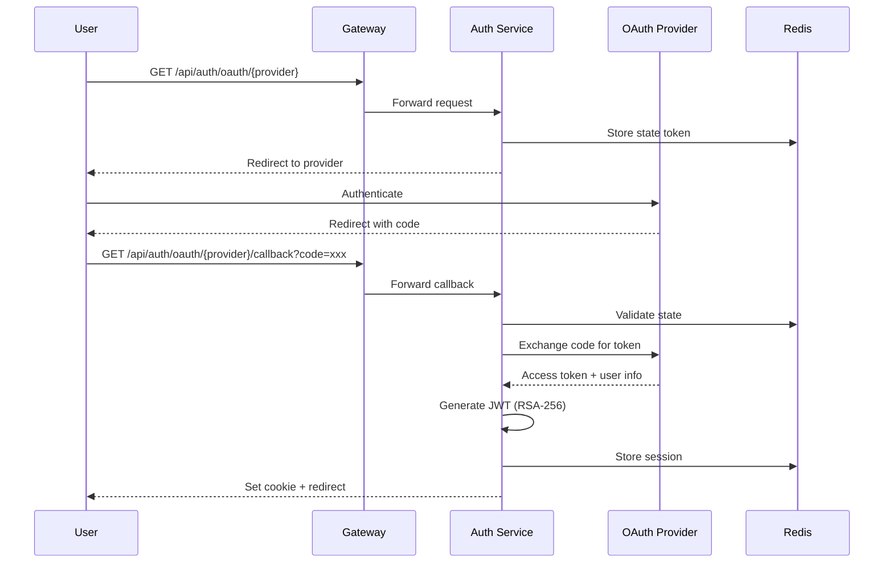
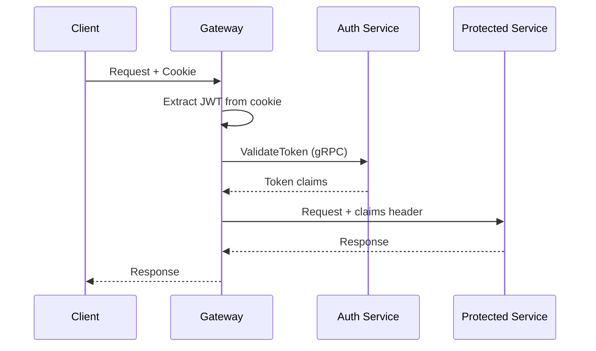
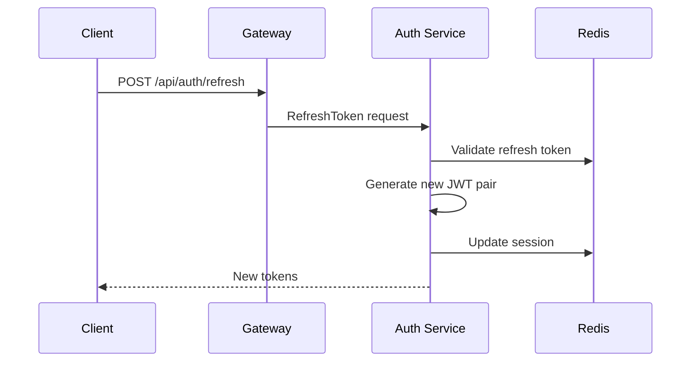
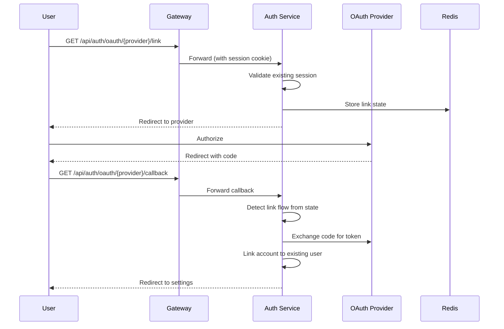

# Authentication Flow

## OAuth Login Flow

## Token Validation

## Token Refresh

## Account Linking Flow

Users can link additional OAuth providers to their account:

## JWT Structure

Tokens are signed with RSA-256. Keys stored at:
- Private: `./infra/keys/dev-private.pem`
- Public: `./infra/keys/dev-public.pem`

Claims include:
- `sub` - User ID
- `email` - User email
- `provider` - OAuth provider used
- `exp` - Expiration timestamp
