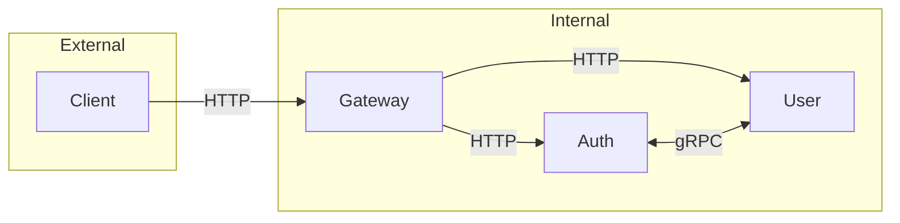
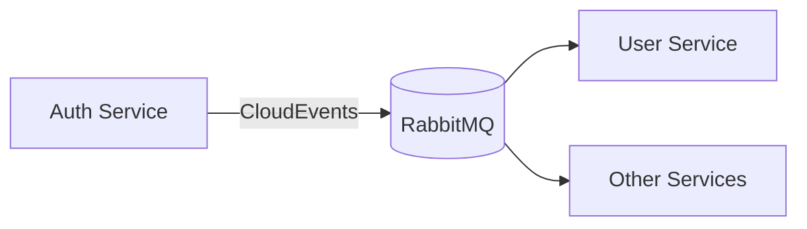

# Service Communication

## Protocol Overview



## Gateway Routing

The Gateway uses YARP to route requests:

| Path Pattern | Destination | Port | Transform |
|--------------|-------------|------|-----------|
| `/api/auth/**` | Auth Service | 5001 | Strip `/api` |
| `/api/user/**` | User Service | 5002 | Strip `/api` |
| `/api/events/**` | Events Service | 5005 | Strip `/api/events` |
| `/api/files/**` | Files Service | 5006 | None |
| `/api/identity/**` | Identity Service | 5010 | Strip `/api` |

## gRPC Services

Defined in `/libs/protos/`:

### auth.proto
```protobuf
service AuthService {
  rpc GetOAuthUrl(GetOAuthUrlRequest) returns (GetOAuthUrlResponse);
  rpc HandleOAuthCallback(HandleOAuthCallbackRequest) returns (HandleOAuthCallbackResponse);
  rpc RefreshToken(RefreshTokenRequest) returns (RefreshTokenResponse);
  rpc RevokeToken(RevokeTokenRequest) returns (RevokeTokenResponse);
  rpc ValidateToken(ValidateTokenRequest) returns (ValidateTokenResponse);
  rpc GetSession(GetSessionRequest) returns (GetSessionResponse);
  rpc EndSession(EndSessionRequest) returns (EndSessionResponse);
}
```

### user.proto
```protobuf
service UserService {
  rpc GetProfile(GetProfileRequest) returns (GetProfileResponse);
  rpc CreateProfile(CreateProfileRequest) returns (CreateProfileResponse);
  rpc UpdateProfile(UpdateProfileRequest) returns (UpdateProfileResponse);
  rpc GetPreferences(GetPreferencesRequest) returns (GetPreferencesResponse);
  rpc UpdatePreferences(UpdatePreferencesRequest) returns (UpdatePreferencesResponse);
  rpc GetLinkedAccounts(GetLinkedAccountsRequest) returns (GetLinkedAccountsResponse);
  rpc LinkAccount(LinkAccountRequest) returns (LinkAccountResponse);
  rpc UnlinkAccount(UnlinkAccountRequest) returns (UnlinkAccountResponse);
}
```

## Message Queue

RabbitMQ handles async communication via CloudEvents:



Event types defined in `libs/protos/events.proto`. See [CloudEvents](./events) for details.
