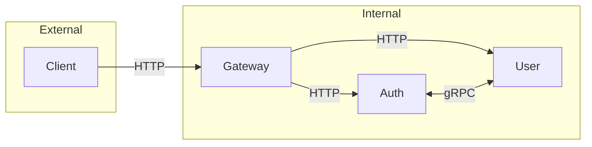
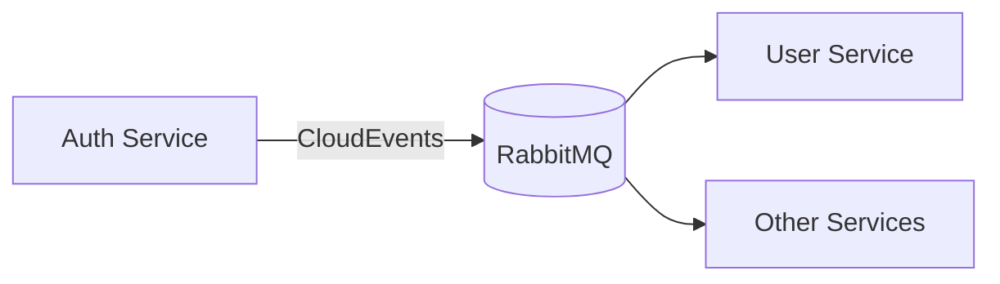

# Service Communication

## Protocol Overview



## Gateway Routing

The Gateway uses YARP to route requests:

| Path Pattern | Destination | Port |
|--------------|-------------|------|
| `/api/auth/**` | Auth Service | 5001 |
| `/api/user/**` | User Service | 5002 |

## gRPC Services

Defined in `/libs/protos/`:

### auth.proto
```protobuf
service AuthService {
  rpc GetOAuthUrl(OAuthUrlRequest) returns (OAuthUrlResponse);
  rpc HandleOAuthCallback(OAuthCallbackRequest) returns (AuthResponse);
  rpc RefreshToken(RefreshTokenRequest) returns (AuthResponse);
  rpc RevokeToken(RevokeTokenRequest) returns (RevokeResponse);
  rpc ValidateToken(ValidateTokenRequest) returns (ValidateTokenResponse);
  rpc GetSession(GetSessionRequest) returns (SessionResponse);
  rpc EndSession(EndSessionRequest) returns (EndSessionResponse);
}
```

### user.proto
```protobuf
service UserService {
  rpc GetProfile(GetProfileRequest) returns (UserProfile);
  rpc CreateProfile(CreateProfileRequest) returns (UserProfile);
  rpc UpdateProfile(UpdateProfileRequest) returns (UserProfile);
  rpc GetPreferences(GetPreferencesRequest) returns (Preferences);
  rpc UpdatePreferences(UpdatePreferencesRequest) returns (Preferences);
  rpc LinkAccount(LinkAccountRequest) returns (LinkedAccount);
  rpc UnlinkAccount(UnlinkAccountRequest) returns (UnlinkResponse);
}
```

## Message Queue

RabbitMQ handles async communication via CloudEvents:



Event types defined in `libs/protos/events.proto`. See [CloudEvents](./events) for details.
