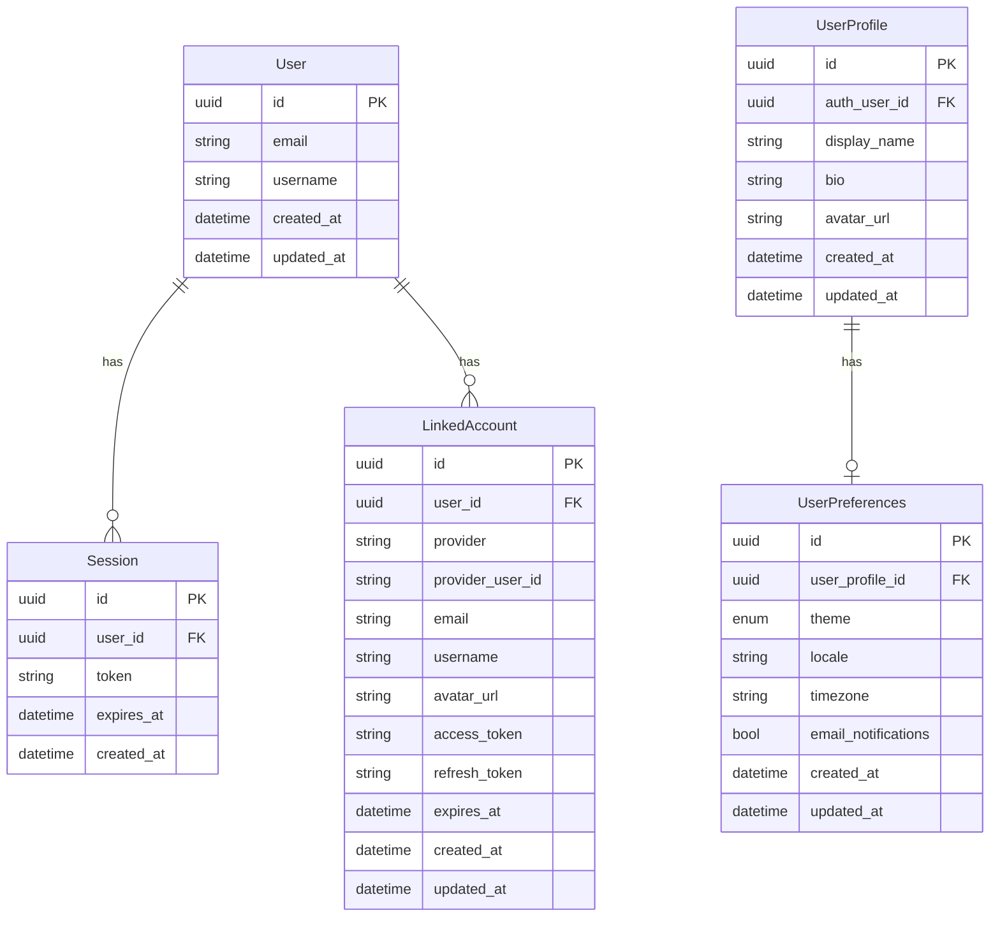

# Data Layer Entities

Database entities defined as JSON schemas, generated to multiple languages.

## Entity Relationships



## Auth Domain

Stored in `auth_db` (PostgreSQL :5434)

### User

Core user identity.

| Field | Type | Required | Description |
|-------|------|----------|-------------|
| `id` | uuid | yes | Primary key |
| `email` | string(255) | yes | User email |
| `username` | string(255) | yes | Username |
| `created_at` | datetime | yes | Creation timestamp |
| `updated_at` | datetime | yes | Last update |

**Relations:**
- Has many `Session`
- Has many `LinkedAccount`

### Session

Cookie-based auth session.

| Field | Type | Required | Description |
|-------|------|----------|-------------|
| `id` | uuid | yes | Primary key |
| `user_id` | uuid | yes | FK to User |
| `token` | string(255) | yes | Session token |
| `expires_at` | datetime | yes | Expiration time |
| `created_at` | datetime | yes | Creation timestamp |

### LinkedAccount

OAuth provider linked to user.

| Field | Type | Required | Description |
|-------|------|----------|-------------|
| `id` | uuid | yes | Primary key |
| `user_id` | uuid | yes | FK to User |
| `provider` | string(50) | yes | Provider name (discord, google, etc) |
| `provider_user_id` | string(255) | yes | User ID from provider |
| `email` | string(255) | no | Email from provider |
| `username` | string(255) | no | Username from provider |
| `avatar_url` | string | no | Avatar URL |
| `access_token` | string | no | OAuth access token |
| `refresh_token` | string | no | OAuth refresh token |
| `expires_at` | datetime | no | Token expiration |
| `created_at` | datetime | yes | Creation timestamp |
| `updated_at` | datetime | yes | Last update |

## User Domain

Stored in `user_db` (PostgreSQL :5433)

### UserProfile

Extended user profile info.

| Field | Type | Required | Description |
|-------|------|----------|-------------|
| `id` | uuid | yes | Primary key |
| `auth_user_id` | uuid | yes | FK to Auth.User |
| `display_name` | string(255) | no | Display name |
| `bio` | string(1000) | no | User bio |
| `avatar_url` | string | no | Avatar URL |
| `created_at` | datetime | yes | Creation timestamp |
| `updated_at` | datetime | yes | Last update |

**Relations:**
- Has one `UserPreferences`

### UserPreferences

User preferences and settings.

| Field | Type | Required | Description |
|-------|------|----------|-------------|
| `id` | uuid | yes | Primary key |
| `user_profile_id` | uuid | yes | FK to UserProfile |
| `theme` | Theme | yes | UI theme preference |
| `locale` | string(10) | no | Locale code (en-US) |
| `timezone` | string(50) | no | Timezone (America/New_York) |
| `email_notifications` | boolean | yes | Email notifications enabled |
| `created_at` | datetime | yes | Creation timestamp |
| `updated_at` | datetime | yes | Last update |

### Theme Enum

```
system | light | dark
```

## Schema Location

```
libs/data_types/schemas/
├── auth/
│   ├── user.json
│   ├── session.json
│   └── linked_account.json
└── user/
    ├── user_profile.json
    └── user_preferences.json
```

## Partial Classes

EF Core navigation properties added via partial classes:

```
src/schema/Schema/Entities/
├── Auth/
│   ├── User.cs          # Sessions, LinkedAccounts collections
│   ├── Session.cs       # User navigation
│   └── LinkedAccount.cs # User navigation
└── User/
    ├── UserProfile.cs      # Preferences navigation
    └── UserPreferences.cs  # UserProfile navigation
```
