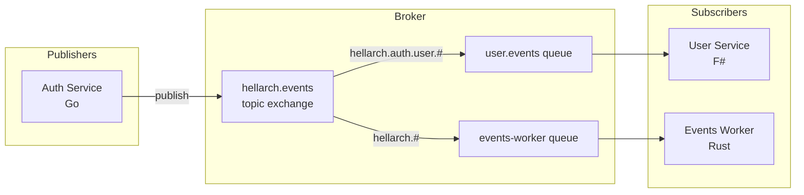
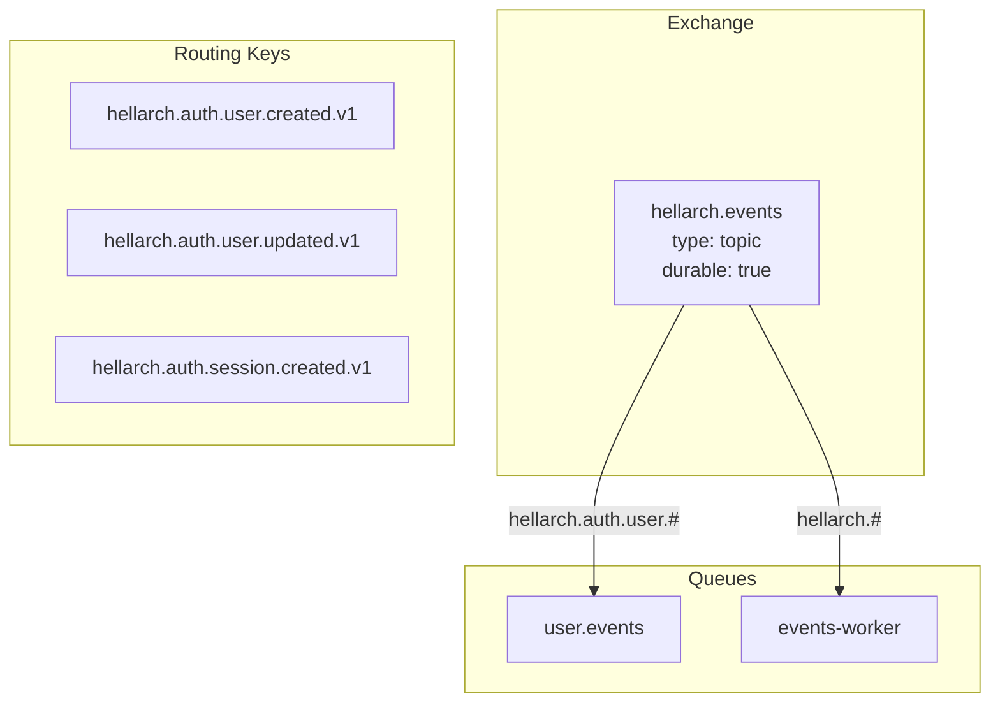
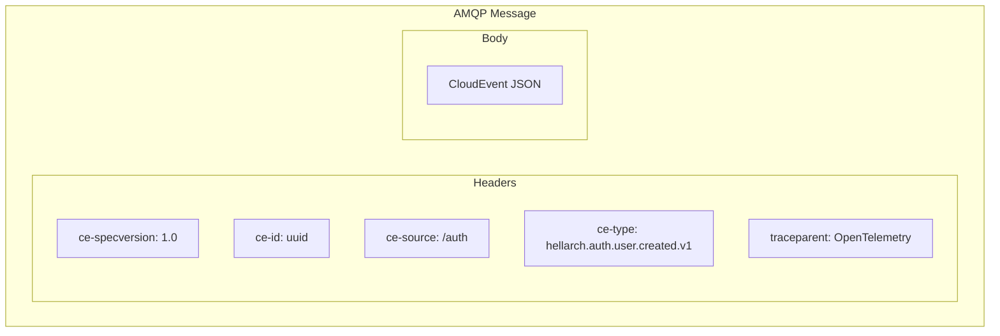
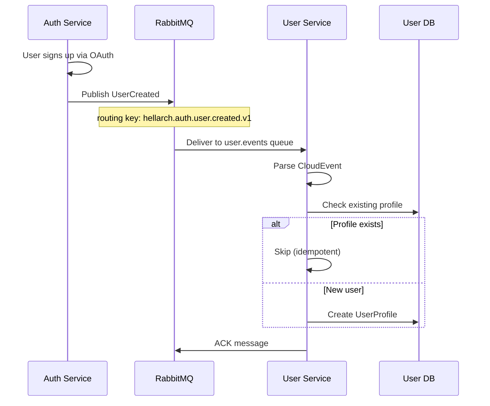
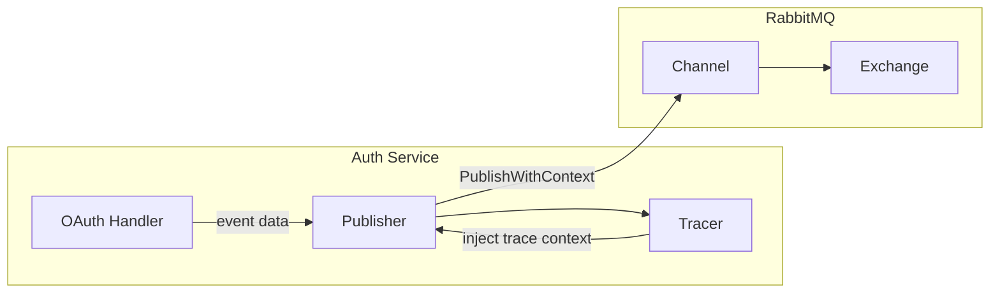
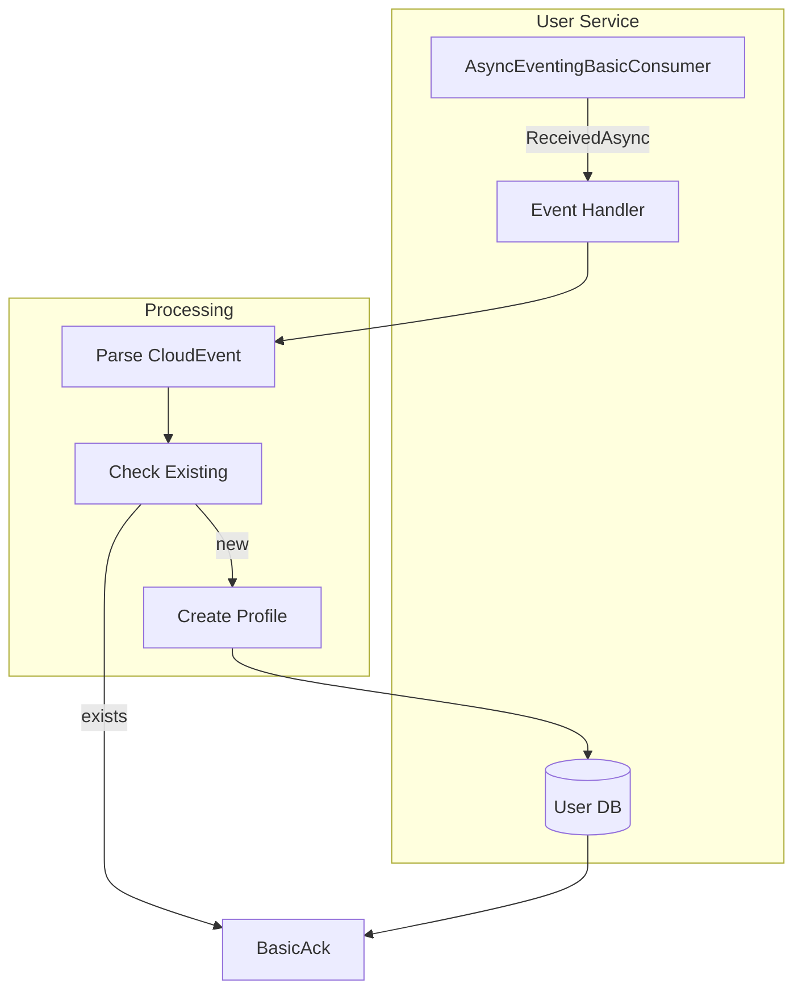
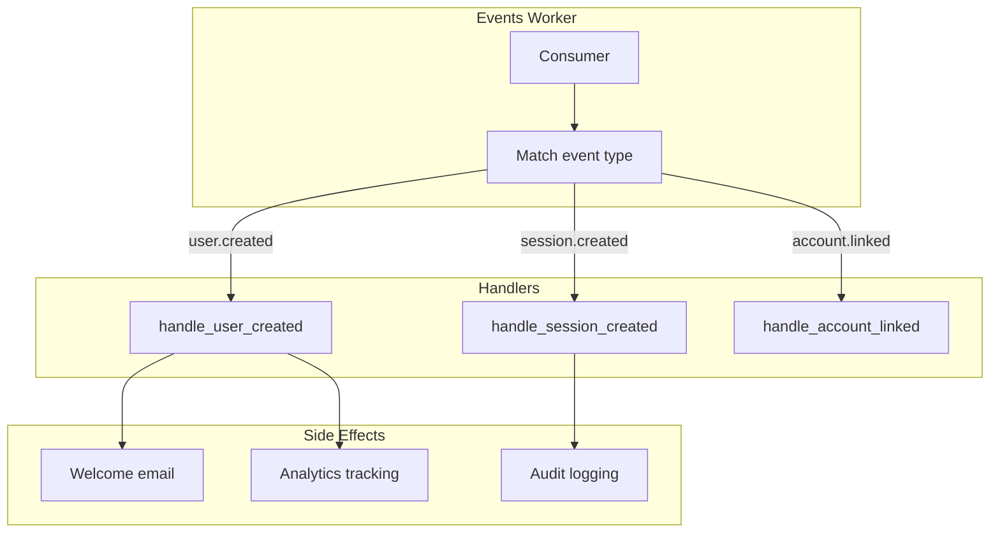
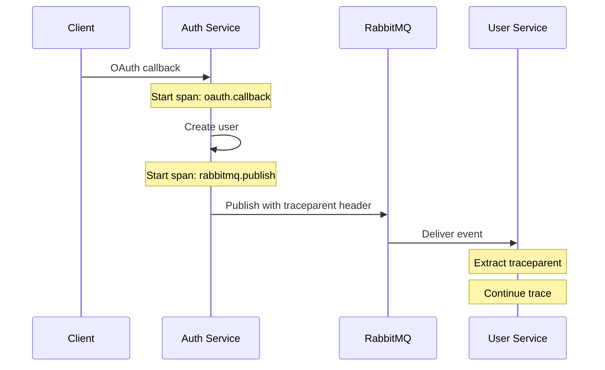
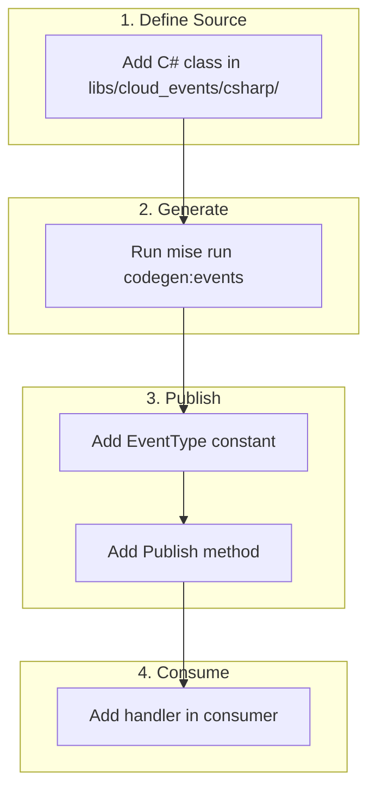
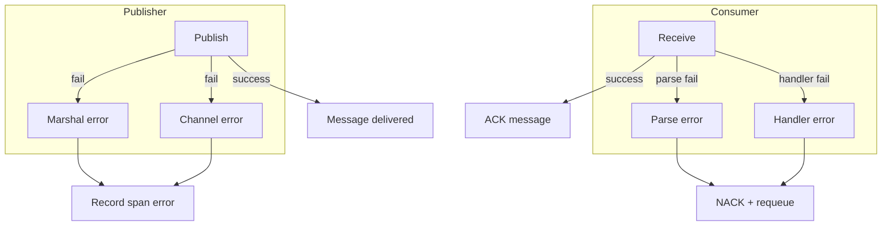

# CloudEvents

Event-driven communication using CloudEvents 1.0 spec with JSON payloads over RabbitMQ.

## Architecture



## RabbitMQ Configuration



| Queue | Binding | Consumer | Purpose |
|-------|---------|----------|---------|
| `user.events` | `hellarch.auth.user.#` | F# User Service | Create user profiles |
| `events-worker` | `hellarch.#` | Rust Events Worker | Emails, analytics, audit |

## Event Structure

CloudEvents 1.0 envelope with JSON payload. Headers carry CloudEvents metadata for routing.



### CloudEvent JSON Format

```json
{
  "specversion": "1.0",
  "id": "550e8400-e29b-41d4-a716-446655440000",
  "source": "/auth",
  "type": "hellarch.auth.user.created.v1",
  "datacontenttype": "application/json",
  "time": "2024-01-15T10:30:00Z",
  "data": {
    "user_id": "...",
    "email": "...",
    "username": "..."
  }
}
```

## Event Types

| Type | Payload | Description |
|------|---------|-------------|
| `hellarch.auth.user.created.v1` | `UserCreated` | New user via OAuth |
| `hellarch.auth.user.updated.v1` | `UserUpdated` | User info changed |
| `hellarch.auth.user.deleted.v1` | `UserDeleted` | User removed |
| `hellarch.auth.session.created.v1` | `SessionCreated` | New session |
| `hellarch.auth.session.ended.v1` | `SessionEnded` | Logout/expiry |
| `hellarch.auth.account.linked.v1` | `AccountLinked` | OAuth linked |
| `hellarch.auth.account.unlinked.v1` | `AccountUnlinked` | OAuth unlinked |

## Payloads

### UserCreated

```json
{
  "user_id": "550e8400-e29b-41d4-a716-446655440000",
  "email": "user@example.com",
  "username": "username",
  "provider": "github",
  "provider_user_id": "12345",
  "avatar_url": "https://avatars.githubusercontent.com/u/12345",
  "created_at": "2024-01-15T10:30:00Z"
}
```

### SessionCreated

```json
{
  "session_id": "550e8400-e29b-41d4-a716-446655440000",
  "user_id": "550e8400-e29b-41d4-a716-446655440001",
  "ip_address": "192.168.1.1",
  "user_agent": "Mozilla/5.0...",
  "created_at": "2024-01-15T10:30:00Z",
  "expires_at": "2024-01-16T10:30:00Z"
}
```

### AccountLinked

```json
{
  "user_id": "550e8400-e29b-41d4-a716-446655440000",
  "provider": "discord",
  "provider_user_id": "67890",
  "email": "user@example.com",
  "linked_at": "2024-01-15T10:30:00Z"
}
```

## Event Flow



## Go Publisher

The Auth service publishes events using a Go publisher with OpenTelemetry tracing.



**Key Features:**
- CloudEvents 1.0 compliant envelope
- OpenTelemetry trace context propagation via AMQP headers
- Topic exchange with event type as routing key
- Persistent message delivery mode

**Location:** `src/services/auth/internal/events/publisher.go`

## F# Consumer

The User service consumes events with idempotency handling.



**Key Features:**
- Binds to `hellarch.auth.user.#` wildcard pattern
- Idempotency check before creating profiles
- Manual ACK after successful processing
- NACK with requeue on errors

**Location:** `src/services/user/User/Infrastructure/Events.fs`

## Rust Consumer

The Events Worker handles side effects like emails and analytics.



**Key Features:**
- Binds to `hellarch.#` to receive all events
- Tokio async runtime
- Structured JSON logging with tracing
- Handles user, session, and account events

**Location:** `src/workers/events/`

## Tracing

OpenTelemetry trace context flows through events:



The publisher injects trace context into AMQP headers using `otel.GetTextMapPropagator().Inject()`.

## Proto Definitions

Event payloads are defined in protobuf for documentation and potential gRPC integration:

```protobuf
// libs/protos/events.proto

message UserCreated {
    string user_id = 1;
    string email = 2;
    string username = 3;
    string provider = 4;
    string provider_user_id = 5;
    string avatar_url = 6;
    google.protobuf.Timestamp created_at = 7;
}

message SessionEnded {
    string session_id = 1;
    string user_id = 2;
    SessionEndReason reason = 3;
    google.protobuf.Timestamp ended_at = 4;
}

enum SessionEndReason {
    SESSION_END_REASON_UNSPECIFIED = 0;
    SESSION_END_REASON_LOGOUT = 1;
    SESSION_END_REASON_EXPIRED = 2;
    SESSION_END_REASON_REVOKED = 3;
}
```

Note: Runtime uses JSON serialization, not protobuf binary. Proto serves as schema documentation.

## Adding New Events



1. **Define the payload** in `libs/cloud_events/csharp/`:
   ```csharp
   namespace HellArch.CloudEvents.Auth;

   public class MyEvent
   {
       public required string UserId { get; init; }
       public required DateTimeOffset HappenedAt { get; init; }
   }
   ```

2. **Run codegen** to generate types for all languages:
   ```bash
   mise run codegen:events
   ```

3. **Add event type constant** in `publisher.go`:
   ```go
   const EventTypeMyEvent = "hellarch.auth.myevent.v1"
   ```

4. **Add type alias and publish method** in `publisher.go`:
   ```go
   type MyEvent = auth.MyEvent

   func (p *Publisher) PublishMyEvent(ctx context.Context, data MyEvent) error {
       return p.Publish(ctx, EventTypeMyEvent, data, "")
   }
   ```

5. **Add consumer handler** using generated types from `hellarch_cloud_events` (Rust) or `HellArch.CloudEvents` (F#)

## Error Handling



| Scenario | Publisher | Consumer |
|----------|-----------|----------|
| Marshal failure | Record error span, return | N/A |
| Publish failure | Record error span, return | N/A |
| Parse failure | N/A | Log, NACK with requeue |
| Handler failure | N/A | Log, NACK with requeue |
| Duplicate event | N/A | Idempotency check, ACK |

## Source Locations

```
libs/protos/
└── events.proto              # Event payload definitions

src/services/auth/internal/events/
└── publisher.go              # Go CloudEvents publisher

src/services/user/User/Infrastructure/
└── Events.fs                 # F# event consumer

src/workers/events/
├── src/
│   ├── main.rs               # Rust consumer + queue setup
│   └── handlers.rs           # Event handlers
├── Cargo.toml
└── Dockerfile
```
