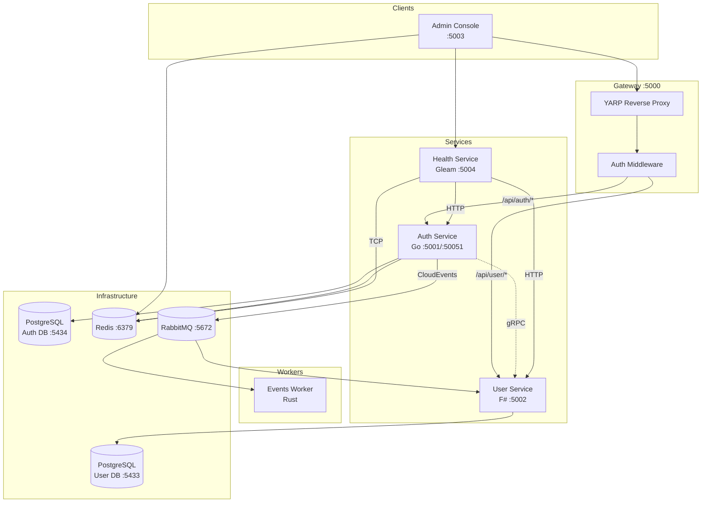
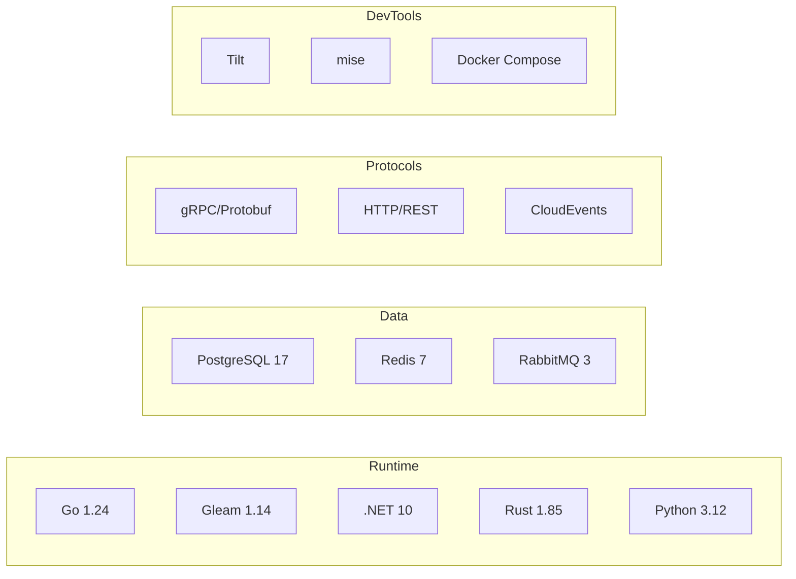
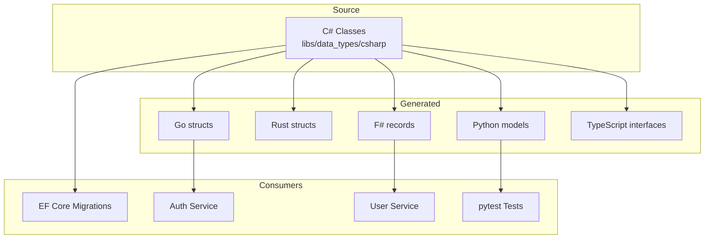
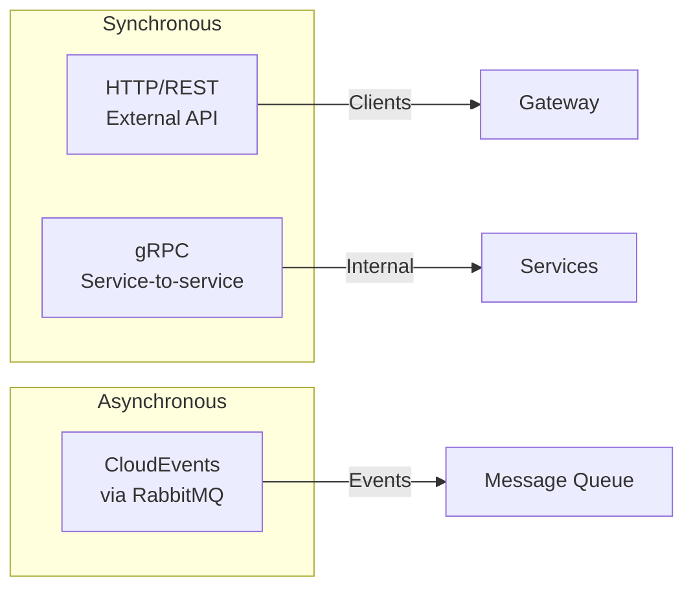

# Architecture Overview

HellArch is a polyglot microservices system for authentication and user management.

## System Diagram

## Service Responsibilities

| Service | Language | Port | Role |
|---------|----------|------|------|
| Gateway | C# | 5000 | Request routing, cookie-to-JWT transform |
| Auth | Go | 5001 (HTTP), 50051 (gRPC) | OAuth flows, JWT tokens, sessions |
| User | F# | 5002 | Profiles, preferences, linked accounts |
| Health | Gleam | 5004 | Aggregates health status from all services |
| Events Worker | Rust | - | Emails, analytics, audit logging |
| Admin Console | C# Blazor | 5003 | User management, Redis browser, health dashboard |

## Technology Stack

## Type System

Single source of truth for data types with multi-language generation:

## Communication Patterns

| Pattern | Use Case | Example |
|---------|----------|---------|
| HTTP/REST | External API calls | Client → Gateway → Service |
| gRPC | Low-latency service calls | Gateway → Auth (token validation) |
| CloudEvents | Async notifications | Auth → User (user.created) |
