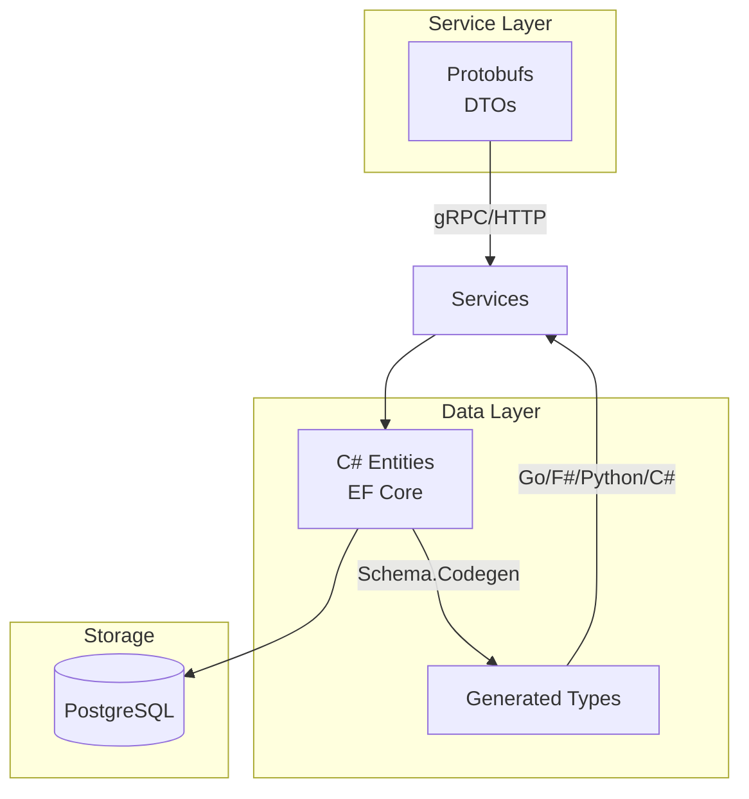
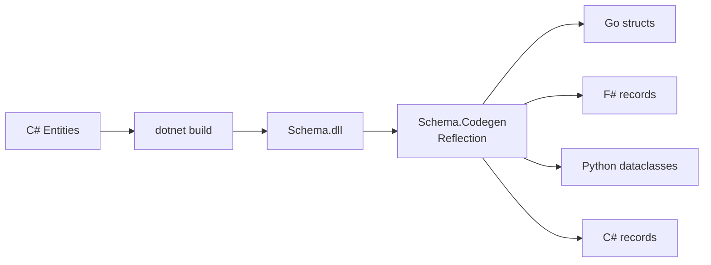

# Schema Architecture

Clean separation between API contracts and persistence layer.

## Layer Separation



## Protobufs → DTOs

API contracts for service communication. What goes over the wire.

```
protos/
├── auth.proto    # OAuth, tokens, sessions
└── user.proto    # Profiles, preferences
```

Generated to:
- Go gRPC stubs (`src/services/auth/proto/`)
- C# gRPC clients (build-time via Grpc.Tools)

## Data Types → Data Layer

Persistence layer. What gets stored in the database.

```
src/schema/
├── Entities/
│   ├── Auth/
│   │   ├── User.cs
│   │   ├── Session.cs
│   │   └── LinkedAccount.cs
│   └── User/
│       ├── UserProfile.cs
│       └── UserPreferences.cs
└── Contexts/
    ├── AuthDbContext.cs
    └── UserDbContext.cs
```

## Code Generation

C# entities generate typed data models for each language via reflection:



Output structure:
```
libs/data_types/
├── go/           # Go structs + json/db tags
├── fsharp/       # F# records
├── python/       # Python dataclasses
└── csharp/       # C# records
```

## Why This Separation?

| Concern | Protobufs (DTO) | Data Types (Entity) |
|---------|-----------------|---------------------|
| Purpose | API contract | Persistence |
| Changes | Versioned, backwards-compatible | Migration-based |
| Shape | What clients see | What DB stores |
| Validation | Message-level | Constraint-level |

Services map between layers - DTOs don't leak into data layer, entities don't leak into API.
