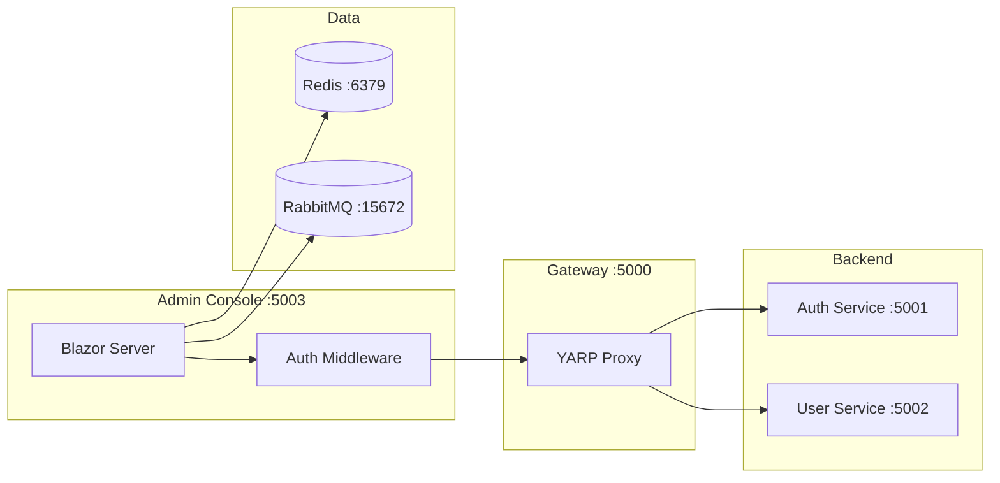

# Admin Console

The Admin Console is a Blazor Server application that provides a unified management interface for hellArch. It runs as a containerized service and communicates with backend services over the internal Docker network.

## Overview

| Property | Value |
|----------|-------|
| **Port** | 5003 |
| **Tech** | Blazor Server (.NET 10) |
| **Location** | `src/clients/Admin/` |

## Features

- **Dashboard**: Real-time service health from [Health Service](/guide/services/health), user/session statistics, quick links to Jaeger and RabbitMQ
- **Users**: Browse users, view linked OAuth accounts, manage sessions, permissions management
- **Permissions**: Grant/revoke user permissions, activate/deactivate users
- **Redis Browser**: Explore Redis keys (sessions, OAuth state, revoked tokens)
- **Events**: Overview of CloudEvents flowing through the system

## Architecture



The Admin Console routes API calls through the Gateway (YARP) and validates user sessions via the Auth service before serving pages. Unauthenticated users are redirected to OAuth login.

## Running

The Admin Console starts automatically with Tilt:

```bash
tilt up
```

Access at [http://localhost:5003](http://localhost:5003)

## Project Structure

```
src/clients/Admin/
├── Admin.csproj
├── Program.cs
├── Dockerfile
├── Components/
│   ├── App.razor
│   ├── Routes.razor
│   ├── _Imports.razor
│   ├── Layout/
│   │   ├── AdminLayout.razor
│   │   └── NavMenu.razor
│   └── Pages/
│       ├── Dashboard.razor
│       ├── Users.razor
│       ├── Sessions.razor
│       ├── Redis.razor
│       └── Events.razor
├── Middleware/
│   └── AdminAuthMiddleware.cs
├── Services/
│   ├── AuthAdminFacade.cs
│   ├── HealthAdapter.cs
│   ├── RabbitMqAdapter.cs
│   └── RedisBrowserAdapter.cs
└── wwwroot/
    └── css/
        └── admin.css
```

## Authentication

The Admin Console uses session-based authentication:

1. `AdminAuthMiddleware` checks for `hellarch_session` cookie
2. Validates session against Auth service `/auth/validate` endpoint
3. Redirects to OAuth login if session is invalid or missing
4. Stores user info in `HttpContext.Items` for downstream components

::: tip Admin Access
Access is controlled via the `admin.access` permission. Users without this permission cannot access the Admin Console.
:::

## Auth Admin API

The Admin Console consumes these endpoints from the Auth service (via Gateway):

| Endpoint | Method | Description |
|----------|--------|-------------|
| `/auth/admin/users` | GET | List users (paginated) |
| `/auth/admin/users/{id}` | GET | Get user with linked accounts |
| `/auth/admin/users/{id}/sessions` | GET | Get user's active sessions |
| `/auth/admin/sessions/{id}` | DELETE | Revoke a session |
| `/auth/admin/stats` | GET | Get counts (users, sessions, accounts) |
| `/auth/admin/users/{id}/permissions` | GET | Get user's permissions |
| `/auth/admin/users/{id}/permissions` | PUT | Set all permissions |
| `/auth/admin/users/{id}/permissions/grant` | POST | Grant single permission |
| `/auth/admin/users/{id}/permissions/revoke` | POST | Revoke single permission |
| `/auth/admin/users/{id}/activate` | POST | Activate user |
| `/auth/admin/users/{id}/deactivate` | POST | Deactivate user |

These endpoints are internal-only (no external auth) - security is provided by network isolation and edge authentication in the Admin Console.

See [Permissions Guide](/guide/permissions) for details on the permission system.

## Redis Browser

The Redis Browser provides direct access to inspect Redis keys:

**Key Patterns**:
- `session:{id}` - Cached session data
- `oauth:state:{state}` - OAuth CSRF tokens
- `revoked:{hash}` - Revoked JWT token hashes

**Capabilities**:
- Scan keys by pattern
- View key type, TTL, and value
- Delete keys (use with caution)

## RabbitMQ Browser

The RabbitMQ adapter connects to the RabbitMQ Management API for queue inspection:

**Capabilities**:
- View queue overview (message counts, consumers)
- List queues and exchanges
- Peek messages from queues (non-destructive)
- Parse CloudEvents from queues

## Environment Variables

| Variable | Default | Description |
|----------|---------|-------------|
| `PORT` | `5003` | HTTP listen port |
| `GATEWAY_URL` | `http://localhost:5000` | Gateway URL for backend API calls |
| `REDIS_URL` | `localhost:6379` | Redis connection string |
| `RABBITMQ_MANAGEMENT_URL` | `http://localhost:15672` | RabbitMQ Management API URL |
| `RABBITMQ_USER` | `hellarch` | RabbitMQ management username |
| `RABBITMQ_PASSWORD` | `hellarch` | RabbitMQ management password |
| `OTEL_EXPORTER_OTLP_ENDPOINT` | `http://localhost:4318` | OpenTelemetry collector |
| `LOG_LEVEL` | `debug` | Logging level |

## Observability

The Admin Console exports traces to Jaeger via OpenTelemetry:

- HTTP request traces
- Backend service call traces
- Redis operation traces (via StackExchange.Redis instrumentation)

View traces at [http://localhost:16686](http://localhost:16686)
