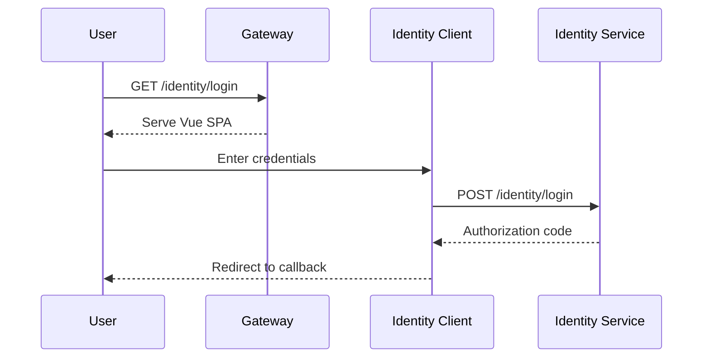

# Identity Client

Vue.js frontend for login and registration flows.

## Overview

| Property | Value |
|----------|-------|
| **Tech** | Vue 3 + Vuetify 3 |
| **Location** | `src/clients/Identity/` |
| **Served at** | `/identity/` (via Gateway) |

## Purpose

The Identity client provides the user-facing login and registration pages for the [Identity Service](/guide/services/identity). It's a single-page application that handles:

- User login with email/password
- New user registration
- OAuth authorization flow UI

## Architecture



## Pages

| Route | Component | Description |
|-------|-----------|-------------|
| `/identity/login` | `Login.vue` | Email/password login form |
| `/identity/register` | `Register.vue` | New user registration |

## Building

```bash
# Install dependencies
cd src/clients/Identity
npm install

# Development server
npm run dev

# Production build
npm run build
```

The production build is copied to `src/gateway/Gateway/wwwroot/identity/` and served by the Gateway.

## Project Structure

```
src/clients/Identity/
├── index.html
├── package.json
├── vite.config.ts
├── tsconfig.json
├── public/
│   └── logo.png
└── src/
    ├── App.vue           # Root component
    ├── main.ts           # Entry point, Vuetify setup
    └── pages/
        ├── Login.vue     # Login form
        └── Register.vue  # Registration form
```

## Styling

Uses Vuetify 3 with Material Design Icons. Follows the hellArch dark theme.
