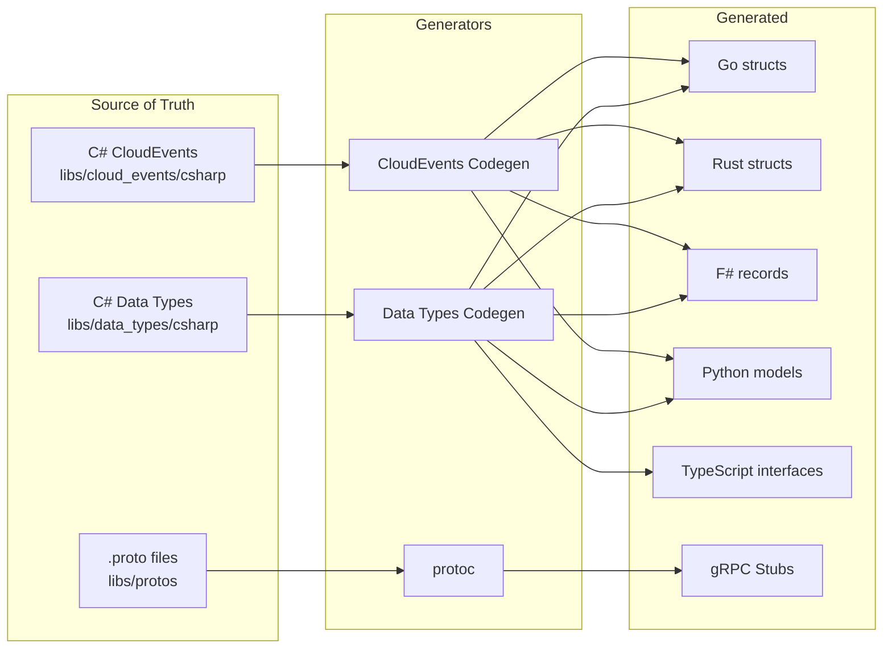
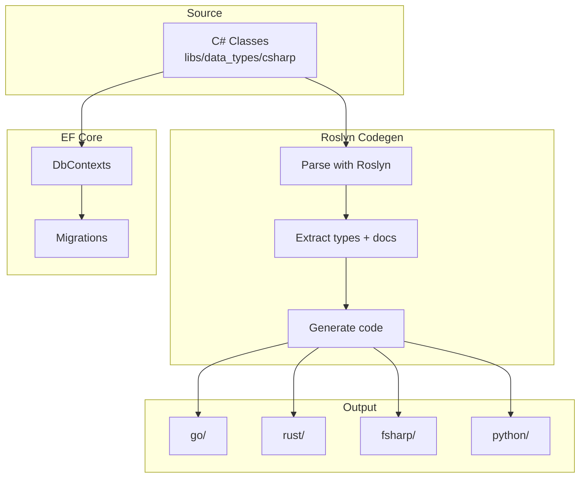

# Code Generation

Three codegen pipelines: data types for persistence, CloudEvents for messaging, protobufs for gRPC. C# types are the source of truth.

## Overview



## Protobuf Generation (DTOs)

Generates gRPC service stubs for API layer.

### Run

```bash
mise run proto:all
```

Or individually:

```bash
mise run proto:fsharp  # F# types
mise run proto:go      # Go gRPC stubs
```

### Input

```
libs/protos/
├── auth.proto     # Auth gRPC service
├── user.proto     # User gRPC service
└── events.proto   # CloudEvents payloads
```

### Output

```
src/services/auth/proto/
├── auth.pb.go        # Go message types
└── auth_grpc.pb.go   # Go gRPC service
```

C# generated at build-time via `Grpc.Tools` NuGet package.

## Data Type Generation (Persistence)

Roslyn-based codegen that parses C# source files and generates typed models for 4 languages.

### How It Works



### Run

```bash
mise run codegen:entities
```

Or manually:

```bash
cd libs/data_types/Codegen && dotnet run -- ../csharp ..
```

### Source Types

C# classes in `libs/data_types/csharp/` are the source of truth:

```csharp
namespace HellArch.DataTypes.Auth;

/// <summary>
/// Core user identity in the auth system.
/// </summary>
public class User
{
    public Guid Id { get; set; }
    public required string Email { get; set; }
    public required string Username { get; set; }
    public bool IsActive { get; set; } = true;
    public Dictionary<string, bool>? Permissions { get; set; }
    public DateTime CreatedAt { get; set; }
    public DateTime UpdatedAt { get; set; }

    // Navigation properties (EF Core)
    public ICollection<Session> Sessions { get; set; } = [];
    public ICollection<LinkedAccount> LinkedAccounts { get; set; } = [];
}
```

Key features:
- Generates 5 languages: Go, Rust, F#, Python, TypeScript
- Doc comments are preserved in generated code
- Collection properties (`ICollection<T>`, `List<T>`) generate as `Vec<T>`, `[]*T`, `T list`, `T[]`
- Dictionary properties (`Dictionary<K,V>`) generate as `map[K]V`, `HashMap<K,V>`, `Map<K,V>`, `dict[K,V]`
- `required` keyword maps to non-nullable in target languages
- Nullables (`?`) map to `Option<T>`, `*T`, `T option`, `T | None`, `T | null`
- Enums defined alongside classes are generated in all languages
- Go field names follow conventions (Id→ID, Url→URL, Ip→IP)
- TypeScript generates proper type imports across files

### Output Structure

```
libs/data_types/
├── csharp/           # Source of truth
│   ├── Auth/
│   └── User/
├── go/               # Generated Go
├── rust/             # Generated Rust
├── fsharp/           # Generated F#
├── python/           # Generated Python
├── typescript/       # Generated TypeScript
│   ├── auth/
│   │   ├── user.ts
│   │   ├── session.ts
│   │   └── linked_account.ts
│   └── user/
│       ├── user_profile.ts
│       └── user_preferences.ts
└── Codegen/          # Generator
```

## Generated Code Examples

From `User.cs` source with collections:

### Go

```go
package auth

import "time"

// Core user identity in the auth system.
type User struct {
	ID string `json:"id"`
	Email string `json:"email"`
	Username string `json:"username"`
	CreatedAt time.Time `json:"created_at"`
	UpdatedAt time.Time `json:"updated_at"`
	Sessions []*Session `json:"sessions"`
	LinkedAccounts []*LinkedAccount `json:"linked_accounts"`
}
```

### Rust

```rust
use serde::{Deserialize, Serialize};
use chrono::{DateTime, Utc};

/// Core user identity in the auth system.
#[derive(Debug, Clone, Serialize, Deserialize)]
pub struct User {
    #[serde(rename = "id")]
    pub id: String,
    #[serde(rename = "email")]
    pub email: String,
    #[serde(rename = "username")]
    pub username: String,
    #[serde(rename = "created_at")]
    pub created_at: DateTime<Utc>,
    #[serde(rename = "updated_at")]
    pub updated_at: DateTime<Utc>,
    #[serde(rename = "sessions")]
    pub sessions: Vec<Session>,
    #[serde(rename = "linked_accounts")]
    pub linked_accounts: Vec<LinkedAccount>,
}
```

### F#

```fsharp
namespace HellArch.DataTypes.Auth

open System

/// Core user identity in the auth system.
type User = {
    Id: Guid
    Email: string
    Username: string
    CreatedAt: DateTime
    UpdatedAt: DateTime
    Sessions: Session list
    LinkedAccounts: LinkedAccount list
}
```

### Python

```python
from __future__ import annotations

from datetime import datetime

from pydantic import BaseModel, ConfigDict

class User(BaseModel):
    """Core user identity in the auth system."""
    model_config = ConfigDict(populate_by_name=True)

    id: str
    email: str
    username: str
    created_at: datetime
    updated_at: datetime
    sessions: list[Session] = []
    linked_accounts: list[LinkedAccount] = []
```

### TypeScript

```typescript
import type { LinkedAccount } from './linked_account';
import type { Session } from './session';

/** Core user identity in the auth system. */
export interface User {
  id: string;
  email: string;
  username: string;
  created_at: string;
  updated_at: string;
  sessions: Session[];
  linked_accounts: LinkedAccount[];
}
```

## CloudEvents Generation

Roslyn-based codegen for CloudEvent payloads. Generates typed event data for all consumers.

### Source Events

C# event classes in `libs/cloud_events/csharp/`:

```csharp
namespace HellArch.CloudEvents.Auth;

/// <summary>
/// Published when a new user is created via OAuth.
/// Event type: hellarch.auth.user.created.v1
/// </summary>
public class UserCreated
{
    public required string UserId { get; init; }
    public required string Email { get; init; }
    public required string Username { get; init; }
    public required string Provider { get; init; }
    public required string ProviderUserId { get; init; }
    public required string AvatarUrl { get; init; }
    public required DateTimeOffset CreatedAt { get; init; }
}
```

### Event Types

| Event Class | Event Type |
|-------------|------------|
| `UserCreated` | `hellarch.auth.user.created.v1` |
| `UserUpdated` | `hellarch.auth.user.updated.v1` |
| `UserDeleted` | `hellarch.auth.user.deleted.v1` |
| `SessionCreated` | `hellarch.auth.session.created.v1` |
| `SessionEnded` | `hellarch.auth.session.ended.v1` |
| `AccountLinked` | `hellarch.auth.account.linked.v1` |
| `AccountUnlinked` | `hellarch.auth.account.unlinked.v1` |

### Enum Support

Enums are generated alongside event types:

```csharp
public enum SessionEndReason
{
    Logout,
    Expired,
    Revoked
}
```

Generates as:

```go
// Go
type SessionEndReason string

const (
	SessionEndReasonLogout SessionEndReason = "logout"
	SessionEndReasonExpired SessionEndReason = "expired"
	SessionEndReasonRevoked SessionEndReason = "revoked"
)
```

```rust
// Rust
#[derive(Debug, Clone, Copy, PartialEq, Eq, Deserialize)]
#[serde(rename_all = "snake_case")]
pub enum SessionEndReason {
    Logout,
    Expired,
    Revoked,
}
```

### Run

```bash
mise run codegen:events
```

Or manually:

```bash
cd libs/cloud_events/Codegen && dotnet run -- ../csharp ..
```

### CloudEvent Wrapper

Generic wrapper types for parsing CloudEvents with typed data:

```go
// Go
type CloudEvent[T any] struct {
    SpecVersion     string    `json:"specversion"`
    ID              string    `json:"id"`
    Source          string    `json:"source"`
    Type            string    `json:"type"`
    DataContentType string    `json:"datacontenttype"`
    Time            time.Time `json:"time"`
    Data            T         `json:"data"`
}
```

```rust
// Rust
#[derive(Debug, Clone, Deserialize)]
pub struct CloudEvent<T> {
    pub specversion: String,
    pub id: String,
    pub source: String,
    #[serde(rename = "type")]
    pub event_type: String,
    pub datacontenttype: String,
    pub time: DateTime<Utc>,
    pub data: T,
}
```

### Output Structure

```
libs/cloud_events/
├── csharp/              # Source of truth
│   ├── UserEvents.cs
│   ├── SessionEvents.cs
│   └── AccountEvents.cs
├── go/
│   ├── cloud_event.go   # Generic wrapper
│   └── auth/            # Event payloads
├── rust/src/
│   ├── lib.rs           # Generic wrapper + mod
│   └── auth/            # Event payloads
├── fsharp/
│   ├── CloudEvent.fs    # Generic wrapper
│   └── auth/            # Event payloads
├── python/auth/         # Generated Python
└── Codegen/             # Generator
```

## Adding a New CloudEvent

1. Create event class in `libs/cloud_events/csharp/`:

```csharp
namespace HellArch.CloudEvents.Auth;

/// <summary>
/// Published when something happens.
/// Event type: hellarch.auth.something.v1
/// </summary>
public class SomethingHappened
{
    public required string UserId { get; init; }
    public required DateTimeOffset HappenedAt { get; init; }
}
```

2. Run codegen:

```bash
mise run codegen:events
```

3. Use generated types in consumers (Rust events worker, F# user service, etc.)

## Adding a New Entity

1. Create entity class in `libs/data_types/csharp/{Domain}/`:

```csharp
namespace HellArch.DataTypes.Auth;

public class MyEntity
{
    public Guid Id { get; set; }
    public required string Name { get; set; }
    public string? Description { get; set; }
    public DateTime CreatedAt { get; set; }
}
```

2. Add to DbContext if needed

3. Run codegen:

```bash
mise run codegen:entities
```

4. Generated types available in all languages

## Adding a New Service Method

1. Add to `.proto` file

```protobuf
service MyService {
  rpc NewMethod(NewRequest) returns (NewResponse);
}
```

2. Regenerate

```bash
mise run proto:all
```

3. Implement handler in service code

## Type Mappings

| C# | Go | Rust | F# | Python | TypeScript |
|----|-----|------|-----|--------|------------|
| `Guid` | `string` | `String` | `Guid` | `str` | `string` |
| `string` | `string` | `String` | `string` | `str` | `string` |
| `int` | `int` | `i32` | `int` | `int` | `number` |
| `long` | `int64` | `i64` | `int64` | `int` | `number` |
| `bool` | `bool` | `bool` | `bool` | `bool` | `boolean` |
| `DateTime` | `time.Time` | `DateTime<Utc>` | `DateTime` | `datetime` | `string` |
| `T?` | `*T` | `Option<T>` | `T option` | `T \| None` | `T \| null` |
| `ICollection<T>` | `[]*T` | `Vec<T>` | `T list` | `list[T]` | `T[]` |
| `Dictionary<K,V>` | `map[K]V` | `HashMap<K,V>` | `Map<K,V>` | `dict[K,V]` | `Record<K,V>` |
| `enum` | `type X string` | `enum` | `type X =` | `Enum` | `enum` |

## EF Core Integration

DbContexts in `src/schema/Schema/Contexts/` reference the C# types from libs:

```csharp
using HellArch.DataTypes.Auth;

public sealed class AuthDbContext(DbContextOptions<AuthDbContext> options)
    : DbContext(options)
{
    public DbSet<User> Users => Set<User>();
    public DbSet<Session> Sessions => Set<Session>();
    public DbSet<LinkedAccount> LinkedAccounts => Set<LinkedAccount>();
}
```

Migrations are generated from these contexts and baked into DB containers.

## Reflection Codegen (Legacy)

A reflection-based generator exists in `src/schema/Schema.Codegen/` that loads compiled DLLs:

```bash
cd src/schema/Schema.Codegen
dotnet run
```

The Roslyn codegen is preferred as it:
- Preserves doc comments from source
- Doesn't require compilation
- Handles complex type patterns
