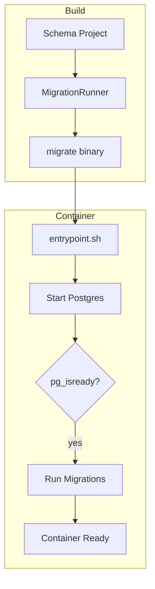
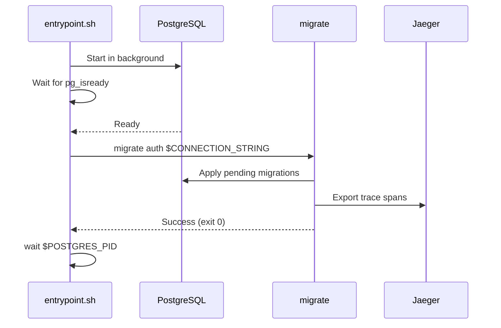
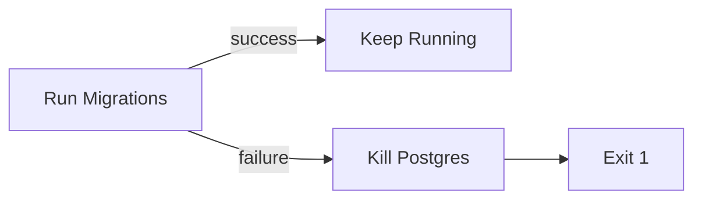
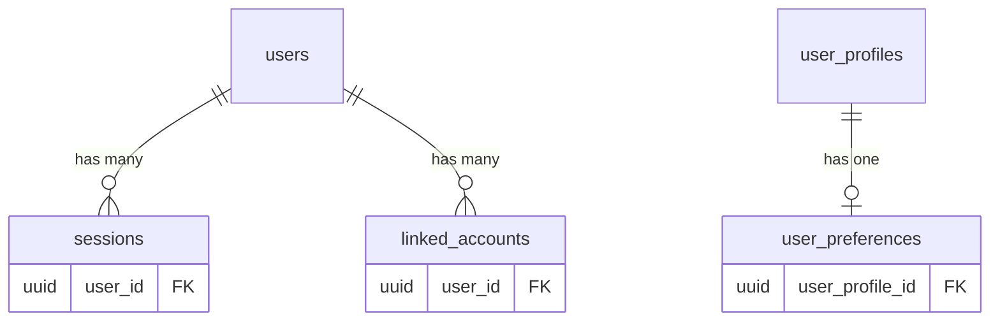

# Database Setup

EF Core manages schema definitions. Migrations run automatically when DB containers start.

## Architecture



## DbContexts

Both contexts use .NET 10 primary constructors and snake_case naming.

### AuthDbContext

```csharp
public sealed class AuthDbContext(DbContextOptions<AuthDbContext> options)
    : DbContext(options)
{
    public DbSet<User> Users => Set<User>();
    public DbSet<Session> Sessions => Set<Session>();
    public DbSet<LinkedAccount> LinkedAccounts => Set<LinkedAccount>();
}
```

**Tables:**
| Table | Primary Key | Indexes |
|-------|-------------|---------|
| `users` | `id` (uuid) | `email` (unique) |
| `sessions` | `id` (uuid) | `token` (unique), `user_id` |
| `linked_accounts` | `id` (uuid) | `(provider, provider_user_id)` (unique), `user_id` |

**Users Columns:**
| Column | Type | Default | Description |
|--------|------|---------|-------------|
| `id` | uuid | `gen_random_uuid()` | Primary key |
| `email` | text | - | User email (unique) |
| `username` | text | - | Display name |
| `is_active` | boolean | `true` | Account status |
| `permissions` | jsonb | `'{}'::jsonb` | Permission map |
| `created_at` | timestamp | `now()` | Creation time |
| `updated_at` | timestamp | `now()` | Last update |

### UserDbContext

```csharp
public sealed class UserDbContext(DbContextOptions<UserDbContext> options)
    : DbContext(options)
{
    public DbSet<UserProfile> UserProfiles => Set<UserProfile>();
    public DbSet<UserPreferences> UserPreferences => Set<UserPreferences>();
}
```

**Tables:**
| Table | Primary Key | Indexes |
|-------|-------------|---------|
| `user_profiles` | `id` (uuid) | `auth_user_id` (unique) |
| `user_preferences` | `id` (uuid) | `user_profile_id` (FK) |

## Events Database

Port: 5435 | Managed by Go service migrations

### audit_logs

```sql
CREATE TABLE audit_logs (
    id UUID PRIMARY KEY DEFAULT gen_random_uuid(),
    event_type TEXT NOT NULL,
    event_id TEXT NOT NULL UNIQUE,
    source TEXT NOT NULL,
    actor_id UUID,
    target_id UUID,
    metadata JSONB,
    created_at TIMESTAMPTZ NOT NULL
);
```

### webhooks

```sql
CREATE TABLE webhooks (
    id UUID PRIMARY KEY DEFAULT gen_random_uuid(),
    name TEXT NOT NULL,
    url TEXT NOT NULL,
    secret TEXT NOT NULL,
    event_types TEXT[] NOT NULL,
    format TEXT NOT NULL DEFAULT 'raw',
    is_active BOOLEAN NOT NULL DEFAULT true,
    created_at TIMESTAMPTZ NOT NULL DEFAULT now(),
    updated_at TIMESTAMPTZ NOT NULL DEFAULT now()
);
```

### webhook_deliveries

```sql
CREATE TABLE webhook_deliveries (
    id UUID PRIMARY KEY DEFAULT gen_random_uuid(),
    webhook_id UUID NOT NULL REFERENCES webhooks(id) ON DELETE CASCADE,
    event_id TEXT NOT NULL,
    event_type TEXT NOT NULL,
    payload JSONB NOT NULL,
    status_code INTEGER,
    response_body TEXT,
    error TEXT,
    attempt INTEGER NOT NULL DEFAULT 1,
    success BOOLEAN NOT NULL DEFAULT false,
    created_at TIMESTAMPTZ NOT NULL DEFAULT now()
);
```

### dead_letters

```sql
CREATE TABLE dead_letters (
    id UUID PRIMARY KEY DEFAULT gen_random_uuid(),
    event_type TEXT NOT NULL,
    event_id TEXT NOT NULL,
    payload JSONB NOT NULL,
    error TEXT NOT NULL,
    queue TEXT NOT NULL,
    created_at TIMESTAMPTZ NOT NULL DEFAULT now()
);
```

## Files Database

Port: 5436 | Managed by Go service migrations

### stored_files

```sql
CREATE TABLE stored_files (
    id UUID PRIMARY KEY DEFAULT gen_random_uuid(),
    owner_id UUID NOT NULL,
    filename TEXT NOT NULL,
    mime_type TEXT NOT NULL,
    size_bytes BIGINT NOT NULL,
    object_key TEXT NOT NULL UNIQUE,
    status TEXT NOT NULL DEFAULT 'pending',
    created_at TIMESTAMPTZ NOT NULL DEFAULT now(),
    updated_at TIMESTAMPTZ NOT NULL DEFAULT now()
);
```

### file_variants

```sql
CREATE TABLE file_variants (
    id UUID PRIMARY KEY DEFAULT gen_random_uuid(),
    file_id UUID NOT NULL REFERENCES stored_files(id) ON DELETE CASCADE,
    variant_type TEXT NOT NULL,
    object_key TEXT NOT NULL,
    mime_type TEXT NOT NULL,
    size_bytes BIGINT NOT NULL,
    created_at TIMESTAMPTZ NOT NULL DEFAULT now(),
    UNIQUE(file_id, variant_type)
);
```

## Identity Database

Port: 5437 | Managed by F# service with Npgsql.FSharp

### identity_users

| Column | Type | Description |
|--------|------|-------------|
| `id` | uuid | Primary key |
| `email` | text | Unique email |
| `username` | text | Display name |
| `password_hash` | text | Argon2id hash |
| `is_active` | boolean | Account status |
| `created_at`, `updated_at` | timestamptz | Timestamps |

### oauth_clients

| Column | Type | Description |
|--------|------|-------------|
| `id` | text | Client ID (PK) |
| `secret_hash` | text | Argon2id hash |
| `name` | text | Client name |
| `redirect_uris` | text[] | Allowed redirect URIs |
| `is_active` | boolean | Client status |

### authorization_codes

| Column | Type | Description |
|--------|------|-------------|
| `code` | text | Auth code (PK) |
| `client_id`, `user_id` | text/uuid | References |
| `redirect_uri`, `scope` | text | OAuth params |
| `code_challenge`, `code_challenge_method` | text | PKCE |
| `expires_at` | timestamptz | Expiration |

### access_tokens / refresh_tokens

| Column | Type | Description |
|--------|------|-------------|
| `token_hash` | text | SHA-256 hash (PK) |
| `user_id`, `client_id` | uuid/text | References |
| `scope`, `expires_at` | text/timestamptz | Token info |
| `client_fingerprint` | text | IP + UA hash |
| `family_id` | uuid | Refresh token family |
| `is_revoked` | boolean | Revocation status (refresh only) |

## Migration Runner

Standalone .NET console app that runs migrations on container startup.

### Usage

```bash
migrate <context> <connection-string>
```

- `context`: `auth` or `user`
- `connection-string`: Npgsql connection string

### How It Works



### Failure Handling

If migrations fail, the container stops immediately to prevent running with an inconsistent schema:



### OpenTelemetry Tracing

The migration runner exports traces to Jaeger when `OTEL_EXPORTER_OTLP_ENDPOINT` is set:

- `database.migrate` - Root span for entire migration run
- `migrations.apply` - Span covering all pending migrations
- `migration.step` - Individual migration span with name tag

View migration traces at [http://localhost:16686](http://localhost:16686)

### Container Build

Two-stage Dockerfile:

```dockerfile
# Stage 1: Build migration runner
FROM mcr.microsoft.com/dotnet/sdk:10.0-preview AS build
RUN dotnet publish MigrationRunner.csproj -r linux-x64 -o /app/publish

# Stage 2: Postgres + migrate binary
FROM postgres:17-bookworm
COPY --from=build /app/publish/MigrationRunner /usr/local/bin/migrate
COPY entrypoint.sh /usr/local/bin/entrypoint-wrapper.sh
ENTRYPOINT ["/usr/local/bin/entrypoint-wrapper.sh"]
```

## Database Defaults

PostgreSQL functions for defaults:

| Column | Default |
|--------|---------|
| `id` | `gen_random_uuid()` |
| `created_at` | `now()` |
| `updated_at` | `now()` |

## Relationships



All foreign keys use `CASCADE` delete.

## Creating Migrations

```bash
cd src/schema/Schema

# Auth context
dotnet ef migrations add MigrationName \
    --context AuthDbContext \
    --output-dir Migrations/Auth

# User context
dotnet ef migrations add MigrationName \
    --context UserDbContext \
    --output-dir Migrations/User
```

After creating migrations, rebuild DB images to include them:

```bash
tilt up
# or
docker compose -f infra/docker/docker-compose.infra.yml build
```

## Project Structure

```
src/schema/
├── Schema/
│   ├── Contexts/
│   │   ├── AuthDbContext.cs
│   │   └── UserDbContext.cs
│   ├── Entities/
│   │   ├── Auth/
│   │   └── User/
│   └── Migrations/
│       ├── Auth/
│       └── User/
└── MigrationRunner/
    └── Program.cs

infra/dbs/
├── auth-db/
│   ├── Dockerfile
│   └── entrypoint.sh
├── user-db/
│   ├── Dockerfile
│   └── entrypoint.sh
├── events-db/
│   └── Dockerfile
├── files-db/
│   └── Dockerfile
└── identity-db/
    └── Dockerfile
```

## Conventions

| Convention | Implementation |
|------------|----------------|
| Naming | `UseSnakeCaseNamingConvention()` |
| Primary Keys | UUID with `gen_random_uuid()` |
| Timestamps | `now()` default |
| Enums | Stored as strings |
| Cascade | All FK relationships |
