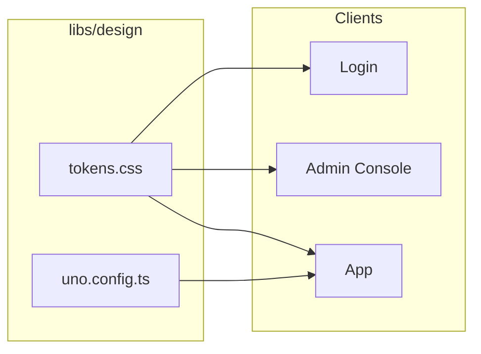

# Design System

**CSS Tokens + UnoCSS**

HellArch uses a unified design system with CSS custom properties (tokens) and UnoCSS for atomic styling.

## Architecture



## Design Tokens

`libs/design/tokens.css` defines the visual language:

### Colors

```css
:root {
  /* Backgrounds - Dark mode first */
  --color-bg-primary: #0f0f0f;
  --color-bg-secondary: #1a1a1a;
  --color-bg-card: #1e1e1e;
  --color-bg-elevated: #252525;

  /* Text */
  --color-text-primary: #f5f5f5;
  --color-text-secondary: #a0a0a0;
  --color-text-muted: #666666;

  /* Brand */
  --color-accent: #5865f2;
  --color-accent-hover: #4752c4;

  /* Semantic */
  --color-success: #22c55e;
  --color-warning: #eab308;
  --color-error: #ef4444;
  --color-info: #3b82f6;

  /* Providers */
  --color-discord: #5865f2;
  --color-github: #333333;
  --color-google: #ea4335;
}
```

### Spacing

```css
:root {
  --space-1: 0.25rem;   /* 4px */
  --space-2: 0.5rem;    /* 8px */
  --space-3: 0.75rem;   /* 12px */
  --space-4: 1rem;      /* 16px */
  --space-6: 1.5rem;    /* 24px */
  --space-8: 2rem;      /* 32px */
}
```

### Typography

```css
:root {
  --font-sans: -apple-system, BlinkMacSystemFont, 'Segoe UI', Roboto, sans-serif;
  --font-mono: 'SF Mono', 'Fira Code', 'Consolas', monospace;

  --text-sm: 0.875rem;
  --text-base: 1rem;
  --text-lg: 1.125rem;
  --text-xl: 1.25rem;
  --text-2xl: 1.5rem;
}
```

### Borders & Shadows

```css
:root {
  --radius-sm: 4px;
  --radius-md: 8px;
  --radius-lg: 12px;
  --radius-full: 9999px;

  --shadow-sm: 0 1px 2px rgba(0, 0, 0, 0.3);
  --shadow-md: 0 4px 6px rgba(0, 0, 0, 0.4);
  --shadow-lg: 0 10px 15px rgba(0, 0, 0, 0.5);
}
```

## UnoCSS Integration

`libs/design/uno.config.ts` maps tokens to utility classes:

```typescript
export default defineConfig({
  theme: {
    colors: {
      bg: {
        primary: 'var(--color-bg-primary)',
        secondary: 'var(--color-bg-secondary)',
        card: 'var(--color-bg-card)',
      },
      accent: {
        DEFAULT: 'var(--color-accent)',
        hover: 'var(--color-accent-hover)',
      },
    },
  },
})
```

### Shortcuts

Pre-defined component patterns:

```typescript
shortcuts: {
  // Layout
  'flex-center': 'flex items-center justify-center',
  'flex-between': 'flex items-center justify-between',

  // Cards
  'card': 'bg-bg-card border border-border rounded-lg p-6',
  'card-elevated': 'bg-bg-elevated border border-border rounded-lg p-6 shadow-md',

  // Buttons
  'btn': 'inline-flex items-center justify-center gap-2 px-4 py-2 rounded-md font-medium transition-all',
  'btn-primary': 'btn bg-accent text-white hover:bg-accent-hover',
  'btn-secondary': 'btn bg-bg-secondary text-text-primary border border-border',
  'btn-discord': 'btn bg-discord text-white hover:bg-accent-hover',

  // Inputs
  'input': 'w-full px-4 py-2 bg-bg-secondary border border-border rounded-md',

  // Text
  'text-heading': 'text-2xl font-bold text-text-primary',
  'text-caption': 'text-sm text-text-secondary',
  'link': 'text-accent hover:underline cursor-pointer',
}
```

## Usage

### In Vue/Vite Apps

Import tokens and use UnoCSS:

```typescript
// main.ts
import 'libs/design/tokens.css'
import 'virtual:uno.css'
```

```vue
<template>
  <div class="card">
    <h1 class="text-heading">Hello</h1>
    <button class="btn-primary">Click me</button>
  </div>
</template>
```

### In Blazor Apps

Import tokens in `_Host.cshtml` or layout:

```html
<link href="/css/tokens.css" rel="stylesheet" />
```

Use CSS variables directly or with safelisted classes:

```razor
<div class="card">
    <h1 class="text-heading">Dashboard</h1>
    <button class="btn-primary">Action</button>
</div>
```

### In Plain CSS

Reference tokens directly:

```css
.my-component {
  background: var(--color-bg-card);
  border: 1px solid var(--color-border);
  border-radius: var(--radius-md);
  padding: var(--space-4);
}

.my-component:hover {
  border-color: var(--color-accent);
}
```

## Design Principles

1. **Dark mode first** - Default palette is dark, light mode optional
2. **Mobile first** - Responsive breakpoints scale up
3. **Atomic classes** - Small, composable utility classes
4. **Token-driven** - All values derive from CSS custom properties
5. **Provider colors** - OAuth providers have branded colors

## Build Tasks

Use mise to build and deploy design assets:

```bash
# Install dependencies
mise run design:install

# Generate utility CSS from source files
mise run design:build

# Copy tokens + utilities to Gateway
mise run design:copy

# Build all clients (includes design)
mise run clients:all
```

The `design:build` task scans Vue components and Razor files to generate only the CSS utilities actually used.

## File Structure

```
libs/design/
├── tokens.css       # CSS custom properties
├── uno.config.ts    # UnoCSS configuration
├── dist/
│   └── utilities.css  # Generated (gitignored)
└── package.json     # Node dependencies
```

## Adding New Tokens

1. Add to `tokens.css`:
   ```css
   :root {
     --color-my-new: #abc123;
   }
   ```

2. Map in `uno.config.ts`:
   ```typescript
   colors: {
     myNew: 'var(--color-my-new)',
   }
   ```

3. Add to safelist if needed for Blazor:
   ```typescript
   safelist: ['bg-my-new', 'text-my-new'],
   ```

## Dashboard Components

Reusable dashboard UI components available for both Blazor and Vue 3. All components use the same CSS classes from `uno.config.ts`.

### Component Libraries

```
libs/components/
├── blazor/                  # .NET Razor components
│   └── Dashboard/
│       ├── MetricCard.razor
│       ├── ProgressBar.razor
│       ├── StatusPill.razor
│       ├── Alert.razor
│       ├── Tabs.razor
│       ├── Pagination.razor
│       ├── Avatar.razor
│       ├── KeyValue.razor
│       ├── KeyValueItem.razor
│       └── Breadcrumbs.razor
└── vue/                     # Vue 3 SFC components
    └── src/dashboard/
        └── (matching components)
```

### Available Components

| Component | Description |
|-----------|-------------|
| `MetricCard` | Display KPI with label, value, and optional trend indicator |
| `ProgressBar` | Progress indicator with variants (success/warning/danger) |
| `StatusPill` | Colored status badges (online/offline/pending/etc) |
| `Alert` | Contextual feedback messages |
| `Tabs` | Tab navigation with pill variant option |
| `Pagination` | Page navigation with ellipsis support |
| `Avatar` | User avatar with image or initials fallback |
| `KeyValue` | List/grid container for key-value pairs |
| `KeyValueItem` | Single key-value display row |
| `Breadcrumbs` | Navigation breadcrumb trail |

### Usage - Blazor

Reference the component library:

```xml
<!-- In your .csproj -->
<ProjectReference Include="..\..\libs\components\blazor\HellArch.Components.csproj" />
```

```razor
@using HellArch.Components.Dashboard

<MetricCard Label="Total Users" Value="1,234" Trend="12.5" TrendDirection="TrendDirection.Up" />

<StatusPill Variant="PillVariant.Online">Active</StatusPill>

<ProgressBar Value="75" Variant="ProgressVariant.Success" ShowLabel="true" />

<KeyValue>
    <KeyValueItem Key="Status" Value="Running" />
    <KeyValueItem Key="Uptime" Value="99.9%" />
</KeyValue>
```

### Usage - Vue 3

Import components from the package:

```typescript
import { MetricCard, StatusPill, ProgressBar, KeyValue, KeyValueItem } from '@hellarch/components-vue'
```

```vue
<template>
  <MetricCard label="Total Users" :value="1234" :trend="12.5" trend-direction="up" />

  <StatusPill variant="online">Active</StatusPill>

  <ProgressBar :value="75" variant="success" show-label />

  <KeyValue>
    <KeyValueItem label="Status" value="Running" />
    <KeyValueItem label="Uptime" value="99.9%" />
  </KeyValue>
</template>
```

### CSS Classes Reference

All components use these UnoCSS shortcuts (from `uno.config.ts`):

```css
/* Metrics */
.metric-card        /* Card container with flex column */
.metric-value       /* Large bold value text */
.metric-label       /* Muted label text */
.metric-trend-up    /* Green upward trend */
.metric-trend-down  /* Red downward trend */

/* Status Pills */
.pill               /* Base badge styling */
.pill-success       /* Green for success/active */
.pill-warning       /* Yellow for warnings */
.pill-danger        /* Red for errors */
.pill-online        /* Green dot + text for online */
.pill-offline       /* Gray for offline */

/* Progress */
.progress-bar       /* Track container */
.progress-fill      /* Animated fill bar */
.progress-fill-success/warning/danger

/* Key-Value */
.kv-list            /* Vertical list layout */
.kv-grid            /* Two-column grid */
.kv-row             /* Single row flex container */
.kv-key             /* Muted key label */
.kv-value           /* Primary value text */

/* Alerts */
.alert              /* Base alert container */
.alert-info/success/warning/danger

/* Navigation */
.breadcrumbs        /* Breadcrumb container */
.pagination         /* Pagination container */
.page-btn           /* Page button */
.page-btn-active    /* Current page */
```
