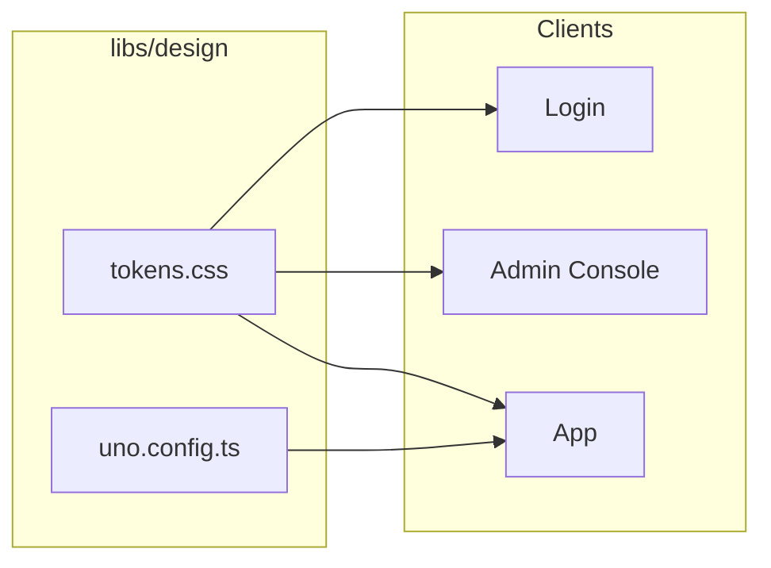

# Design System

**Neon Cyberpunk - CSS Tokens + UnoCSS**

HellArch uses a two-layer design token system with a neon cyberpunk aesthetic. Dark mode first, mobile first.

## Architecture



## Two-Layer Token System

The design system uses a primitive → semantic token architecture:

| Layer | Purpose | Usage |
|-------|---------|-------|
| **Primitive** | Raw palette values | 5% - intentional brand moments |
| **Semantic** | Role-based tokens | 95% - everyday styling |

## Primitive Tokens (Layer 1)

Raw palette values. Use sparingly for intentional brand moments:

```css
:root {
  /* Backgrounds */
  --palette-black: #0a0a0a;
  --palette-black-light: #111111;
  --palette-black-lighter: #161616;
  --palette-black-lightest: #1c1c1c;

  /* Grays */
  --palette-gray-dark: #2a2a2a;
  --palette-gray: #3a3a3a;
  --palette-gray-light: #737373;
  --palette-gray-lighter: #9a9a9a;

  /* Neon Palette (brand colors) */
  --palette-neon-pink: #D162A4;
  --palette-neon-rose: #A30262;
  --palette-neon-dusty: #B55690;
  --palette-neon-peach: #FF9A56;
  --palette-neon-orange: #EF7627;
  --palette-neon-coral: #D52D00;
  --palette-neon-green: #39ff14;
  --palette-neon-red: #ff0033;
  --palette-neon-yellow: #ffff00;

  /* Provider brands */
  --palette-discord: #5865f2;
  --palette-github: #f0f0f0;
  --palette-google: #ea4335;
}
```

## Semantic Tokens (Layer 2)

Role-based tokens for 95% of styling:

```css
:root {
  /* Surfaces - where content lives */
  --color-surface: var(--palette-black);
  --color-surface-raised: var(--palette-black-light);
  --color-surface-overlay: var(--palette-black-lighter);
  --color-surface-elevated: var(--palette-black-lightest);
  --color-surface-backdrop: rgba(0, 0, 0, 0.8);

  /* Text hierarchy */
  --color-text: #ffffff;
  --color-text-secondary: var(--palette-gray-lighter);
  --color-text-muted: var(--palette-gray-light);
  --color-text-inverse: var(--palette-black);

  /* Brand - primary actions */
  --color-primary: var(--palette-neon-pink);
  --color-primary-hover: var(--palette-neon-dusty);
  --color-primary-active: var(--palette-neon-rose);

  /* Feedback states */
  --color-success: var(--palette-neon-green);
  --color-warning: var(--palette-neon-yellow);
  --color-danger: var(--palette-neon-red);
  --color-info: var(--palette-neon-pink);

  /* Borders */
  --color-border: var(--palette-gray-dark);
  --color-border-hover: var(--palette-gray);
  --color-border-focus: var(--color-primary);
}
```

## Glows

Neon glow effects for hover states and emphasis:

```css
:root {
  /* Semantic glows */
  --glow-primary: 0 0 8px rgba(209, 98, 164, 0.4);
  --glow-primary-intense: 0 0 20px rgba(209, 98, 164, 0.5), 0 4px 12px rgba(0, 0, 0, 0.3);
  --glow-success: 0 0 8px rgba(57, 255, 20, 0.4);
  --glow-danger: 0 0 8px rgba(255, 0, 51, 0.4);
  --glow-warning: 0 0 8px rgba(255, 255, 0, 0.4);

  /* Primitive glows (for brand moments) */
  --glow-pink: 0 0 8px rgba(209, 98, 164, 0.4);
  --glow-rose: 0 0 8px rgba(163, 2, 98, 0.4);
  --glow-green: 0 0 8px rgba(57, 255, 20, 0.4);
}
```

## Typography

Custom fonts with modular scale:

```css
:root {
  /* Font families */
  --font-sans: 'Space Grotesk', -apple-system, BlinkMacSystemFont, 'Segoe UI', Roboto, sans-serif;
  --font-mono: 'JetBrains Mono', 'Fira Code', 'SF Mono', 'Consolas', monospace;

  /* Type scale (1.25 ratio) */
  --text-xs: 0.75rem;      /* 12px */
  --text-sm: 0.875rem;     /* 14px */
  --text-base: 1rem;       /* 16px */
  --text-lg: 1.125rem;     /* 18px */
  --text-xl: 1.25rem;      /* 20px */
  --text-2xl: 1.5rem;      /* 24px */
  --text-3xl: 2rem;        /* 32px */
  --text-4xl: 2.5rem;      /* 40px */
  --text-5xl: 3.5rem;      /* 56px */

  /* Line heights */
  --leading-tight: 1.25;
  --leading-normal: 1.5;
  --leading-relaxed: 1.625;
  --leading-prose: 1.75;   /* Optimal for body text */
}
```

## Spacing System

Complete 4px-based scale:

```css
:root {
  --space-1: 0.25rem;      /* 4px */
  --space-2: 0.5rem;       /* 8px */
  --space-3: 0.75rem;      /* 12px */
  --space-4: 1rem;         /* 16px - base unit */
  --space-6: 1.5rem;       /* 24px */
  --space-8: 2rem;         /* 32px */
  --space-12: 3rem;        /* 48px */
  --space-16: 4rem;        /* 64px */
  --space-24: 6rem;        /* 96px */

  /* Layout widths */
  --width-sidebar: 220px;
  --width-content-lg: 1024px;
  --width-content-xl: 1152px;
}
```

## Borders & Shadows

```css
:root {
  /* Sharper borders */
  --radius-sm: 2px;
  --radius-md: 4px;
  --radius-lg: 8px;
  --radius-full: 9999px;

  /* Deep shadows */
  --shadow-sm: 0 1px 2px rgba(0, 0, 0, 0.5);
  --shadow-md: 0 4px 6px rgba(0, 0, 0, 0.6);
  --shadow-lg: 0 10px 15px rgba(0, 0, 0, 0.7);
}
```

## UnoCSS Integration

`libs/design/uno.config.ts` maps tokens to utility classes:

```typescript
export default defineConfig({
  theme: {
    colors: {
      // Semantic surfaces
      surface: {
        DEFAULT: 'var(--color-surface)',
        raised: 'var(--color-surface-raised)',
        overlay: 'var(--color-surface-overlay)',
        elevated: 'var(--color-surface-elevated)',
      },
      // Text hierarchy
      text: {
        DEFAULT: 'var(--color-text)',
        secondary: 'var(--color-text-secondary)',
        muted: 'var(--color-text-muted)',
        inverse: 'var(--color-text-inverse)',
      },
      // Brand colors
      primary: {
        DEFAULT: 'var(--color-primary)',
        hover: 'var(--color-primary-hover)',
      },
      // Neon primitives (for brand moments)
      neon: {
        pink: 'var(--color-neon-pink)',
        rose: 'var(--color-neon-rose)',
        green: 'var(--color-neon-green)',
        // ...
      },
    },
  },
})
```

### Shortcuts

Pre-defined component patterns:

```typescript
shortcuts: {
  // Layout
  'flex-center': 'flex items-center justify-center',
  'flex-between': 'flex items-center justify-between',

  // Cards (semantic)
  'card': 'bg-surface-overlay border border-border rounded-sm p-6 transition-all',
  'card-glow': 'card hover:border-primary hover:shadow-glow-primary',
  'card-interactive': 'card hover:border-primary/50 hover:bg-surface-elevated cursor-pointer',

  // Buttons - neon brand variants
  'btn': 'inline-flex items-center gap-2 px-4 py-2 rounded-sm font-semibold transition-all active:scale-95',
  'btn-neon': 'btn border border-neon-pink text-neon-pink hover:bg-neon-pink hover:text-surface hover:shadow-glow-pink',
  'btn-neon-solid': 'btn bg-neon-pink text-surface font-bold hover:shadow-glow-pink',

  // Buttons - semantic
  'btn-primary': 'btn bg-primary text-text-inverse hover:shadow-glow-primary',
  'btn-secondary': 'btn bg-surface-raised border border-border hover:bg-surface-elevated',
  'btn-ghost': 'btn bg-transparent text-text-secondary hover:text-primary',
  'btn-danger': 'btn border border-danger text-danger hover:bg-danger hover:text-white',

  // Inputs
  'input': 'w-full px-4 py-2 bg-surface-raised border border-border rounded-sm focus:border-focus focus:shadow-glow-primary',

  // Typography
  'h1': 'text-5xl font-bold leading-tight tracking-tight text-text',
  'h2': 'text-4xl font-bold leading-tight tracking-tight text-text',
  'text-heading': 'text-2xl font-bold tracking-tight text-text',
  'text-caption': 'text-sm text-text-secondary',
  'text-gradient': 'bg-gradient-to-r from-neon-pink to-neon-orange bg-clip-text text-transparent',

  // Links
  'link': 'text-link hover:text-link-hover transition-colors',
  'link-underline': 'link hover:after:w-full after:transition-all',
}

## Animations

The design system includes a comprehensive animation library:

### Fade Animations

```css
.animate-fade-in        /* Basic fade in */
.animate-fade-in-up     /* Fade in from below */
.animate-fade-in-down   /* Fade in from above */
.animate-fade-in-left   /* Fade in from left */
.animate-fade-in-right  /* Fade in from right */
.animate-fade-out       /* Fade out */
```

### Scale & Slide Animations

```css
.animate-scale-in       /* Scale up entrance */
.animate-pop            /* Pop effect */
.animate-slide-in-right /* Slide from right */
.animate-slide-in-up    /* Slide from bottom */
```

### Utility Animations

```css
.animate-spin           /* Continuous rotation */
.animate-bounce         /* Bouncing effect */
.animate-shake          /* Error shake */
.animate-ping           /* Notification pulse */
.animate-shimmer        /* Skeleton loading */
.glow-breathe           /* Subtle glow pulse */
```

### Stagger Delays

For list animations:

```css
.stagger-1 through .stagger-8  /* 50ms increments */
```

### Animation Shortcuts

```typescript
// Enter animations
'enter-fade': 'animate-fade-in',
'enter-up': 'animate-fade-in-up',
'enter-scale': 'animate-scale-in',

// Exit animations
'exit-fade': 'animate-fade-out',
'exit-scale': 'animate-scale-out',

// State animations
'state-error': 'animate-shake border-danger',
'state-success': 'animate-pop border-success',

// Loading states
'spinner': 'w-5 h-5 border-2 border-border border-t-primary rounded-full animate-spin',
'skeleton-shimmer': 'bg-surface-raised animate-shimmer rounded-sm',
```

## Usage

### In Vue/Vite Apps

Import tokens and use UnoCSS:

```typescript
// main.ts
import 'libs/design/tokens.css'
import 'virtual:uno.css'
```

```vue
<template>
  <div class="card-glow enter-up">
    <h1 class="text-gradient">Hello</h1>
    <button class="btn-neon-solid">Click me</button>
  </div>
</template>
```

### In Blazor Apps

Import tokens in `_Host.cshtml` or layout:

```html
<link href="/css/tokens.css" rel="stylesheet" />
```

Use CSS variables directly or with safelisted classes:

```razor
<div class="card">
    <h1 class="text-heading">Dashboard</h1>
    <div class="health-dot-healthy"></div>
    <button class="btn-primary">Action</button>
</div>
```

### In Plain CSS

Reference semantic tokens:

```css
.my-component {
  background: var(--color-surface-overlay);
  border: 1px solid var(--color-border);
  border-radius: var(--radius-sm);
  padding: var(--space-4);
}

.my-component:hover {
  border-color: var(--color-primary);
  box-shadow: var(--glow-primary);
}
```

## Design Principles

1. **Two-layer tokens** - Semantic tokens for everyday use, primitives for brand moments
2. **Dark mode first** - Neon cyberpunk palette optimized for dark backgrounds
3. **Mobile first** - Responsive breakpoints scale up
4. **Glow effects** - Neon glows for hover states and emphasis
5. **Sharp corners** - Minimal border radius for a technical aesthetic
6. **Custom fonts** - Space Grotesk + JetBrains Mono for the cyberpunk feel

## Build Tasks

Use mise to build and deploy design assets:

```bash
# Install dependencies
mise run design:install

# Generate utility CSS from source files
mise run design:build

# Copy tokens + utilities to Gateway
mise run design:copy

# Build all clients (includes design)
mise run clients:all
```

The `design:build` task scans Vue components and Razor files to generate only the CSS utilities actually used.

## File Structure

```
libs/design/
├── tokens.css       # CSS custom properties
├── uno.config.ts    # UnoCSS configuration
├── dist/
│   └── utilities.css  # Generated (gitignored)
└── package.json     # Node dependencies
```

## Adding New Tokens

1. Add to `tokens.css`:
   ```css
   :root {
     --color-my-new: #abc123;
   }
   ```

2. Map in `uno.config.ts`:
   ```typescript
   colors: {
     myNew: 'var(--color-my-new)',
   }
   ```

3. Add to safelist if needed for Blazor:
   ```typescript
   safelist: ['bg-my-new', 'text-my-new'],
   ```

## Dashboard Atomic Elements

The design system includes comprehensive dashboard UI patterns as UnoCSS shortcuts:

### Metric Cards

Display KPIs with trends:

```html
<div class="metric-card">
  <span class="metric-value">1,234</span>
  <span class="metric-label">Total Users</span>
  <span class="metric-trend-up">↑ 12.5%</span>
</div>

<!-- Mini variant -->
<div class="metric-mini">
  <span class="metric-mini-value">99.9%</span>
  <span class="metric-mini-label">Uptime</span>
</div>
```

### Status Pills

Semantic status indicators:

```html
<span class="pill-success">Active</span>
<span class="pill-warning">Pending</span>
<span class="pill-danger">Failed</span>
<span class="pill-online">Online</span>
<span class="pill-offline">Offline</span>
```

### Progress Bars

```html
<div class="progress-bar">
  <div class="progress-fill-success" style="width: 75%"></div>
</div>
```

### Health Indicators

```html
<div class="health-dot-healthy"></div>  <!-- Green with glow -->
<div class="health-dot-warning"></div>  <!-- Yellow pulsing -->
<div class="health-dot-danger"></div>   <!-- Red pulsing -->
```

### Key-Value Pairs

```html
<div class="kv-list">
  <div class="kv-row">
    <span class="kv-key">Status</span>
    <span class="kv-value">Running</span>
  </div>
</div>

<!-- Grid layout -->
<div class="kv-grid">
  <span class="kv-key">CPU</span>
  <span class="kv-value">45%</span>
</div>
```

### Alerts

```html
<div class="alert-success">
  <span class="alert-icon">✓</span>
  <div class="alert-content">
    <div class="alert-title">Success</div>
    Operation completed.
  </div>
</div>
```

### Data Tables

```html
<table class="data-table">
  <thead>
    <tr><th class="data-th">Name</th><th class="data-th">Status</th></tr>
  </thead>
  <tbody>
    <tr class="data-row-clickable">
      <td class="data-td">Service A</td>
      <td class="data-td"><span class="pill-success">Active</span></td>
    </tr>
  </tbody>
</table>
```

### Tabs

```html
<!-- Underline tabs -->
<div class="tabs">
  <button class="tab-active">Overview</button>
  <button class="tab">Settings</button>
</div>

<!-- Pill tabs -->
<div class="tabs-pills">
  <button class="tab-pill-active">Day</button>
  <button class="tab-pill">Week</button>
</div>
```

### Navigation

```html
<!-- Sidebar nav -->
<a class="nav-link nav-link-active">
  <span class="nav-icon">📊</span>
  Dashboard
</a>

<!-- Breadcrumbs -->
<nav class="breadcrumbs">
  <a class="breadcrumb">Home</a>
  <span class="breadcrumb-sep">/</span>
  <span class="breadcrumb-current">Users</span>
</nav>

<!-- Pagination -->
<div class="pagination">
  <button class="page-btn">←</button>
  <button class="page-btn-active">1</button>
  <button class="page-btn">2</button>
  <button class="page-btn">→</button>
</div>
```

### Badges

```html
<span class="badge">Default</span>
<span class="badge-success">Success</span>
<span class="badge-warning">Warning</span>
<span class="badge-danger">Error</span>
```

### Buttons

```html
<!-- Icon buttons -->
<button class="btn-icon">✕</button>
<button class="btn-icon-danger">🗑</button>

<!-- Button groups -->
<div class="btn-group">
  <button class="btn-group-item-active">Grid</button>
  <button class="btn-group-item">List</button>
</div>
```

### Avatars

```html
<div class="avatar">JD</div>
<div class="avatar-sm">J</div>
<div class="avatar-lg"></div>

<!-- Avatar group -->
<div class="avatar-group">
  <div class="avatar avatar-ring">A</div>
  <div class="avatar avatar-ring">B</div>
</div>
```

### Layout Shortcuts

```html
<!-- Grid patterns -->
<div class="grid-2">...</div>    <!-- 2-column responsive -->
<div class="grid-3">...</div>    <!-- 3-column responsive -->
<div class="grid-4">...</div>    <!-- 4-column for stats -->
<div class="grid-sidebar">...</div>  <!-- Sidebar layout -->

<!-- Spacing patterns -->
<div class="stack">...</div>     <!-- Vertical spacing (24px) -->
<div class="stack-sm">...</div>  <!-- Compact (16px) -->
<div class="row">...</div>       <!-- Horizontal with gap -->
<div class="row-between">...</div>

<!-- Page containers -->
<div class="page">...</div>      <!-- Standard max-width -->
<div class="page-wide">...</div> <!-- Wider content -->
```

### Modals & Dropdowns

```html
<!-- Modal -->
<div class="modal-overlay">
  <div class="modal-panel">...</div>
</div>

<!-- Dropdown -->
<div class="dropdown">
  <button>Menu</button>
  <div class="dropdown-menu">
    <a class="dropdown-item">Option 1</a>
    <div class="dropdown-divider"></div>
    <a class="dropdown-item-danger">Delete</a>
  </div>
</div>
```

### Code Display

```html
<code class="code-inline">const x = 1</code>

<pre class="code-block">
function hello() {
  console.log('world')
}
</pre>
```

## Prose Styles

Typography for body content and documentation:

```html
<article class="prose">
  <h1>Title</h1>
  <p>Body text with <a href="#">links</a> and <code>inline code</code>.</p>
  <blockquote>Quoted text with neon accent border</blockquote>
</article>
```

Prose variants:

```css
.prose        /* Default prose styling */
.prose-sm     /* Smaller text size */
.prose-lg     /* Larger text size */
.prose-invert /* Inverted for light backgrounds */
```

Features:
- Optimal line height (1.75) for readability
- Max-width 65ch for comfortable reading
- Heading hierarchy with proper spacing
- Styled links, lists, blockquotes, tables
- Code blocks with syntax highlighting support

## Migration from Legacy Tokens

Legacy aliases are available for backwards compatibility:

| Legacy Token | Semantic Token | Notes |
|--------------|----------------|-------|
| `--color-bg-primary` | `--color-surface` | |
| `--color-bg-secondary` | `--color-surface-raised` | |
| `--color-bg-card` | `--color-surface-overlay` | |
| `--color-bg-elevated` | `--color-surface-elevated` | |
| `--color-text-primary` | `--color-text` | |
| `--color-error` | `--color-danger` | |
| `--color-accent` | `--color-primary` | |

Legacy aliases will be removed in v2.0. Migrate to semantic tokens for new code.
