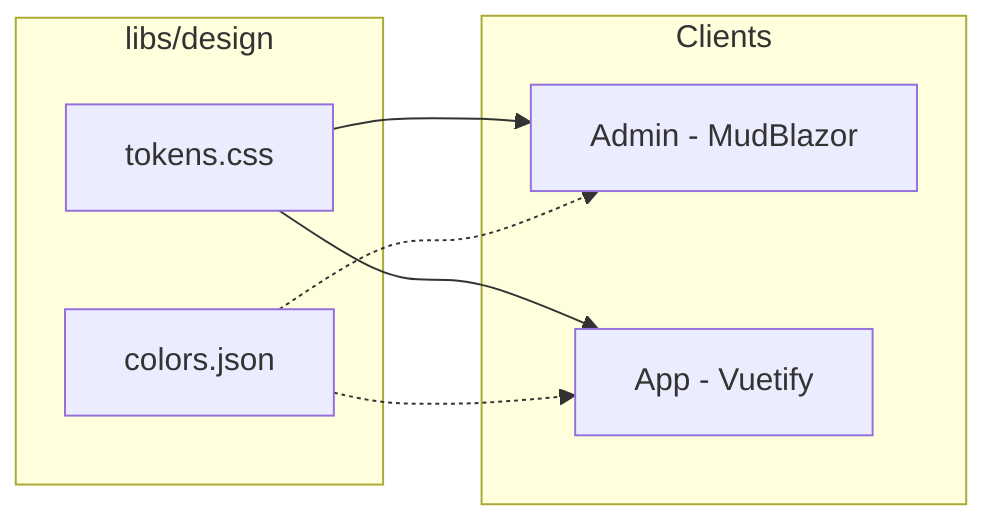

# Design System

**Neon Cyberpunk - MudBlazor + Vuetify**

HellArch uses component frameworks with custom themes for a consistent neon cyberpunk aesthetic. Dark mode first, mobile first.

## Architecture



## Component Frameworks

| Client | Framework | Theme Location |
|--------|-----------|----------------|
| Admin (Blazor) | MudBlazor 8.x | `src/clients/Admin/Theme/HellArchTheme.cs` |
| App (Vue) | Vuetify 3.x | `src/clients/App/src/main.ts` |

Both frameworks provide:
- Pre-built accessible components
- Dark mode support
- Responsive grid systems
- Material Design foundation
- Custom theming APIs

## Color Palette

The neon cyberpunk palette is shared across both frameworks:

### Backgrounds

| Token | Hex | Usage |
|-------|-----|-------|
| Black | `#0a0a0a` | Base background |
| Black Light | `#111111` | Drawer, appbar |
| Black Lighter | `#161616` | Surface, cards |
| Black Lightest | `#1c1c1c` | Elevated surfaces |

### Grays

| Token | Hex | Usage |
|-------|-----|-------|
| Gray Dark | `#2a2a2a` | Borders, dividers |
| Gray | `#3a3a3a` | Input borders |
| Gray Light | `#737373` | Disabled text |
| Gray Lighter | `#9a9a9a` | Secondary text |

### Neon Colors (Brand)

| Token | Hex | Usage |
|-------|-----|-------|
| Neon Pink | `#D162A4` | Primary actions |
| Neon Rose | `#A30262` | Primary darken |
| Neon Dusty | `#B55690` | Secondary |
| Neon Peach | `#FF9A56` | Tertiary, accents |
| Neon Orange | `#EF7627` | Warm accents |
| Neon Green | `#39ff14` | Success states |
| Neon Red | `#ff0033` | Error states |
| Neon Yellow | `#ffff00` | Warning states |

### Provider Brands

| Provider | Hex |
|----------|-----|
| Discord | `#5865f2` |
| GitHub | `#f0f0f0` |
| Google | `#ea4335` |

## MudBlazor Theme (Admin)

The Admin console uses MudBlazor with a custom dark palette:

```csharp
// src/clients/Admin/Theme/HellArchTheme.cs
public static class HellArchTheme
{
    public static MudTheme Create() => new()
    {
        PaletteDark = CreateDarkPalette(),
        LayoutProperties = new LayoutProperties
        {
            DefaultBorderRadius = "2px"  // Sharp corners
        }
    };

    private static PaletteDark CreateDarkPalette() => new()
    {
        // Backgrounds
        Black = "#0a0a0a",
        Background = "#0a0a0a",
        Surface = "#161616",
        DrawerBackground = "#111111",
        AppbarBackground = "#111111",

        // Text
        TextPrimary = "#ffffff",
        TextSecondary = "#9a9a9a",
        TextDisabled = "#737373",

        // Primary - Neon Pink
        Primary = "#D162A4",
        PrimaryContrastText = "#0a0a0a",
        PrimaryDarken = "#A30262",
        PrimaryLighten = "#B55690",

        // Feedback states
        Success = "#39ff14",
        Warning = "#ffff00",
        Error = "#ff0033",
        Info = "#D162A4",

        // Borders
        Divider = "#2a2a2a",
        LinesDefault = "#2a2a2a",
        TableLines = "#2a2a2a",
    };
}
```

### Usage in Blazor

```razor
@* App.razor *@
<MudThemeProvider Theme="HellArchTheme.Create()" IsDarkMode="true" />
<MudPopoverProvider />
<MudDialogProvider />
<MudSnackbarProvider />

@* Components use MudBlazor primitives *@
<MudButton Color="Color.Primary">Action</MudButton>
<MudCard>
    <MudCardContent>Content here</MudCardContent>
</MudCard>
<MudDataGrid Items="@items" />
```

## Vuetify Theme (App)

The Vue app uses Vuetify 3 with a custom dark theme:

```typescript
// src/clients/App/src/main.ts
const vuetify = createVuetify({
  theme: {
    defaultTheme: 'dark',
    themes: {
      dark: {
        dark: true,
        colors: {
          // Primary - Neon Pink
          primary: '#ff4d8d',
          'primary-darken-1': '#d93d75',
          secondary: '#ff6b9d',
          accent: '#ff8a65',

          // Feedback
          error: '#ef5350',
          warning: '#ffb74d',
          info: '#64b5f6',
          success: '#66bb6a',

          // Surfaces
          background: '#08080c',
          surface: '#0f0f14',
          'surface-bright': '#1a1a22',
          'surface-variant': '#16161e',

          // Text
          'on-surface': '#e4e4e7',
          'on-surface-variant': '#a1a1aa',
        },
      },
    },
  },
})
```

### Usage in Vue

```vue
<template>
  <v-app>
    <v-app-bar color="surface">
      <v-toolbar-title>HellArch</v-toolbar-title>
    </v-app-bar>

    <v-main>
      <v-container>
        <v-btn color="primary">Action</v-btn>
        <v-card>
          <v-card-text>Content here</v-card-text>
        </v-card>
        <v-data-table :items="items" />
      </v-container>
    </v-main>
  </v-app>
</template>
```

## CSS Tokens (Shared)

`libs/design/tokens.css` provides CSS custom properties for:
- Raw palette values (primitives)
- Semantic role-based tokens
- Typography scale
- Spacing scale
- Animations

These can be used alongside component frameworks for custom styling.

### Typography

```css
:root {
  --font-sans: 'Space Grotesk', -apple-system, sans-serif;
  --font-mono: 'JetBrains Mono', 'Fira Code', monospace;

  /* Type scale (1.25 ratio) */
  --text-xs: 0.75rem;      /* 12px */
  --text-sm: 0.875rem;     /* 14px */
  --text-base: 1rem;       /* 16px */
  --text-lg: 1.125rem;     /* 18px */
  --text-xl: 1.25rem;      /* 20px */
  --text-2xl: 1.5rem;      /* 24px */
  --text-3xl: 2rem;        /* 32px */
}
```

### Spacing

```css
:root {
  --space-1: 0.25rem;      /* 4px */
  --space-2: 0.5rem;       /* 8px */
  --space-3: 0.75rem;      /* 12px */
  --space-4: 1rem;         /* 16px */
  --space-6: 1.5rem;       /* 24px */
  --space-8: 2rem;         /* 32px */
  --space-12: 3rem;        /* 48px */
}
```

### Glows

Neon glow effects for hover states:

```css
:root {
  --glow-primary: 0 0 8px rgba(209, 98, 164, 0.4);
  --glow-primary-intense: 0 0 20px rgba(209, 98, 164, 0.5);
  --glow-success: 0 0 8px rgba(57, 255, 20, 0.4);
  --glow-danger: 0 0 8px rgba(255, 0, 51, 0.4);
}
```

### Animations

```css
.animate-fade-in { }
.animate-fade-in-up { }
.animate-scale-in { }
.animate-spin { }
.animate-bounce { }
.animate-shake { }
.animate-shimmer { }
```

## Design Principles

1. **Component frameworks** - MudBlazor and Vuetify handle accessibility, responsiveness, and consistency
2. **Dark mode first** - Neon cyberpunk palette optimized for dark backgrounds
3. **Mobile first** - Responsive components scale up
4. **Sharp corners** - 2px border radius for technical aesthetic
5. **Neon glows** - Subtle glow effects for interactive states
6. **Custom fonts** - Space Grotesk + JetBrains Mono

## File Structure

```
libs/design/
├── tokens.css       # CSS custom properties
└── colors.json      # Color palette reference

src/clients/Admin/
└── Theme/
    └── HellArchTheme.cs  # MudBlazor theme

src/clients/App/src/
├── main.ts          # Vuetify theme config
└── styles/
    └── global.css   # Additional custom styles
```

## Adding Colors

1. Add to `libs/design/colors.json` for reference
2. Update MudBlazor palette in `HellArchTheme.cs`
3. Update Vuetify theme in `main.ts`
4. Optionally add CSS token in `tokens.css`

## Framework Documentation

- [MudBlazor Docs](https://mudblazor.com/docs/overview)
- [Vuetify Docs](https://vuetifyjs.com/en/introduction/why-vuetify/)
