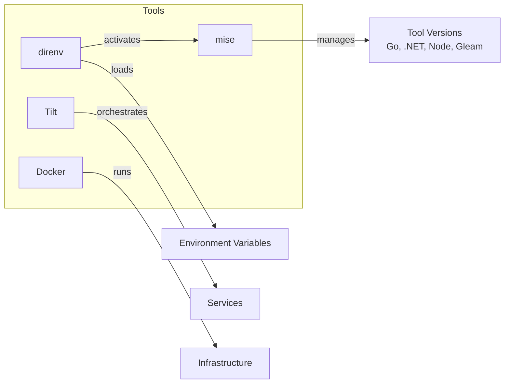
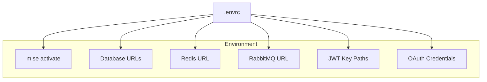
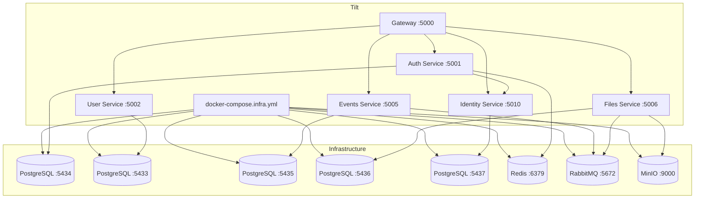
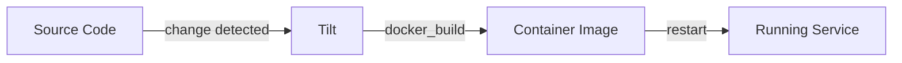

# Development Workflow

Local development uses Tilt for orchestration, mise for tool versions, and direnv for environment setup.

## Toolchain



## Prerequisites

Install these tools:

| Tool | Purpose |
|------|---------|
| [mise](https://mise.jdx.dev/) | Runtime version manager |
| [direnv](https://direnv.net/) | Environment loader |
| [Tilt](https://tilt.dev/) | Dev orchestration |
| [Docker](https://docker.com/) | Containers |

## Setup

```bash
# Clone repo
git clone https://github.com/Nechja/hellArch
cd hellArch

# Allow direnv (loads mise + env vars)
direnv allow

# Verify tools
mise doctor
```

## Tool Versions

Defined in `.mise.toml`:

```toml
[tools]
dotnet = "10.0"
go = "1.24"
gleam = "latest"
node = "22"
python = "3.12"
uv = "latest"
sops = "latest"
age = "latest"
golangci-lint = "latest"
ruff = "latest"
```

## Environment

Defined in `.envrc`:



Key variables:
- `AUTH_DATABASE_URL` - Auth PostgreSQL (port 5434)
- `USER_DATABASE_URL` - User PostgreSQL (port 5433)
- `DATABASE_URL` - Events PostgreSQL (port 5435)
- `FILES_DATABASE_URL` - Files PostgreSQL (port 5436)
- `IDENTITY_DATABASE_URL` - Identity PostgreSQL (port 5437)
- `REDIS_URL` - Redis connection
- `JWT_PRIVATE_KEY_PATH` / `JWT_PUBLIC_KEY_PATH` - RSA keys

## Running Services

### Start Everything

```bash
tilt up
```

Opens Tilt UI at http://localhost:10350

### What Tilt Runs



### Quick Links

| Service | URL |
|---------|-----|
| Tilt UI | http://localhost:10350 |
| Gateway | http://localhost:5000 |
| Admin Console | http://localhost:5003 |
| RabbitMQ UI | http://localhost:15672 |
| MinIO Console | http://localhost:9001 |
| Jaeger | http://localhost:16686 |

See [Service Ports](/guide/#ports) for complete port reference and [Configuration](/guide/configuration) for environment variables.

## Image Rebuilds

Tilt watches for file changes and rebuilds container images automatically:



| Language | Services |
|----------|----------|
| Go | Auth, Events, Files, Workers |
| F# | Identity, User |
| C# | Gateway, Admin |
| Gleam | Health |

Tilt uses `docker_build` for all services - no volume mounts or hot reload. This ensures the development environment matches production.

## Stopping

```bash
# Stop services (keep containers)
tilt down

# Stop and remove infrastructure
docker compose -f infra/docker/docker-compose.infra.yml down
```

## Mise Tasks

Common tasks defined in `.mise.toml`:

```bash
# Proto generation
mise run proto:all      # Generate all proto types
mise run proto:go       # Generate Go types
mise run proto:fsharp   # Generate F# types

# Codegen
mise run codegen:all      # Generate all types (entities + events)
mise run codegen:entities # Generate entity types from C# models
mise run codegen:events   # Generate CloudEvents types from C# models

# Design system
mise run design:install # Install npm dependencies
mise run design:build   # Generate utility CSS
mise run design:copy    # Copy to Gateway

# Client builds
mise run app:build      # Build Vue app
mise run app:copy       # Copy to Gateway
mise run clients:all    # Build and deploy all clients

# Testing
mise run test:all       # Run all tests
mise run test:api       # Run API tests
mise run test:integration # Run integration tests
mise run test:parallel  # Run tests in parallel
```
