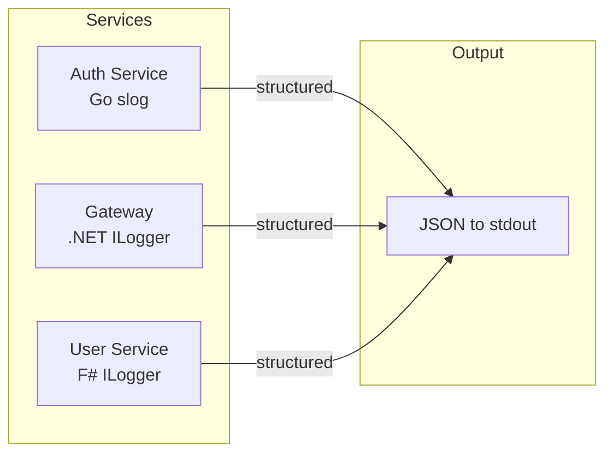
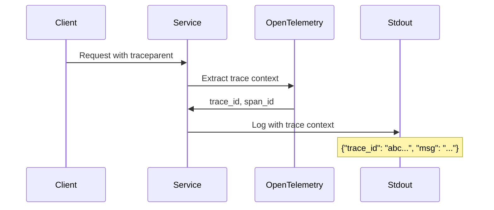

# Logging Standards

HellArch uses structured JSON logging across all services for consistency and observability integration.

## Overview



## Core Principles

1. **Structured over unstructured** - Always use key-value pairs, never string interpolation
2. **JSON format** - All services output JSON for log aggregation
3. **Consistent field names** - Same field names across Go, .NET, and F#
4. **Context propagation** - Include trace/span IDs when available

## Log Levels

| Level | When to use | Examples |
|-------|-------------|----------|
| `debug` | Development diagnostics, verbose flow tracing | Request/response bodies, SQL queries, cache operations |
| `info` | Truly informational, not spammy. Significant events only. | Service startup/shutdown, configuration loaded, scheduled job completed |
| `warn` | Recoverable failures, audit-worthy events. Things to know about but not errors. | Failed login attempt, rate limit hit, validation rejected, deprecated API used |
| `error` | Actual errors. Something has gone wrong. | Database connection failed, external API unreachable, unhandled exception |

### Level Guidelines

- **Debug** is for developers. Anything useful during development goes here.
- **Info** should be rare. If you're logging every request at Info, it's too noisy.
- **Warn** is for "expected failures" - things that happen in normal operation but deserve attention. Failed auth, invalid input, recoverable timeouts.
- **Error** means something broke. Pages someone if it happens too often.

## Standard Fields

Every log entry should include:

| Field | Description | Example |
|-------|-------------|---------|
| `time` | ISO8601 timestamp | `2024-01-15T10:30:00Z` |
| `level` | Log level | `info`, `error` |
| `msg` | Human-readable message | `"request completed"` |
| `service` | Service name | `gateway`, `auth`, `user` |

### Request Context (when applicable)

| Field | Description |
|-------|-------------|
| `trace_id` | OpenTelemetry trace ID |
| `span_id` | OpenTelemetry span ID |
| `request_id` | Unique request identifier |
| `method` | HTTP method |
| `path` | Request path |
| `status` | Response status code |
| `duration_ms` | Request duration in milliseconds |

### Error Context

| Field | Description |
|-------|-------------|
| `error` | Error message |
| `error_type` | Error type/code |
| `stack` | Stack trace (debug only) |

## Go (slog)

```go
import "log/slog"

// Setup in main.go
logger := slog.New(slog.NewJSONHandler(os.Stdout, &slog.HandlerOptions{
    Level: slog.LevelDebug, // Use LevelInfo in production
}))
slog.SetDefault(logger)

// Usage
slog.Info("user authenticated",
    "user_id", user.ID,
    "provider", "discord",
)

slog.Error("database query failed",
    "error", err,
    "query", "find_user_by_id",
    "user_id", userID,
)
```

## .NET (ILogger)

```csharp
// Program.cs configuration
builder.Logging.ClearProviders();
builder.Logging.AddJsonConsole(options =>
{
    options.IncludeScopes = true;
    options.TimestampFormat = "yyyy-MM-ddTHH:mm:ssZ";
    options.JsonWriterOptions = new JsonWriterOptions { Indented = false };
});

// Usage with structured logging
logger.LogInformation("User authenticated {@UserId} via {Provider}", userId, "discord");

logger.LogError(exception, "Database query failed for {Query} {UserId}", "find_user_by_id", userId);
```

## F# (ILogger)

```fsharp
// Same ILogger setup as .NET
// Usage
logger.LogInformation("User authenticated {UserId} via {Provider}", userId, "discord")

logger.LogError(ex, "Database query failed for {Query} {UserId}", "find_user_by_id", userId)
```

## Anti-patterns

```go
// BAD: String interpolation loses structure
slog.Info(fmt.Sprintf("user %s logged in", userID))

// GOOD: Structured fields
slog.Info("user logged in", "user_id", userID)
```

```csharp
// BAD: String interpolation
logger.LogInformation($"User {userId} logged in");

// GOOD: Message template
logger.LogInformation("User logged in {UserId}", userId);
```

## Environment Configuration

| Variable | Description | Default |
|----------|-------------|---------|
| `LOG_LEVEL` | Minimum log level | `debug` (dev), `info` (prod) |
| `LOG_FORMAT` | Output format | `json` |

## OpenTelemetry Integration

When OTel is configured, trace context is automatically added to logs:



```json
{
  "time": "2024-01-15T10:30:00Z",
  "level": "info",
  "msg": "request completed",
  "service": "gateway",
  "trace_id": "abc123...",
  "span_id": "def456...",
  "method": "GET",
  "path": "/api/user/123",
  "status": 200,
  "duration_ms": 45
}
```
