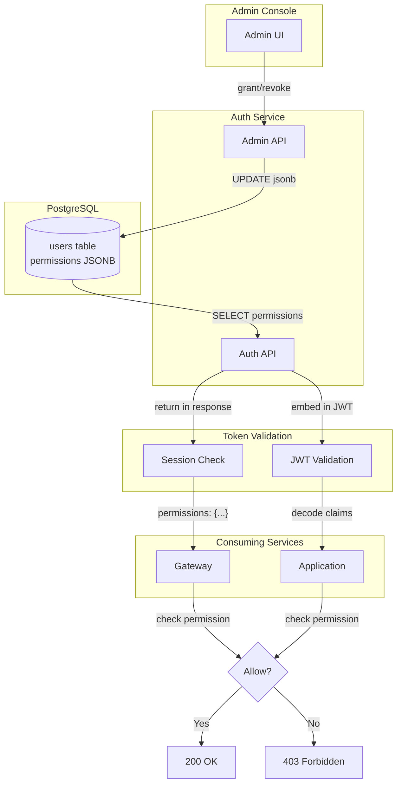
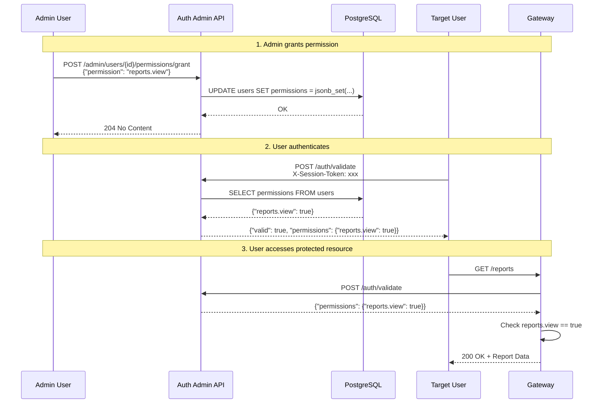
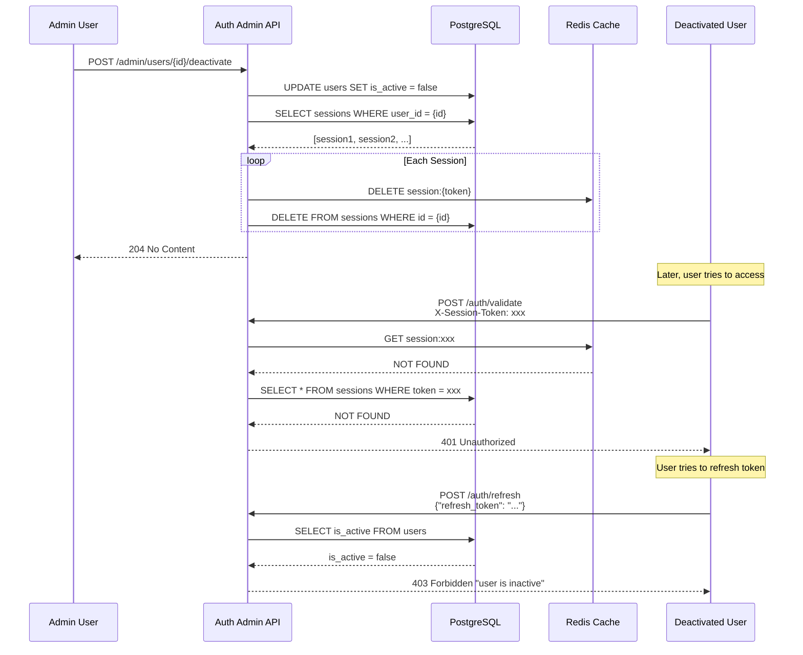
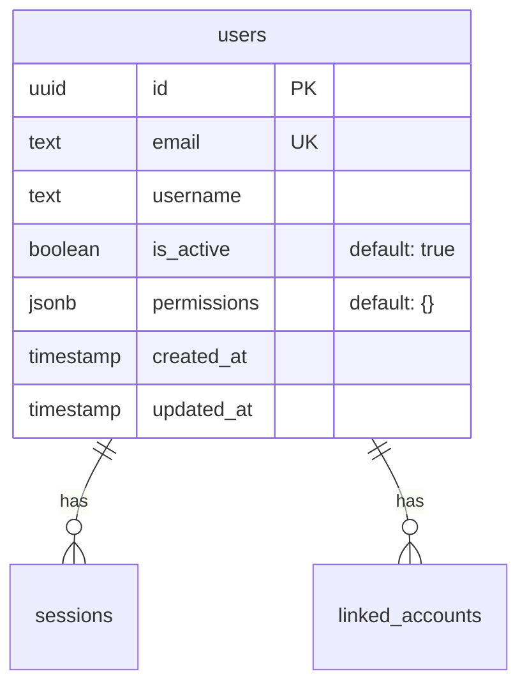
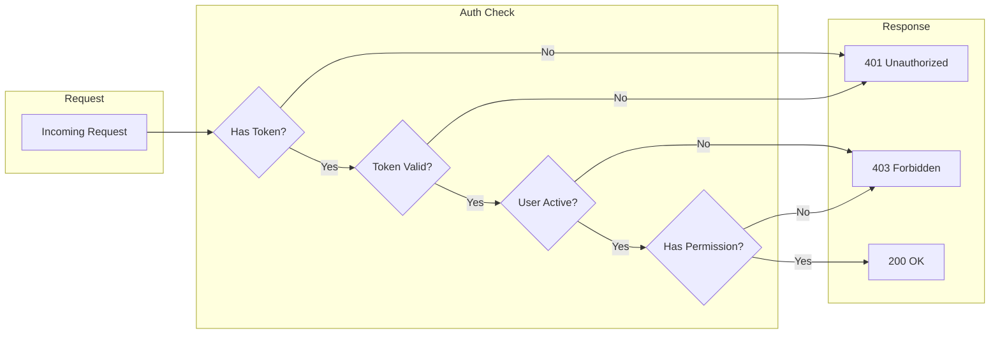
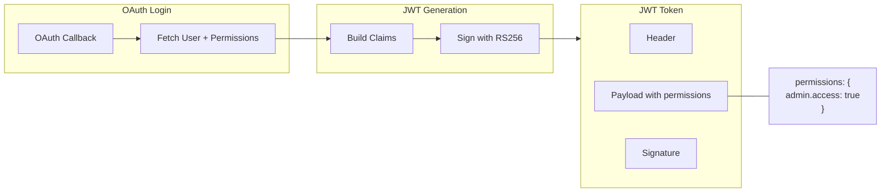
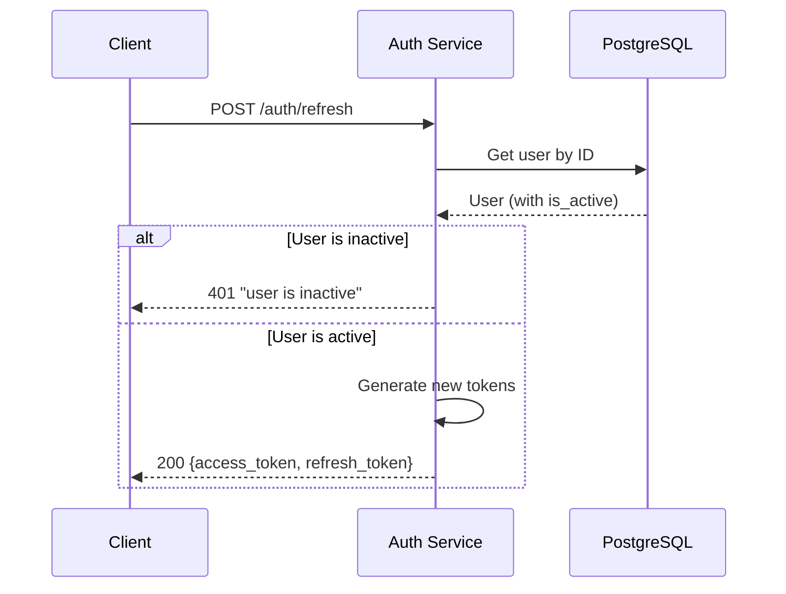
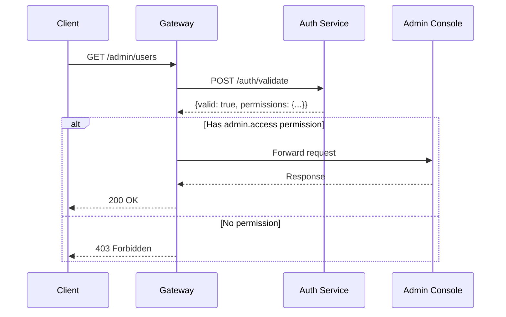

# Permissions & User Status

Role-based access control using a flexible permissions map stored as JSONB.

## How Permissions Flow



## Permission Lifecycle



## User Deactivation Flow



## Permission Storage



**JSONB Structure:**
```json
{
  "admin.access": true,
  "admin.users.read": true,
  "admin.users.write": true,
  "reports.view": true,
  "reports.export": true
}
```

## Permission Check Flow



## JWT with Permissions



**JWT Payload Example:**
```json
{
  "iss": "hellarch-auth",
  "sub": "550e8400-e29b-41d4-a716-446655440000",
  "exp": 1704067200,
  "uid": "550e8400-e29b-41d4-a716-446655440000",
  "email": "user@example.com",
  "username": "testuser",
  "permissions": "{\"admin.access\":true,\"reports.view\":true}"
}
```

## Data Model

### User Entity

```csharp
public class User
{
    public Guid Id { get; set; }
    public required string Email { get; set; }
    public required string Username { get; set; }
    public bool IsActive { get; set; } = true;
    public Dictionary<string, bool>? Permissions { get; set; }
    public DateTime CreatedAt { get; set; }
    public DateTime UpdatedAt { get; set; }
}
```

### Database Schema

```sql
-- Added via migration: AddUserPermissionsAndIsActive
ALTER TABLE users ADD COLUMN is_active boolean NOT NULL DEFAULT true;
ALTER TABLE users ADD COLUMN permissions jsonb DEFAULT '{}'::jsonb;
```

The permissions column uses PostgreSQL JSONB for flexible, queryable storage:

```json
{
  "admin.access": true,
  "users.read": true,
  "users.write": true,
  "reports.view": true
}
```

## Permission Format

Permissions use a dot-notation hierarchy:

| Permission | Description |
|------------|-------------|
| `admin.access` | Access to admin console |
| `admin.users.read` | View user list |
| `admin.users.write` | Modify users |
| `admin.sessions.revoke` | Revoke user sessions |
| `reports.view` | View reports |
| `reports.export` | Export reports |

Only `true` values are stored. Revoking removes the key entirely.

## Admin API

### Get User Permissions

```http
GET /auth/admin/users/{id}/permissions
```

Response:
```json
{
  "user_id": "550e8400-e29b-41d4-a716-446655440000",
  "permissions": {
    "admin.access": true,
    "users.read": true
  }
}
```

### Set All Permissions

Replace entire permissions map:

```http
PUT /auth/admin/users/{id}/permissions
Content-Type: application/json

{
  "permissions": {
    "admin.access": true,
    "users.read": true,
    "users.write": false
  }
}
```

### Grant Single Permission

```http
POST /auth/admin/users/{id}/permissions/grant
Content-Type: application/json

{
  "permission": "admin.users.write"
}
```

Response: `204 No Content`

### Revoke Single Permission

```http
POST /auth/admin/users/{id}/permissions/revoke
Content-Type: application/json

{
  "permission": "admin.users.write"
}
```

Response: `204 No Content`

## User Activation

### Deactivate User

```http
POST /auth/admin/users/{id}/deactivate
```

Response: `204 No Content`

**Side effects:**
- All active sessions are invalidated (deleted from DB + Redis)
- User cannot refresh tokens
- Session validation returns `403 Forbidden` with `user_inactive` error

### Activate User

```http
POST /auth/admin/users/{id}/activate
```

Response: `204 No Content`

## Auth Flow Integration

### Session Validation

`POST /auth/validate` returns permissions and active status:

```json
{
  "valid": true,
  "user_id": "550e8400-e29b-41d4-a716-446655440000",
  "email": "user@example.com",
  "username": "testuser",
  "is_active": true,
  "permissions": {
    "admin.access": true
  }
}
```

If user is inactive:
```json
{
  "valid": false,
  "error": "user_inactive"
}
```
Status: `403 Forbidden`

### JWT Token Claims

Permissions are embedded in JWT access tokens:

```json
{
  "iss": "hellarch-auth",
  "sub": "550e8400-e29b-41d4-a716-446655440000",
  "uid": "550e8400-e29b-41d4-a716-446655440000",
  "email": "user@example.com",
  "username": "testuser",
  "permissions": "{\"admin.access\":true}",
  "exp": 1704067200
}
```

### Token Refresh

`POST /auth/refresh` checks `is_active` before issuing new tokens:



## Database Operations

### PostgreSQL JSONB Functions

Permission operations use native JSONB functions:

```go
// Grant - add key with true value
`UPDATE users SET permissions = jsonb_set(
    COALESCE(permissions, '{}'::jsonb),
    $2,
    'true'::jsonb
), updated_at = NOW() WHERE id = $1`

// Revoke - remove key
`UPDATE users SET permissions = permissions - $2,
 updated_at = NOW() WHERE id = $1`
```

### Query Examples

```sql
-- Users with admin access
SELECT * FROM users
WHERE permissions->>'admin.access' = 'true';

-- Users with any permission starting with 'reports.'
SELECT * FROM users
WHERE permissions ?| array['reports.view', 'reports.export'];

-- Count users by permission
SELECT permissions->>'admin.access' as has_admin, COUNT(*)
FROM users
GROUP BY permissions->>'admin.access';
```

## Gateway Integration

The Gateway can use permissions for route authorization:



## Implementation Files

```
src/services/auth/
├── internal/
│   ├── handler/
│   │   ├── admin.go      # Permission endpoints
│   │   ├── auth.go       # Token generation with permissions
│   │   └── http.go       # Validate returns permissions
│   └── store/
│       └── postgres.go   # JSONB permission queries

libs/data_types/csharp/Auth/
└── User.cs               # Entity with Permissions field

src/schema/Schema/Migrations/Auth/
└── 20251228233227_AddUserPermissionsAndIsActive.cs
```
