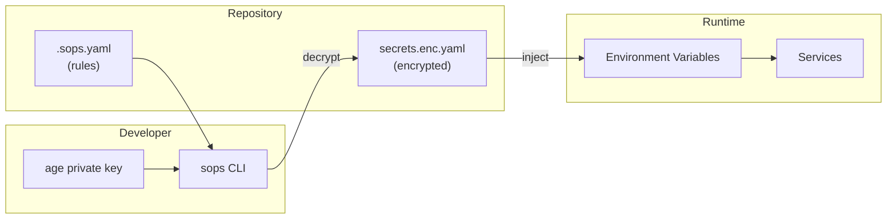
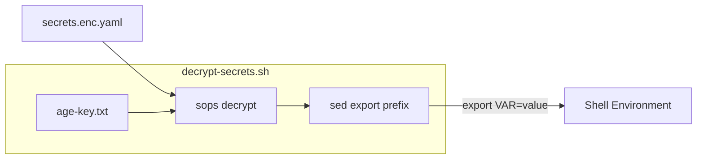
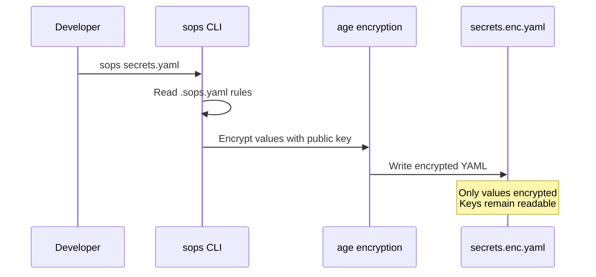
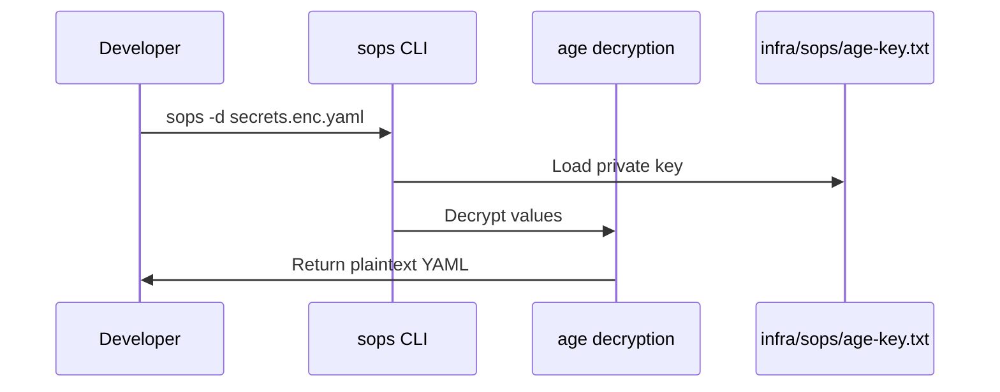
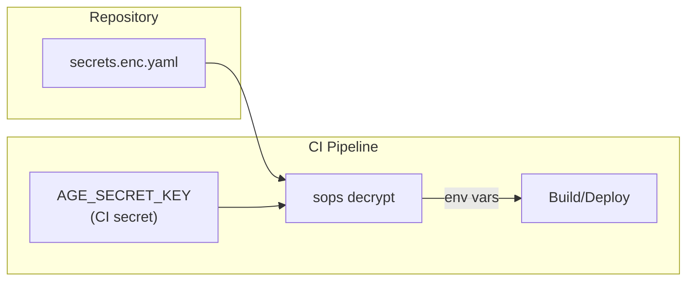

# Secrets Management

**SOPS + age**

HellArch uses [SOPS](https://github.com/getsecrets/sops) (Secrets OPerationS) with [age](https://age-encryption.org/) encryption to manage sensitive configuration.

## Architecture



## Configuration

SOPS rules are defined in `.sops.yaml`:

```yaml
creation_rules:
  - path_regex: \.secrets\..*$
    age: age1f9jcqmh4nmw0tjdrq0k92fe5xa6a76l5pdh8xw4et3teecdrg9mqsv5y8r
  - path_regex: secrets\.ya?ml$
    age: age1f9jcqmh4nmw0tjdrq0k92fe5xa6a76l5pdh8xw4et3teecdrg9mqsv5y8r
```

Files matching these patterns are automatically encrypted with the specified age public key.

## Managed Secrets

Encrypted secrets are stored in `infra/sops/secrets.enc.yaml`:

| Service | Environment Variable | Description |
|---------|---------------------|-------------|
| Discord OAuth | `DISCORD_CLIENT_ID` | OAuth application client ID |
| Discord OAuth | `DISCORD_CLIENT_SECRET` | OAuth application client secret |
| PostgreSQL | `DATABASE_PASSWORD` | Database connection password |
| RabbitMQ | `RABBITMQ_PASSWORD` | Message broker password |
| Redis | `REDIS_PASSWORD` | Cache connection password |

## Tools Setup

SOPS and age are managed via mise:

```toml
# .mise.toml
[tools]
sops = "latest"
age = "latest"
```

Install with:

```bash
mise install
```

## Local Development

### Quick Start

The setup script handles key generation and secret decryption:

```bash
./scripts/setup-dev.sh
```

This:
1. Generates `infra/sops/age-key.txt` if missing
2. Decrypts secrets to `.env.secrets`

### Load Secrets into Shell

Use the decrypt script to export secrets as environment variables:

```bash
# Option 1: eval
eval $(./scripts/decrypt-secrets.sh)

# Option 2: source
source <(./scripts/decrypt-secrets.sh)
```



### Decrypt to File

```bash
export SOPS_AGE_KEY_FILE=infra/sops/age-key.txt
sops decrypt --output-type dotenv infra/sops/secrets.enc.yaml > .env.secrets
```

## Manual Usage

### View Decrypted

```bash
export SOPS_AGE_KEY_FILE=infra/sops/age-key.txt
sops -d infra/sops/secrets.enc.yaml
```

### Edit Encrypted File

Opens in your editor, decrypts on load, re-encrypts on save:

```bash
export SOPS_AGE_KEY_FILE=infra/sops/age-key.txt
sops infra/sops/secrets.enc.yaml
```

### Encrypt a New File

Create a plaintext YAML file matching the path regex, then:

```bash
sops -e secrets.yaml > secrets.enc.yaml
```

### Extract Single Value

```bash
export SOPS_AGE_KEY_FILE=infra/sops/age-key.txt
sops -d --extract '["DISCORD_CLIENT_ID"]' infra/sops/secrets.enc.yaml
```

## Encryption Flow



## Decryption Flow



## Key Management

### Generate New Key

```bash
age-keygen -o key.txt
```

Output:

```
# created: 2025-12-28T16:47:29Z
# public key: age1f9jcqmh4nmw0tjdrq0k92fe5xa6a76l5pdh8xw4et3teecdrg9mqsv5y8r
AGE-SECRET-KEY-1...
```

### Key Location

For HellArch, the age private key is stored at `infra/sops/age-key.txt`.

SOPS looks for age keys in order:

1. `SOPS_AGE_KEY` environment variable (key contents)
2. `SOPS_AGE_KEY_FILE` environment variable (path to key file)
3. `~/.config/sops/age/keys.txt` (default)

The decrypt script sets `SOPS_AGE_KEY_FILE` automatically.

### Add Team Member

1. Get their age public key
2. Add to `.sops.yaml`:
   ```yaml
   creation_rules:
     - path_regex: secrets\.ya?ml$
       age: >-
         age1f9jcqmh4nmw0tjdrq0k92fe5xa6a76l5pdh8xw4et3teecdrg9mqsv5y8r,
         age1newteammemberpublickey...
   ```
3. Re-encrypt existing files:
   ```bash
   sops updatekeys infra/sops/secrets.enc.yaml
   ```

## CI/CD Integration



Store the age private key as a CI secret, then decrypt at runtime:

```bash
export SOPS_AGE_KEY="$AGE_SECRET_KEY"
sops -d infra/sops/secrets.enc.yaml > .env
```

## File Structure

```
hellArch/
├── .sops.yaml                    # Encryption rules
├── .mise.toml                    # Tool versions (sops, age)
├── .env.secrets                  # Decrypted secrets (gitignored)
├── scripts/
│   ├── setup-dev.sh              # Initial setup (generates key)
│   └── decrypt-secrets.sh        # Export secrets to shell
└── infra/
    └── sops/
        ├── age-key.txt           # Private key (gitignored)
        └── secrets.enc.yaml      # Encrypted secrets
```

## Security Notes

- Never commit plaintext secrets or private keys
- The age public key in `.sops.yaml` is safe to commit
- Encrypted files can be safely committed to git
- Only users with the corresponding private key can decrypt
- Rotate secrets if a private key is compromised
- `age-key.txt` and `.env.secrets` should be in `.gitignore`
