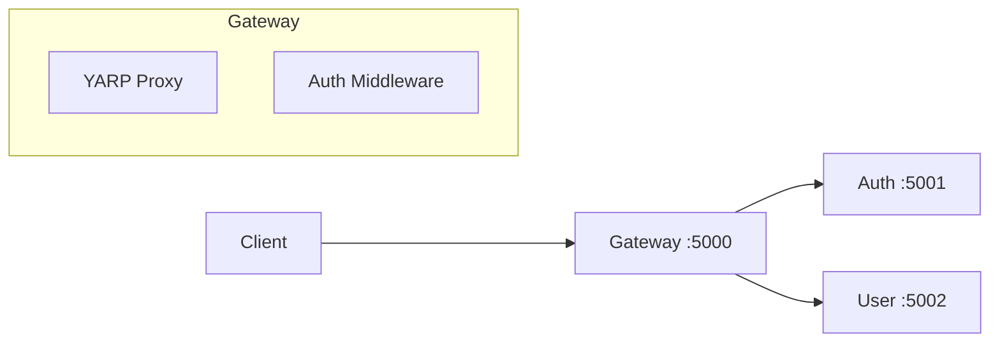
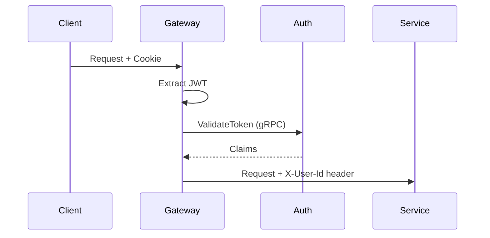

# Gateway Service

**.NET 10 / C# / YARP**

The Gateway is the single entry point for all client requests.

## Architecture



## Responsibilities

1. **Request Routing** - Routes `/api/auth/*` and `/api/user/*` to respective services
2. **Cookie-to-JWT Transform** - Extracts JWT from cookies, adds to request headers
3. **CORS Handling** - Manages cross-origin requests

## Route Configuration

From `appsettings.json`:

```json
{
  "ReverseProxy": {
    "Routes": {
      "auth-route": {
        "ClusterId": "auth-cluster",
        "Match": { "Path": "/api/auth/{**catch-all}" }
      },
      "user-route": {
        "ClusterId": "user-cluster",
        "Match": { "Path": "/api/user/{**catch-all}" }
      }
    },
    "Clusters": {
      "auth-cluster": {
        "Destinations": {
          "auth": { "Address": "http://localhost:5001" }
        }
      },
      "user-cluster": {
        "Destinations": {
          "user": { "Address": "http://localhost:5002" }
        }
      }
    }
  }
}
```

## Auth Middleware

The middleware intercepts requests and:
1. Reads `auth_token` cookie
2. Validates JWT with Auth service (gRPC)
3. Adds user claims to request headers



## Location

`src/gateway/Gateway/`
