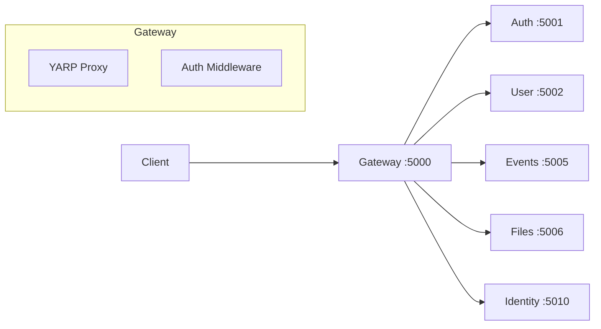
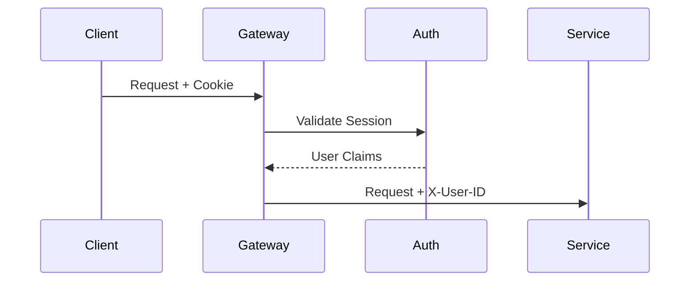
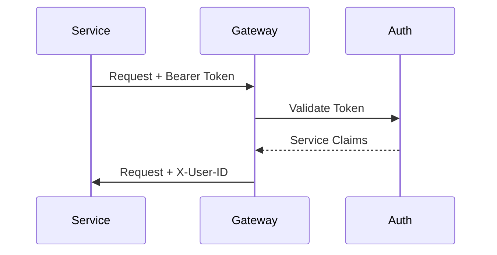

# Gateway Service

**.NET 10 / C# / YARP**

The Gateway is the single entry point for all client requests.

## Architecture



## Responsibilities

1. **Request Routing** - Routes API requests to respective services
2. **Authentication** - Validates session cookies and Bearer tokens, adds user context headers
3. **CORS Handling** - Manages cross-origin requests
4. **Static File Serving** - Serves Vue SPA clients (App, Identity)
5. **Rate Limiting** - Per-IP rate limiting with stricter limits for auth endpoints

## Route Configuration

Routes are configured in `appsettings.json`. Each route has optional path transforms.

| Route | Path | Destination | Transform |
|-------|------|-------------|-----------|
| auth-route | `/api/auth/**` | Auth :5001 | Strip `/api` |
| user-route | `/api/user/**` | User :5002 | Strip `/api` |
| events-route | `/api/events/**` | Events :5005 | Strip `/api/events` |
| files-route | `/api/files/**` | Files :5006 | None |
| identity-api-route | `/api/identity/**` | Identity :5010 | Strip `/api` |

Example configuration:

```json
{
  "ReverseProxy": {
    "Routes": {
      "auth-route": {
        "ClusterId": "auth-cluster",
        "Match": { "Path": "/api/auth/{**catch-all}" },
        "Transforms": [{ "PathRemovePrefix": "/api" }]
      },
      "events-route": {
        "ClusterId": "events-cluster",
        "Match": { "Path": "/api/events/{**catch-all}" },
        "Transforms": [{ "PathRemovePrefix": "/api/events" }]
      }
    }
  }
}
```

## Auth Middleware

The middleware validates authentication and adds user context headers for downstream services.

### Authentication Methods

| Method | Use Case | Header/Cookie |
|--------|----------|---------------|
| Session Cookie | Browser clients | `hellarch_session` cookie |
| Bearer Token | Service-to-service | `Authorization: Bearer {token}` |

### Flow

1. Check if path is bypassed (public endpoints like `/api/auth/providers`)
2. Try session cookie validation
3. If no session, try Bearer token validation
4. Add user context headers if authenticated
5. Check route permissions if required

### User Context Headers

Set for downstream services when authenticated:

| Header | Description |
|--------|-------------|
| `X-User-ID` | User or service identifier (e.g., `user:uuid` or `service:testing-service`) |
| `X-Username` | Username if available |
| `X-Permissions` | JSON object of permissions |

### Sequence Diagrams

**Browser Client (Session Cookie):**


**Service Client (Bearer Token):**


### Bypass Paths

These paths skip authentication middleware (handled by the service itself):

- `/api/auth/login`, `/api/auth/logout`, `/api/auth/refresh`
- `/api/auth/validate`, `/api/auth/token`, `/api/auth/providers`
- `/api/auth/{provider}` - OAuth provider routes
- `/health` - Health checks
- `/app/login`, `/app/register` - Public pages

## Location

`src/gateway/Gateway/`
