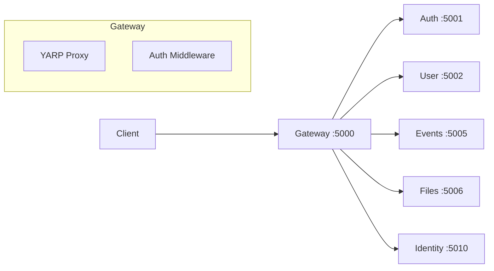
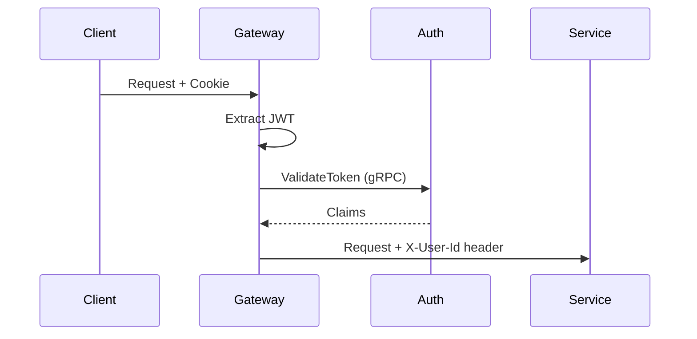

# Gateway Service

**.NET 10 / C# / YARP**

The Gateway is the single entry point for all client requests.

## Architecture



## Responsibilities

1. **Request Routing** - Routes API requests to respective services
2. **Cookie-to-JWT Transform** - Extracts JWT from cookies, adds to request headers
3. **CORS Handling** - Manages cross-origin requests
4. **Static File Serving** - Serves Vue SPA clients (Admin, Identity)

## Route Configuration

Routes are configured in `appsettings.json`. Each route has optional path transforms.

| Route | Path | Destination | Transform |
|-------|------|-------------|-----------|
| auth-route | `/api/auth/**` | Auth :5001 | Strip `/api` |
| user-route | `/api/user/**` | User :5002 | Strip `/api` |
| events-route | `/api/events/**` | Events :5005 | Strip `/api/events` |
| files-route | `/api/files/**` | Files :5006 | None |
| identity-api-route | `/api/identity/**` | Identity :5010 | Strip `/api` |

Example configuration:

```json
{
  "ReverseProxy": {
    "Routes": {
      "auth-route": {
        "ClusterId": "auth-cluster",
        "Match": { "Path": "/api/auth/{**catch-all}" },
        "Transforms": [{ "PathRemovePrefix": "/api" }]
      },
      "events-route": {
        "ClusterId": "events-cluster",
        "Match": { "Path": "/api/events/{**catch-all}" },
        "Transforms": [{ "PathRemovePrefix": "/api/events" }]
      }
    }
  }
}
```

## Auth Middleware

The middleware intercepts requests and:
1. Reads `auth_token` cookie
2. Validates JWT with Auth service (gRPC)
3. Adds user claims to request headers



## Location

`src/gateway/Gateway/`
