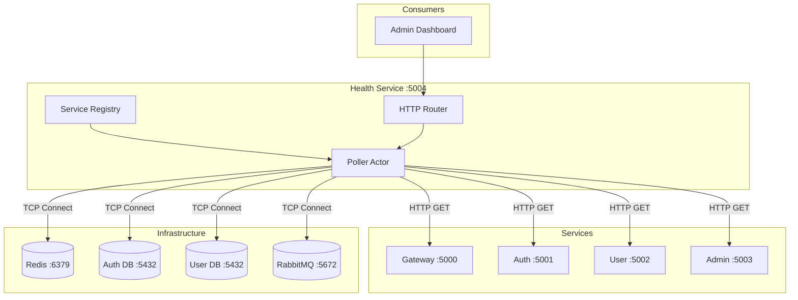
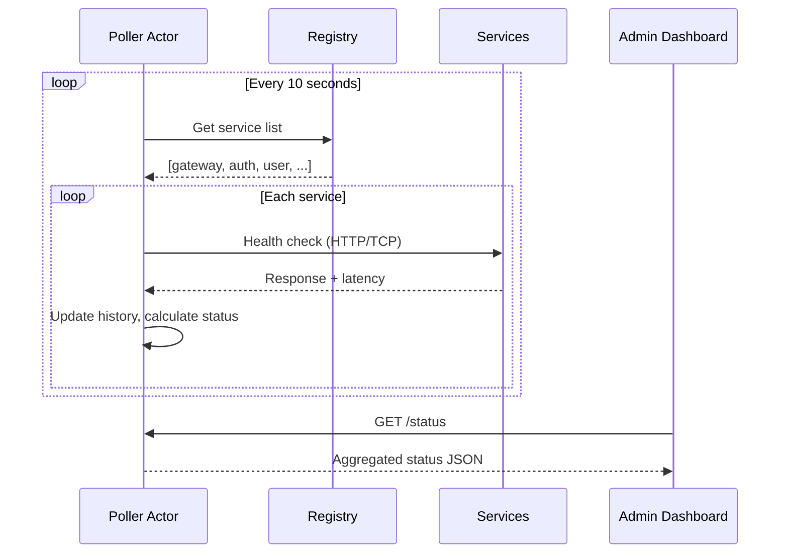
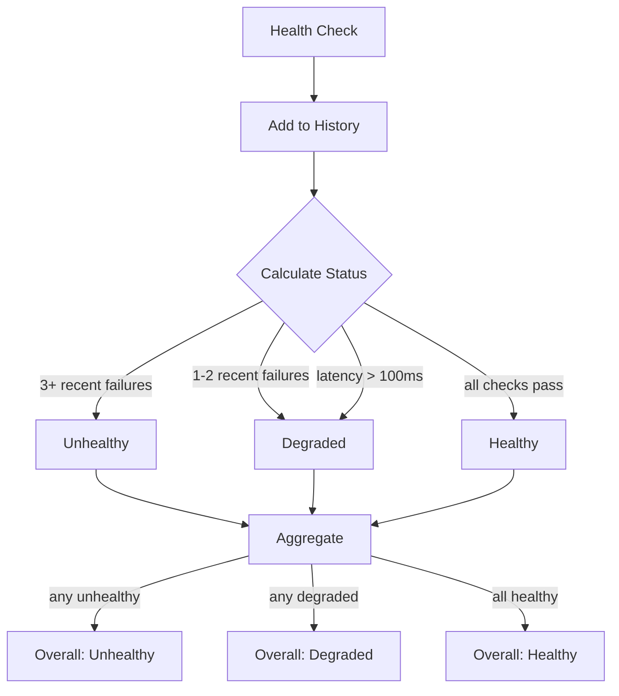
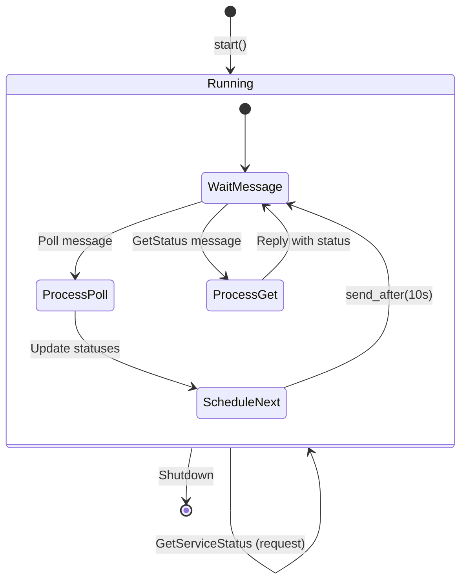

# Health Service

**Gleam (Erlang/OTP)**

Aggregates health status from all services and infrastructure components.

## Overview

| Property | Value |
|----------|-------|
| **Port** | 5004 |
| **Tech** | Gleam 1.14 (Erlang target) |
| **Location** | `src/services/health/` |

## Architecture



## How It Works



## Status Calculation



## Monitored Services

| Service | Check Type | Endpoint | Critical |
|---------|------------|----------|----------|
| gateway | HTTP GET | `/health` | Yes |
| auth | HTTP GET | `/auth/health` | Yes |
| user | HTTP GET | `/user/health` | Yes |
| admin | HTTP GET | `/health` | No |
| redis | TCP Connect | `:6379` | Yes |
| auth-db | TCP Connect | `:5432` | Yes |
| user-db | TCP Connect | `:5432` | Yes |
| rabbitmq | TCP Connect | `:5672` | Yes |

## API Endpoints

### Health Check

```http
GET /health
```

Simple health check for the health service itself.

**Response:**
```json
{
  "status": "healthy"
}
```

### Aggregated Status

```http
GET /status
```

Returns status of all monitored services.

**Response:**
```json
{
  "overall": "healthy",
  "checked_at": "2024-01-15T10:30:00Z",
  "services": {
    "gateway": {
      "status": "healthy",
      "latency_ms": 5,
      "last_check": "2024-01-15T10:30:00Z",
      "error": null
    },
    "auth": {
      "status": "healthy",
      "latency_ms": 12,
      "last_check": "2024-01-15T10:30:00Z",
      "error": null
    },
    "redis": {
      "status": "healthy",
      "latency_ms": 1,
      "last_check": "2024-01-15T10:30:00Z",
      "error": null
    }
  }
}
```

### Individual Service Status

```http
GET /status/{name}
```

Returns detailed status for a single service with history.

**Response:**
```json
{
  "name": "auth",
  "status": "healthy",
  "latency_ms": 12,
  "last_check": "2024-01-15T10:30:00Z",
  "error": null,
  "history": [
    {
      "status": "healthy",
      "latency_ms": 12,
      "checked_at": "2024-01-15T10:30:00Z",
      "error": null
    },
    {
      "status": "healthy",
      "latency_ms": 15,
      "checked_at": "2024-01-15T10:29:50Z",
      "error": null
    }
  ]
}
```

## Configuration

| Constant | Default | Description |
|----------|---------|-------------|
| `default_port` | 5004 | HTTP listen port |
| `default_poll_interval_ms` | 10,000 | Poll interval (10s) |
| `degraded_latency_threshold_ms` | 100 | Latency threshold for degraded |
| `unhealthy_failure_threshold` | 3 | Consecutive failures for unhealthy |
| `history_depth` | 10 | Health check history size |
| `check_timeout_ms` | 5,000 | Timeout per health check |

## Environment Variables

| Variable | Default | Description |
|----------|---------|-------------|
| `PORT` | `5004` | HTTP listen port |
| `POLL_INTERVAL_MS` | `10000` | Poll interval in milliseconds |

## Code Structure

```
src/services/health/
├── gleam.toml           # Dependencies (mist, gleam_json, birl)
├── manifest.toml        # Lock file
├── Dockerfile           # Multi-stage build
└── src/
    ├── health.gleam     # Entry point
    └── health/
        ├── config.gleam      # Configuration constants
        ├── types.gleam       # Type definitions
        ├── registry.gleam    # Service registry
        ├── poller.gleam      # OTP actor for polling
        ├── router.gleam      # HTTP request handler
        └── http_client.gleam # HTTP/TCP client
```

## OTP Actor Model

The poller uses Gleam's OTP actor pattern:



## Dependencies

| Package | Purpose |
|---------|---------|
| mist | HTTP server |
| gleam_http | HTTP types |
| gleam_json | JSON encoding |
| birl | Time/date handling |
| envoy | Environment variables |
| gleam_otp | Actor model |
| gleam_erlang | Erlang interop |

## Admin Console Integration

The Admin Console displays health status on the Dashboard via `HealthAdapter`:

```csharp
public class HealthAdapter(IHttpClientFactory httpClientFactory)
{
    public async Task<AggregatedStatus?> GetStatus()
    {
        var response = await _client.GetAsync("status");
        return JsonSerializer.Deserialize<AggregatedStatus>(json);
    }
}
```

## Docker Build

Two-stage build with Erlang runtime:

```dockerfile
# Build
FROM ghcr.io/gleam-lang/gleam:v1.14.0-erlang-alpine AS builder
RUN gleam export erlang-shipment

# Runtime
FROM erlang:27-alpine
COPY --from=builder /app/build/erlang-shipment ./
```

## Adding a New Service

1. Add to `registry.gleam`:

```gleam
Service(
  name: "my-service",
  url: "http://my-service:8080",
  check_type: HttpGet("/health"),
  critical: True,
)
```

2. Rebuild and deploy - the poller will automatically start monitoring it.
