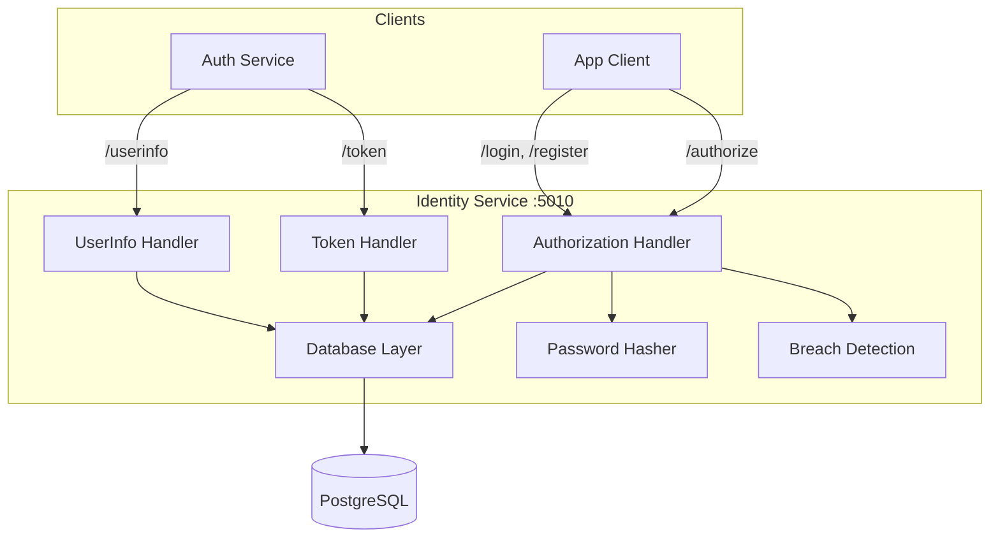
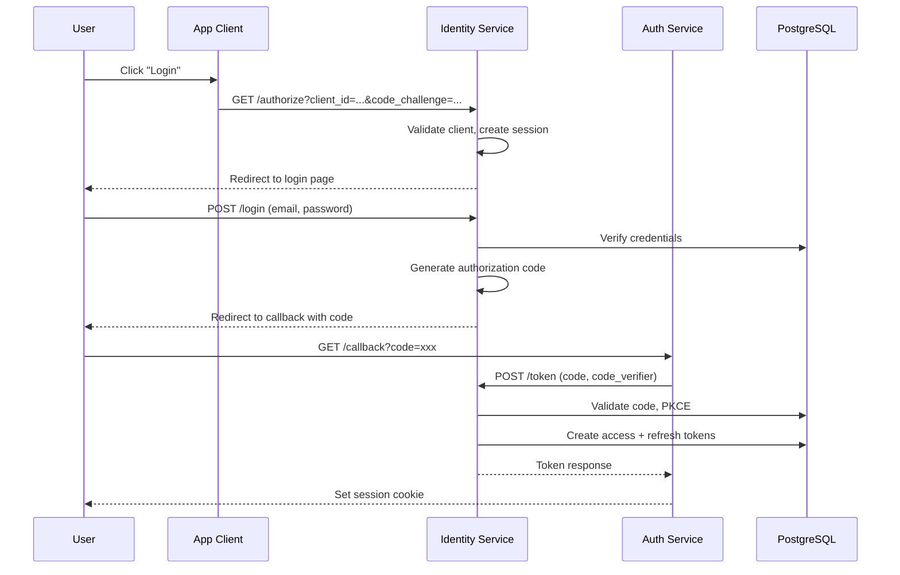
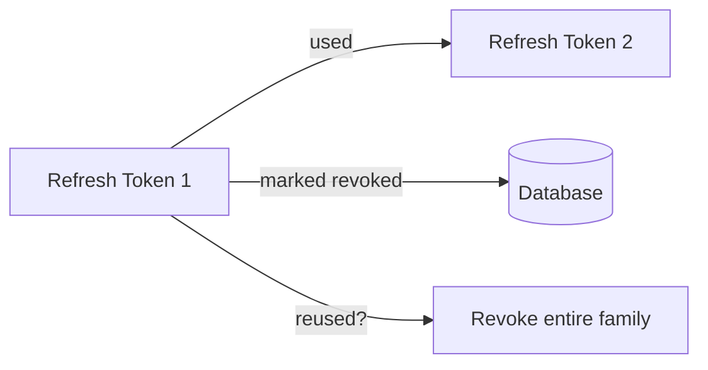
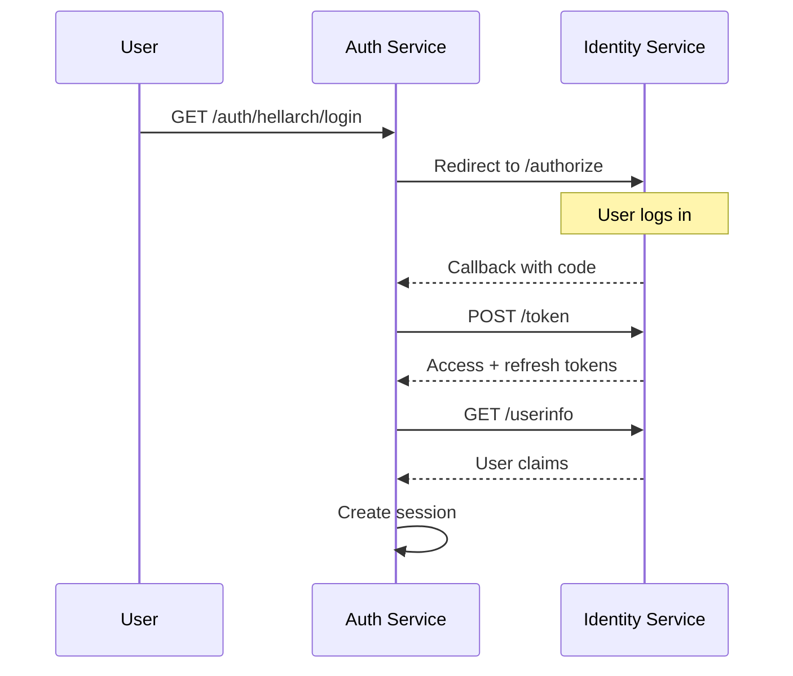

# Identity Service

**F# (.NET 10)**

OAuth 2.0 authorization server with user registration and authentication.

## Overview

| Property | Value |
|----------|-------|
| **Port** | 5010 |
| **Tech** | F# / ASP.NET Core 10 |
| **Location** | `src/services/identity/` |

## Architecture



## OAuth 2.0 Flow



## API Reference

See [Identity API](/api/identity) for complete endpoint documentation.

::: tip Gateway Routing
Clients access these endpoints via the Gateway at `/api/identity/...`. The Gateway strips the `/api` prefix before forwarding.
:::

**Key endpoints:**
- `GET /api/identity/authorize` - Start OAuth authorization flow
- `POST /api/identity/login` - Authenticate user
- `POST /api/identity/register` - Register new user
- `POST /api/identity/token` - Exchange code/refresh for tokens
- `POST /api/identity/revoke` - Revoke tokens
- `GET /api/identity/userinfo` - Get user info (OIDC)

## Security Features

### Password Security

- **Argon2id** hashing (memory-hard, resistant to GPU/ASIC attacks)
- Salt: 16 bytes, Hash: 32 bytes
- Memory: 64 MB, Iterations: 3, Parallelism: 4
- Constant-time comparison prevents timing attacks

### PKCE Support

Proof Key for Code Exchange (RFC 7636) prevents authorization code interception:

- Only S256 (SHA-256) method supported
- Code verifier validated during token exchange
- Required for all authorization flows

### Token Security

- Tokens stored as SHA-256 hashes (raw tokens never persisted)
- Client fingerprint binding (IP + User-Agent hash)
- Stolen tokens from different client rejected

### Token Rotation



- Refresh tokens marked revoked after use (not deleted)
- Family tracking: reuse detection revokes all tokens in family
- Prevents refresh token theft going unnoticed

### Breach Detection

Integrates with Have I Been Pwned API:

- k-Anonymity: only 5-char SHA-1 prefix sent to API
- Non-blocking: API failures don't prevent registration
- Warns users if password found in breaches

## Token Lifetimes

| Token Type | Lifetime |
|------------|----------|
| Authorization Code | 5 minutes |
| Access Token | 1 hour |
| Refresh Token | 30 days |

## Environment Variables

| Variable | Default | Description |
|----------|---------|-------------|
| `HTTP_PORT` | `5010` | HTTP listen port |
| `IDENTITY_DATABASE_URL` | - | PostgreSQL connection string |
| `IDENTITY_CLIENT_URL` | `http://localhost:5000/identity` | Frontend login/register page URL |
| `IDENTITY_ALLOWED_ORIGINS` | `http://localhost:5000,http://localhost:3000` | CORS allowed origins |
| `IDENTITY_SEED_CLIENT_ID` | - | OAuth client ID to seed on startup |
| `IDENTITY_SEED_CLIENT_SECRET` | - | OAuth client secret to seed |
| `IDENTITY_SEED_REDIRECT_URIS` | - | Comma-separated redirect URIs |
| `OTEL_EXPORTER_OTLP_ENDPOINT` | - | OpenTelemetry collector endpoint |

## Database Schema

See [Identity Database](/guide/database#identity-database) for full schema.

**Tables:** `identity_users`, `oauth_clients`, `authorization_codes`, `access_tokens`, `refresh_tokens`

## Code Structure

```
src/services/identity/
├── Dockerfile
└── Identity/
    ├── Identity.fsproj
    ├── Program.fs              # Entry point, DI setup
    ├── Api/
    │   ├── AuthHandlers.fs     # /authorize, /login, /register
    │   ├── TokenHandlers.fs    # /token, /revoke
    │   ├── ResourceHandlers.fs # /userinfo
    │   ├── HealthHandlers.fs   # /health
    │   ├── Config.fs           # Configuration types
    │   ├── HttpUtils.fs        # Error handling
    │   └── Views.fs            # URL builders
    ├── Domain/
    │   ├── Types.fs            # Domain models, errors
    │   └── Validation.fs       # Input validation
    └── Infrastructure/
        ├── Database.fs         # PostgreSQL operations
        ├── PasswordHasher.fs   # Argon2id hashing
        ├── TokenGenerator.fs   # Secure token generation
        └── BreachDetection.fs  # HIBP integration
```

## Integration with Auth Service

The Auth service uses Identity as its OAuth provider for the "hellarch" provider:



## Client Seeding

On startup, if `IDENTITY_SEED_CLIENT_ID` and `IDENTITY_SEED_CLIENT_SECRET` are set, the service creates an OAuth client automatically. This is idempotent - existing clients are not modified.

```bash
IDENTITY_SEED_CLIENT_ID=hellarch
IDENTITY_SEED_CLIENT_SECRET=secret
IDENTITY_SEED_REDIRECT_URIS=http://localhost:5000/api/auth/hellarch/callback
```

## Dependencies

| Package | Purpose |
|---------|---------|
| Npgsql.FSharp | PostgreSQL access |
| Konscious.Security.Cryptography.Argon2 | Password hashing |
| OpenTelemetry.* | Distributed tracing |
| HellArch.HttpUtil | Shared HTTP utilities |
| HellArch.DataTypes | Shared type definitions |
