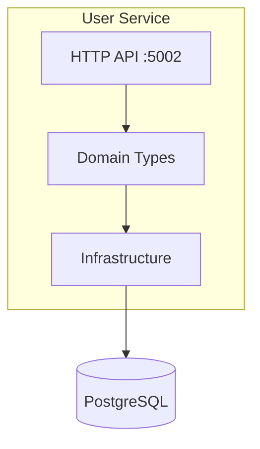
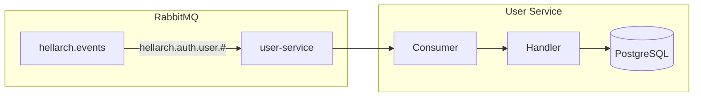
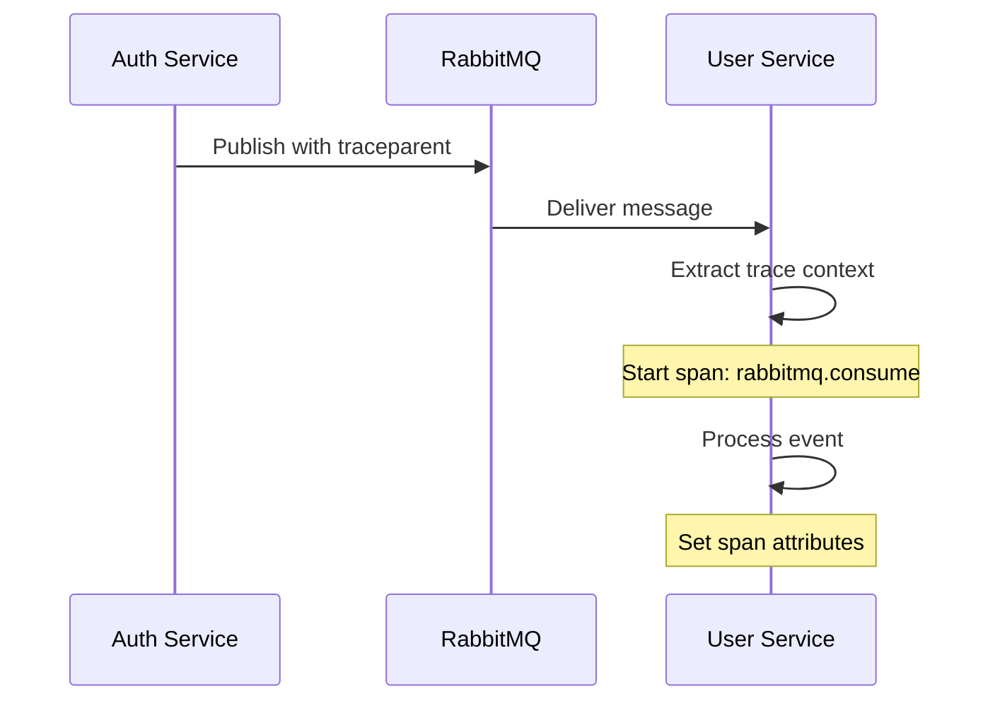

# User Service

**F# (.NET 10)**

Manages user profiles and preferences using functional patterns.

## Overview

| Property | Value |
|----------|-------|
| **Port** | 5002 |
| **Tech** | F# / ASP.NET Core 10 |
| **Database** | `user_db` (port 5433) |
| **Location** | `src/services/user/` |

## Architecture



## Domain Model

```fsharp
type UserProfile = {
    Id: Guid
    Email: string
    DisplayName: string option
    AvatarUrl: string option
    CreatedAt: DateTime
    UpdatedAt: DateTime
}

type Preferences = {
    UserId: Guid
    Theme: Theme        // Light | Dark | System
    Locale: string
    NotificationsEnabled: bool
}

type LinkedAccount = {
    UserId: Guid
    Provider: OAuthProvider
    ProviderUserId: string
    LinkedAt: DateTime
}
```

## Endpoints

::: tip Gateway Routing
Clients access these endpoints via the Gateway at `/api/user/...`. The Gateway strips the `/api` prefix before forwarding.
:::

| Method | Path | Description |
|--------|------|-------------|
| GET | `/user/health` | Health check (includes DB status) |
| GET | `/user/me` | Get current user profile |
| PUT | `/user/me` | Update current user profile |
| GET | `/user/{id}` | Get user profile |
| POST | `/user` | Create profile |
| PUT | `/user/{id}` | Update profile |
| GET | `/user/{id}/preferences` | Get preferences |
| PUT | `/user/{id}/preferences` | Update preferences |

## Event Consuming

Consumes CloudEvents from RabbitMQ to react to auth state changes.



### Consumed Events

| Event | Action |
|-------|--------|
| `hellarch.auth.user.created.v1` | Create UserProfile |

### Idempotency

Consumer checks for existing profile before creating:

```fsharp
match existingProfile with
| Ok(Some _) -> () // Skip
| Ok None -> Database.createProfile dbConfig request
```

### OpenTelemetry Tracing

Consumer propagates trace context from RabbitMQ headers:



```fsharp
let private activitySource = new ActivitySource("hellarch/user/events")

// Extract trace context from headers
let parentContext = extractTraceContext headers

// Start span with parent context
use activity =
    activitySource.StartActivity(
        "rabbitmq.consume",
        ActivityKind.Consumer,
        parentContext.ActivityContext
    )

// Set semantic convention tags
activity.SetTag("messaging.system", "rabbitmq")
activity.SetTag("messaging.destination.name", "hellarch.events")
activity.SetTag("messaging.cloudevents.type", eventType)
```

## Code Structure

```
src/services/user/
├── Dockerfile
└── User/
    ├── Program.fs               # Entry point
    ├── User.fsproj
    ├── Domain/
    │   ├── Types.fs             # Domain types
    │   └── Mapping.fs           # DTO to domain mapping
    ├── Infrastructure/
    │   ├── Database.fs          # Npgsql.FSharp access
    │   └── Events.fs            # RabbitMQ consumer
    └── Api/
        ├── HealthHandlers.fs    # Health check handler
        ├── HttpUtils.fs         # HTTP utilities
        ├── ProfileHandlers.fs   # User profile handlers
        └── PreferencesHandlers.fs # User preferences handlers
```

## Database

Uses dedicated PostgreSQL instance on port 5433.

## Environment Variables

| Variable | Required | Default | Description |
|----------|----------|---------|-------------|
| `USER_DATABASE_URL` | Yes | - | PostgreSQL connection string |
| `RABBITMQ_URL` | Yes | - | RabbitMQ AMQP URL |
| `OTEL_EXPORTER_OTLP_ENDPOINT` | No | `http://localhost:4318` | OpenTelemetry endpoint |
| `OTEL_SERVICE_NAME` | No | `user` | Service name for tracing |
| `LOG_LEVEL` | No | `debug` | Logging level (debug, info, warn, error) |

The RabbitMQ queue name is hardcoded as `user-service`.
