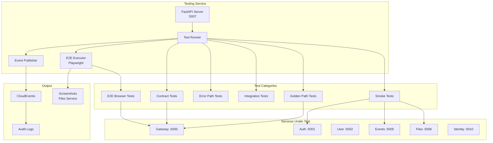
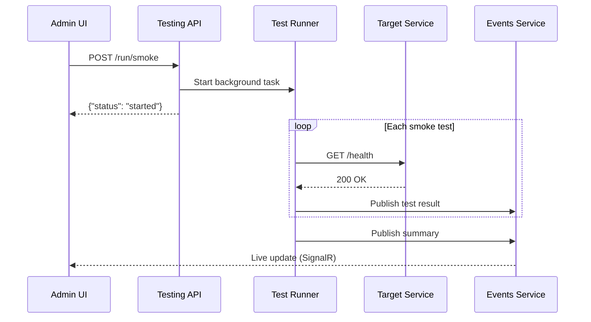

# Testing

## Philosophy

Tests exist to catch bugs before they ship. Every test should justify its existence by protecting against real failures.

### No "true = true" Tests

Don't write tests that just verify constants or trivial mappings:

```go
// Bad - this catches nothing
func TestConfigDefault(t *testing.T) {
    cfg := DefaultConfig()
    if cfg.Timeout != 30 {
        t.Error("expected 30")
    }
}

// Good - this catches real logic bugs
func TestCooldownPreventsRapidRestarts(t *testing.T) {
    h := NewHandler(cfg)
    h.HandleUnhealthy(ctx, event)  // First restart
    h.HandleUnhealthy(ctx, event)  // Should be blocked
    if restartCount != 1 {
        t.Error("cooldown should prevent second restart")
    }
}
```

### Test Logic That Breaks

Focus on code paths where bugs actually hide:

| Worth Testing | Not Worth Testing |
|--------------|-------------------|
| Validation logic (regex, bounds) | String constants |
| State machines (cooldowns, retries) | Simple getters |
| Security checks (auth, permissions) | Configuration defaults |
| Type coercion (parsing headers) | Direct field access |
| Business rules (thresholds, limits) | Constructor assignment |

### Tests Should Find Dev Errors Early

Good tests catch mistakes during development, not just verify existing behavior:

- **Regex validation** - catches invalid patterns before they reject good input or accept bad
- **Time-based logic** - catches race conditions and off-by-one errors in cooldowns/windows
- **Security boundaries** - catches permission bypasses before they ship
- **Protocol handling** - catches type mismatches when external systems send unexpected formats

### Keep Tests Focused

Each test should verify one behavior. If a test name needs "and" in it, split it:

```go
// Bad - tests two things
func TestValidatesInputAndSavesToDatabase(t *testing.T) { ... }

// Good - separate concerns
func TestRejectsInvalidInput(t *testing.T) { ... }
func TestPersistsValidInput(t *testing.T) { ... }
```

---

## Integration Testing Service

Centralized test orchestration service with scheduled execution, API-triggered runs, and browser automation via Playwright.

## Architecture



## Test Categories

| Category | Purpose | Schedule |
|----------|---------|----------|
| **Smoke** | Health checks for all services | 30s |
| **Contract** | API response schema validation | 5m |
| **Errors** | Error handling and edge cases | 5m |
| **Integration** | Cross-service communication | 2m |
| **Golden** | Critical business flows | 5m |
| **E2E** | Browser-based UI testing | 15m |

## Stack

| Tool | Purpose |
|------|---------|
| FastAPI | HTTP API server |
| Playwright | Browser automation for E2E |
| httpx | Async HTTP client |
| structlog | Structured logging |
| Pydantic | Configuration and models |

## Configuration

Tests are defined in `infra/config/tests.json`:

```json
{
  "services": {
    "gateway": "http://gateway:5000",
    "auth": "http://auth:5001",
    "events": "http://events:5005"
  },
  "schedules": {
    "smoke": "30s",
    "contract": "5m",
    "e2e": "15m"
  },
  "tests": {
    "smoke": [...],
    "contract": [...],
    "errors": [...],
    "integration": [...],
    "golden": [...],
    "e2e": [...]
  }
}
```

## Running Tests

### Via Admin UI

Navigate to **Tests** page (`/tests`) in the Admin console:
- Click individual category buttons (Smoke, Contract, etc.)
- Click **All** to run all test categories
- View results in real-time via live updates

### Via API

```bash
# Trigger specific category
curl -X POST http://localhost:5007/run/smoke
curl -X POST http://localhost:5007/run/contract
curl -X POST http://localhost:5007/run/errors
curl -X POST http://localhost:5007/run/integration
curl -X POST http://localhost:5007/run/golden
curl -X POST http://localhost:5007/run/e2e

# Trigger all tests
curl -X POST http://localhost:5007/run/all

# Check service status
curl http://localhost:5007/status
```

### Response Format

```json
{
  "status": "started",
  "category": "smoke",
  "message": "Smoke tests started"
}
```

## Test Types

### Smoke Tests

Simple health checks for each service:

```json
{
  "name": "auth_health",
  "description": "Auth service health check",
  "target": "auth"
}
```

### Contract Tests

Validate API responses match expected schemas:

```json
{
  "name": "auth_health_schema",
  "description": "Auth health response matches schema",
  "endpoint": "/api/auth/health",
  "method": "GET",
  "expected_status": [200],
  "schema_name": "health"
}
```

### Error Tests

Verify proper error handling:

```json
{
  "name": "auth_malformed_bearer",
  "description": "Malformed bearer token returns 401",
  "endpoint": "/api/auth/validate",
  "method": "POST",
  "headers": {"Authorization": "Bearer not.a.valid.jwt"},
  "expected_status": [401]
}
```

### Integration Tests

Cross-service communication:

```json
{
  "name": "gateway_auth_validation",
  "description": "Gateway validates tokens with auth service",
  "targets": ["gateway", "auth"]
}
```

### Golden Path Tests

Critical business flows with multiple steps:

```json
{
  "name": "auth_flow",
  "description": "Complete authentication flow through gateway",
  "critical": true,
  "steps": [
    "obtain_token",
    "validate_at_gateway",
    "access_protected_resource"
  ]
}
```

### E2E Tests

Browser-based UI testing with Playwright:

```json
{
  "name": "login_page_renders",
  "description": "Verify login page loads with OAuth providers",
  "base_url": "http://gateway:5000",
  "critical": true,
  "steps": [
    {"action": "navigate", "value": "/app/login"},
    {"action": "wait_time", "value": "3000"},
    {"action": "screenshot", "screenshot_name": "login-page"},
    {"action": "assert_text", "selector": "h2", "value": "Sign in"},
    {"action": "assert_visible", "selector": ".provider-grid"},
    {"action": "screenshot", "screenshot_name": "login-verified"}
  ]
}
```

#### E2E Step Actions

| Action | Description | Parameters |
|--------|-------------|------------|
| `navigate` | Go to URL | `value`: path or URL |
| `click` | Click element | `selector`: CSS selector |
| `fill` | Fill input field | `selector`, `value` |
| `type` | Type text character by character | `selector`, `value` |
| `wait` | Wait for element | `selector`: CSS selector |
| `wait_time` | Wait fixed time | `value`: milliseconds |
| `assert_visible` | Assert element visible | `selector`: CSS selector |
| `assert_text` | Assert text content | `selector`, `value` |
| `assert_url` | Assert URL contains | `value`: expected substring |
| `screenshot` | Capture screenshot | `screenshot_name` |

## Event Publishing

Test results are published as CloudEvents:

| Event Type | Description |
|------------|-------------|
| `hellarch.test.passed.v1` | Test passed |
| `hellarch.test.failed.v1` | Test failed |
| `hellarch.test.error.v1` | Test execution error |
| `hellarch.test.run_completed.v1` | Test run summary |
| `hellarch.test.golden_path_failed.v1` | Critical golden path failure |
| `hellarch.test.e2e.passed.v1` | E2E test passed |
| `hellarch.test.e2e.failed.v1` | E2E test failed |
| `hellarch.test.e2e.critical_failed.v1` | Critical E2E failure |

Events are sent to the Events service and appear in audit logs.

## Screenshots

E2E tests can capture screenshots at any step. Screenshots are:
1. Captured by Playwright
2. Uploaded to Files service
3. Referenced in test results
4. Viewable in Admin UI

## Service Status

Check testing service status:

```bash
curl http://localhost:5007/status
```

```json
{
  "service": "testing",
  "status": "ready",
  "running_tests": {},
  "config_loaded": true,
  "smoke_tests": 6,
  "contract_tests": 8,
  "error_tests": 12,
  "integration_tests": 4,
  "golden_tests": 4,
  "e2e_tests": 1
}
```

## Admin UI

The Tests page in Admin console provides:

- **Test Triggers**: Buttons to run each test category
- **Service Status**: Current testing service state
- **Results Table**: Paginated test results with filtering
- **Live Updates**: Real-time result streaming via SignalR
- **Screenshot Viewing**: View E2E screenshots inline

### Filtering Results

Filter by:
- **Category**: smoke, contract, errors, integration, golden, e2e
- **Result**: passed, failed, error

## Environment Variables

| Variable | Default | Description |
|----------|---------|-------------|
| `PORT` | `5007` | HTTP server port |
| `TESTING_CONFIG_PATH` | `/config/tests.json` | Test configuration file |
| `TESTING_EVENTS_URL` | `http://events:5005` | Events service URL |
| `TESTING_FILES_URL` | `http://files:5006` | Files service URL (screenshot uploads) |
| `TESTING_CLIENT_ID` | `testing-service` | Service account client ID |
| `TESTING_CLIENT_SECRET` | - | Service account secret |
| `TESTING_LOG_LEVEL` | `INFO` | Log level |
| `OTEL_SERVICE_NAME` | `testing` | OpenTelemetry service name |
| `OTEL_EXPORTER_OTLP_ENDPOINT` | - | OTLP endpoint for tracing |

## Docker

The testing service runs as a Docker container with Playwright's Chromium browser:

```dockerfile
FROM python:3.12-slim

# Install Playwright browser dependencies
RUN apt-get update && apt-get install -y --no-install-recommends \
    libnss3 libnspr4 libatk1.0-0 ...

# Install Python packages and Playwright browser
RUN uv pip install --system -e . && \
    playwright install chromium
```

## Adding New Tests

### Smoke Test

Add to `tests.json`:

```json
{
  "name": "my_service_health",
  "description": "My service health check",
  "target": "my_service"
}
```

Add service URL to `services` section.

### Contract Test

1. Define schema in `src/services/testing/src/testing/schemas.py`
2. Add test to `tests.json`:

```json
{
  "name": "my_endpoint_schema",
  "endpoint": "/api/my/endpoint",
  "method": "GET",
  "expected_status": [200],
  "schema_name": "my_schema"
}
```

### E2E Test

```json
{
  "name": "my_ui_flow",
  "description": "Test my UI flow",
  "base_url": "http://gateway:5000",
  "steps": [
    {"action": "navigate", "value": "/my-page"},
    {"action": "assert_visible", "selector": ".my-element"},
    {"action": "screenshot", "screenshot_name": "my-page-loaded"}
  ]
}
```

## Debugging

### View Test Logs

```bash
docker logs hellarch-testing -f
```

### Check Recent Results

```bash
# Via Events audit logs
curl "http://localhost:5000/api/events/audit-logs?page_size=10" | jq '.items[] | select(.type | contains("test"))'
```

### Run Specific Category

```bash
curl -X POST http://localhost:5007/run/smoke
```

## Test Flow


