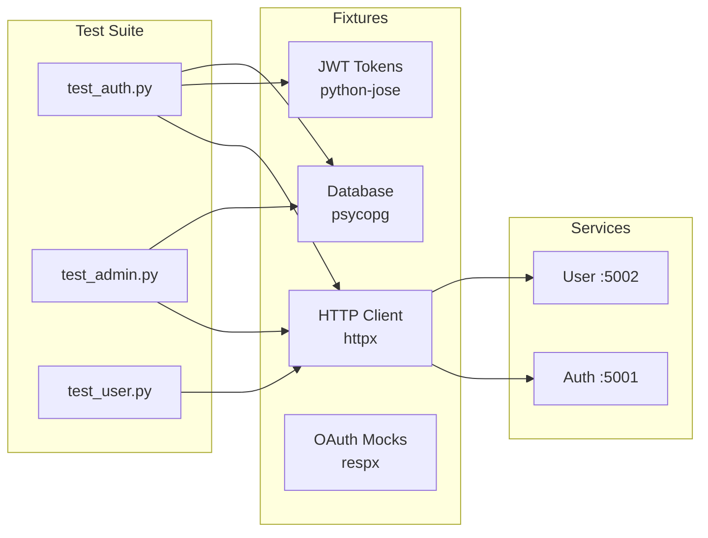
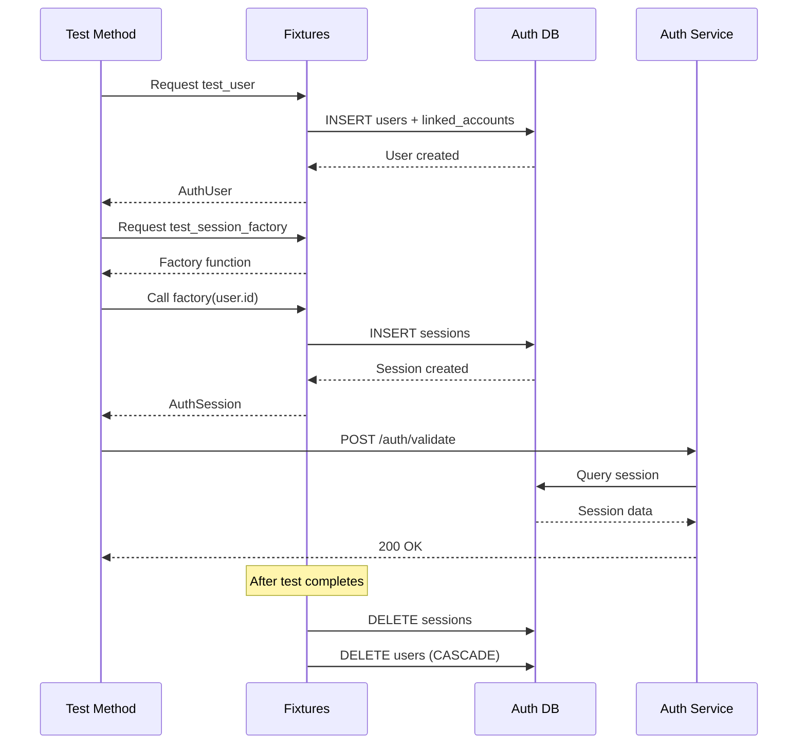

# Testing

**Python + pytest**

API and integration tests using pytest with async support.

## Architecture



## Stack

| Tool | Purpose |
|------|---------|
| pytest | Test framework |
| pytest-asyncio | Async test support (auto mode) |
| pytest-xdist | Parallel execution |
| httpx | Async HTTP client |
| respx | HTTP mocking for OAuth providers |
| psycopg | PostgreSQL async access |
| python-jose | JWT token creation/validation |
| pydantic | Data validation |
| redis | Redis client for cache tests |
| aio-pika | RabbitMQ client for event tests |
| hellarch-types | Generated Python types |

## Setup

```bash
cd tests
uv sync
```

Uses the generated Python types from `libs/data_types/python` via workspace dependency:

```toml
[tool.uv.sources]
hellarch-types = { path = "../libs/data_types/python" }
```

## Running Tests

### Using mise (recommended)

```bash
mise run test:all         # Run all tests
mise run test:api         # Run API tests only
mise run test:integration # Run integration tests only
mise run test:parallel    # Run all tests in parallel
```

### Using uv directly

```bash
# All tests
uv run pytest

# Specific test file
uv run pytest api/test_auth.py

# Specific test class
uv run pytest api/test_auth.py::TestHealthEndpoint

# Specific test method
uv run pytest api/test_auth.py::TestValidateEndpoint::test_validate_with_valid_bearer_token

# Parallel execution
uv run pytest -n auto

# Verbose output
uv run pytest -v
```

## Test Structure

```
tests/
├── pyproject.toml       # Dependencies + pytest config
├── conftest.py          # Global fixtures (http_client, jwt_keys, base_urls)
├── fixtures/
│   ├── auth.py          # User/session factories with cleanup
│   ├── db.py            # Database connections + cleanup
│   └── oauth_mocks.py   # OAuth provider mocks (Discord, Google, GitHub)
├── api/                 # API endpoint tests
│   ├── test_auth.py     # Auth service endpoints
│   ├── test_admin.py    # Admin API endpoints
│   └── test_user.py     # User service endpoints
├── integration/         # Cross-service integration tests
└── e2e/                 # End-to-end flow tests
```

## Test Coverage

### Auth Service (`api/test_auth.py`)

| Class | Tests |
|-------|-------|
| `TestHealthEndpoint` | Health check returns healthy |
| `TestValidateEndpoint` | Session token, bearer token, invalid token, no token |
| `TestRefreshEndpoint` | Valid refresh, invalid refresh, expired token |
| `TestMeEndpoint` | Valid session, session cookie, no session, invalid session |

### Admin API (`api/test_admin.py`)

| Class | Tests |
|-------|-------|
| `TestAdminUserEndpoints` | Get user includes permissions and is_active |
| `TestPermissionManagement` | Get/set/grant/revoke permissions, user not found |
| `TestUserActivation` | Deactivate/activate user, deactivate invalidates sessions |
| `TestDeactivatedUserAuthFlow` | Deactivated user session fails, refresh fails |
| `TestPermissionsInAuthResponse` | Validate includes permissions and is_active |

### User Service (`api/test_user.py`)

| Class | Tests |
|-------|-------|
| `TestHealthEndpoint` | Health check returns healthy |
| `TestGetProfileEndpoint` | Profile not found |
| `TestCreateProfileEndpoint` | Create profile, invalid body |
| `TestUpdateProfileEndpoint` | Update not found |
| `TestGetPreferencesEndpoint` | Preferences not found |
| `TestMeEndpoint` | Without user ID header, invalid user ID |

## Fixtures

### HTTP Client

```python
@pytest.fixture
async def http_client() -> httpx.AsyncClient:
    async with httpx.AsyncClient(timeout=30.0) as client:
        yield client
```

### Base URLs

```python
@pytest.fixture(scope="session")
def base_urls() -> dict[str, str]:
    return {
        "gateway": os.getenv("GATEWAY_URL", "http://localhost:5000"),
        "auth": os.getenv("AUTH_URL", "http://localhost:5001"),
        "user": os.getenv("USER_URL", "http://localhost:5002"),
        "admin": os.getenv("ADMIN_URL", "http://localhost:5003"),
    }
```

### JWT Token Creation

```python
@pytest.fixture
def create_access_token(jwt_keys: tuple[str, str]):
    private_key, _ = jwt_keys

    def _create(
        user_id: str,
        email: str = "test@example.com",
        username: str = "testuser",
        expires_in: timedelta = timedelta(hours=1),
    ) -> str:
        claims = {
            "iss": "hellarch-auth",
            "sub": user_id,
            "exp": datetime.now(timezone.utc) + expires_in,
            "uid": user_id,
            "email": email,
            "username": username,
        }
        return jwt.encode(claims, private_key, algorithm="RS256")

    return _create
```

### Test User Factory

Creates a user with a linked OAuth account:

```python
@pytest_asyncio.fixture
async def test_user_factory() -> Callable[..., AuthUser]:
    created_users: list[str] = []

    async def _create(
        email: str = "test@example.com",
        username: str = "testuser",
    ) -> AuthUser:
        async with auth_db_connection() as conn:
            # Creates user + linked_account records
            user = await create_test_user(conn, email, username)
            created_users.append(user.id)
            await conn.commit()
            return user

    yield _create

    # Cleanup (CASCADE deletes linked_accounts, sessions)
    async with auth_db_connection() as conn:
        for user_id in created_users:
            await conn.execute("DELETE FROM users WHERE id = %s", (user_id,))
        await conn.commit()
```

### Database Connections

```python
@asynccontextmanager
async def auth_db_connection() -> AsyncGenerator[psycopg.AsyncConnection, None]:
    async with await psycopg.AsyncConnection.connect(get_auth_db_url()) as conn:
        yield conn
```

### Session Factory

Creates sessions for existing users with automatic cleanup:

```python
@pytest_asyncio.fixture
async def test_session_factory() -> Callable:
    created_sessions: list[str] = []

    async def _create(user_id: str) -> AuthSession:
        async with auth_db_connection() as conn:
            session = await create_test_session(conn, user_id)
            created_sessions.append(session.id)
            await conn.commit()
            return session

    yield _create

    # Cleanup
    async with auth_db_connection() as conn:
        for session_id in created_sessions:
            await conn.execute("DELETE FROM sessions WHERE id = %s", (session_id,))
        await conn.commit()
```

### OAuth Provider Mocks

Mock OAuth token exchange and user info endpoints:

```python
@pytest.fixture
def mock_discord_oauth() -> Generator[tuple[respx.MockRouter, MockOAuthUser], None, None]:
    user = MockOAuthUser(
        id="123456789",
        email="testuser@example.com",
        username="TestUser",
        avatar_url="https://cdn.discordapp.com/avatars/123456789/abc123.png",
    )

    with respx.mock(assert_all_called=False) as mock:
        # Mock token exchange
        mock.post("https://discord.com/api/oauth2/token").respond(
            json={
                "access_token": "mock_discord_access_token",
                "token_type": "Bearer",
                "expires_in": 604800,
            }
        )

        # Mock user info
        mock.get("https://discord.com/api/users/@me").respond(
            json={
                "id": user.id,
                "username": user.username,
                "email": user.email,
            }
        )

        yield mock, user
```

Available mocks: `mock_discord_oauth`, `mock_google_oauth`, `mock_github_oauth`

## Example Tests

### Health Check

```python
class TestHealthEndpoint:
    async def test_health_returns_healthy(
        self,
        http_client: httpx.AsyncClient,
        base_urls: dict[str, str],
    ):
        response = await http_client.get(f"{base_urls['auth']}/auth/health")

        assert response.status_code == 200
        assert response.json() == {"status": "healthy"}
```

### Token Validation

```python
class TestValidateEndpoint:
    async def test_validate_with_valid_bearer_token(
        self,
        http_client: httpx.AsyncClient,
        base_urls: dict[str, str],
        test_user: AuthUser,
        create_access_token: Callable[..., str],
    ):
        token = create_access_token(
            user_id=test_user.id,
            email=test_user.email,
            username=test_user.username,
        )

        response = await http_client.post(
            f"{base_urls['auth']}/auth/validate",
            headers={"Authorization": f"Bearer {token}"},
        )

        assert response.status_code == 200
        assert response.json()["valid"] is True
```

### Session Authentication

```python
class TestMeEndpoint:
    async def test_me_with_session_cookie(
        self,
        http_client: httpx.AsyncClient,
        base_urls: dict[str, str],
        test_session: AuthSession,
    ):
        response = await http_client.get(
            f"{base_urls['auth']}/auth/me",
            cookies={"hellarch_session": test_session.token},
        )

        assert response.status_code == 200
        assert response.json()["user_id"] == test_session.user_id
```

### Permission Management

```python
class TestPermissionManagement:
    async def test_grant_permission(
        self,
        http_client: httpx.AsyncClient,
        base_urls: dict[str, str],
        test_user: AuthUser,
    ):
        # Grant permission
        response = await http_client.post(
            f"{base_urls['auth']}/auth/admin/users/{test_user.id}/permissions/grant",
            json={"permission": "admin.users.write"},
        )
        assert response.status_code == 204

        # Verify it was granted
        get_response = await http_client.get(
            f"{base_urls['auth']}/auth/admin/users/{test_user.id}/permissions",
        )
        assert get_response.json()["permissions"]["admin.users.write"] is True
```

### User Deactivation Flow

```python
class TestUserActivation:
    async def test_deactivate_invalidates_sessions(
        self,
        http_client: httpx.AsyncClient,
        base_urls: dict[str, str],
        test_user: AuthUser,
        test_session_factory: Callable,
    ):
        # Create session for user
        session = await test_session_factory(test_user.id)

        # Verify session is valid
        validate_response = await http_client.post(
            f"{base_urls['auth']}/auth/validate",
            headers={"X-Session-Token": session.token},
        )
        assert validate_response.status_code == 200

        # Deactivate user
        await http_client.post(
            f"{base_urls['auth']}/auth/admin/users/{test_user.id}/deactivate",
        )

        # Session should now be invalid
        validate_response = await http_client.post(
            f"{base_urls['auth']}/auth/validate",
            headers={"X-Session-Token": session.token},
        )
        assert validate_response.status_code == 401
```

## Test Data Flow



## Environment Variables

| Variable | Default | Description |
|----------|---------|-------------|
| `GATEWAY_URL` | `http://localhost:5000` | Gateway base URL |
| `AUTH_URL` | `http://localhost:5001` | Auth service URL |
| `USER_URL` | `http://localhost:5002` | User service URL |
| `ADMIN_URL` | `http://localhost:5003` | Admin console URL |
| `AUTH_DATABASE_URL` | `postgres://...localhost:5434/auth_db` | Auth DB connection |
| `USER_DATABASE_URL` | `postgres://...localhost:5433/user_db` | User DB connection |

## Database Cleanup

Tests use fixtures that automatically clean up created data:

```python
@pytest_asyncio.fixture
async def clean_auth_db(auth_db: psycopg.AsyncConnection):
    yield auth_db
    await conn.execute("TRUNCATE sessions, linked_accounts, users CASCADE")
```

## pytest Configuration

Configured in `pyproject.toml`:

```toml
[tool.pytest.ini_options]
asyncio_mode = "auto"                        # No need for @pytest.mark.asyncio
asyncio_default_fixture_loop_scope = "function"
testpaths = ["api", "integration", "e2e"]    # Test discovery paths
```

The `asyncio_mode = "auto"` setting means all `async def` test functions are automatically recognized as async tests.

## Adding New Tests

1. **Create test file** in appropriate directory:
   - `api/` - Single service endpoint tests
   - `integration/` - Cross-service tests
   - `e2e/` - Full user flow tests

2. **Use existing fixtures** from `conftest.py` and `fixtures/`:
   - `http_client` - Async HTTP client
   - `base_urls` - Service URL dict
   - `test_user` - User with linked account
   - `test_session` - Session for test_user
   - `test_user_factory` - Create multiple users
   - `test_session_factory` - Create sessions for any user
   - `create_access_token` - Generate JWT access tokens
   - `create_refresh_token` - Generate JWT refresh tokens

3. **Follow the async class pattern**:

```python
from fixtures.auth import AuthUser, AuthSession

class TestMyFeature:
    async def test_success_case(
        self,
        http_client: httpx.AsyncClient,
        base_urls: dict[str, str],
        test_user: AuthUser,
    ):
        response = await http_client.get(
            f"{base_urls['auth']}/my/endpoint",
            headers={"X-User-ID": test_user.id},
        )
        assert response.status_code == 200

    async def test_error_case(
        self,
        http_client: httpx.AsyncClient,
        base_urls: dict[str, str],
    ):
        response = await http_client.get(
            f"{base_urls['auth']}/my/endpoint",
        )
        assert response.status_code == 401
```

4. **Add new fixtures** in `fixtures/` if needed:
   - Create factory fixtures for reusable data creation
   - Include cleanup in the fixture teardown
   - Use `@pytest_asyncio.fixture` for async fixtures

## CI Integration

Tests run against live services. Ensure infrastructure is running:

```bash
# Start services
tilt up

# Wait for services to be ready
# (Tilt UI shows status at http://localhost:10350)

# Run tests
mise run test:all

# Or run specific test suite
mise run test:api
```

## Debugging Tips

```bash
# Run single test with output
uv run pytest api/test_auth.py::TestValidateEndpoint::test_validate_with_valid_bearer_token -v -s

# Show local variables on failure
uv run pytest --tb=long

# Drop into debugger on failure
uv run pytest --pdb

# Run tests matching pattern
uv run pytest -k "validate"
```
