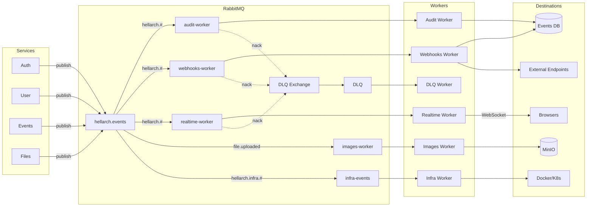

# Workers

Background workers that consume events from RabbitMQ and perform asynchronous processing.

## Overview

| Worker | Language | Purpose | Queue |
|--------|----------|---------|-------|
| [Audit](./audit.md) | Go | Records all events for audit trail | `audit-worker` |
| [Webhooks](./webhooks.md) | Go | Dispatches events to registered endpoints | `webhooks-worker` |
| [Realtime](./realtime.md) | C# | Broadcasts events to browsers via SignalR | `realtime-worker` |
| [Images](./images.md) | Go | Generates thumbnails for uploaded images | `images-worker` |
| [DLQ](./dlq.md) | C# | Logs failed events from dead letter queue | `hellarch.events.dlq` |
| [Infra](./infra.md) | Go | Auto-restarts unhealthy services | `infra-events` |

## Architecture



## Project Structure

### Go Workers (Audit, Webhooks, Images, Infra)

```
src/workers/{name}/
├── cmd/worker/main.go     # Entry point
├── internal/
│   ├── config/config.go   # Environment config
│   ├── consumer/consumer.go # RabbitMQ consumer
│   ├── store/postgres.go  # Database access
│   └── telemetry/telemetry.go # OpenTelemetry setup
├── go.mod
├── go.sum
├── Dockerfile
└── .air.toml              # Hot reload config
```

### C# Workers (Realtime)

```
src/workers/{name}/
├── Program.cs             # Entry point, DI setup
├── Hubs/                  # SignalR hubs (if applicable)
├── Services/              # Background services
├── appsettings.json
├── {Name}.csproj
└── Dockerfile
```

## Common Dependencies

### Go Workers

| Package | Purpose |
|---------|---------|
| `rabbitmq/amqp091-go` | RabbitMQ client |
| `jackc/pgx/v5` | PostgreSQL driver |
| `exaring/otelpgx` | DB tracing |
| `go.opentelemetry.io/otel` | Distributed tracing |

### C# Workers

| Package | Purpose |
|---------|---------|
| `RabbitMQ.Client` | RabbitMQ client |
| `OpenTelemetry.*` | Distributed tracing |
| `Microsoft.AspNetCore.SignalR` | WebSocket hub (realtime) |

## Database

Workers share the `events_db` PostgreSQL database:

| Table | Worker | Description |
|-------|--------|-------------|
| `audit_logs` | Audit | Event history |
| `webhooks` | Webhooks | Registered endpoints |
| `webhook_deliveries` | Webhooks | Delivery attempts |

## Environment Variables

| Variable | Required | Default | Description |
|----------|----------|---------|-------------|
| `RABBITMQ_URL` | Yes | - | RabbitMQ connection string |
| `DATABASE_URL` | Audit/Webhooks | - | PostgreSQL connection string |
| `JWT_SECRET` | Realtime | - | JWT signing key |
| `OTEL_EXPORTER_OTLP_ENDPOINT` | No | `localhost:4318` | OpenTelemetry collector |

## Running Locally

Workers run via Docker Compose with hot reload:

```bash
# Start all services including workers
tilt up

# Or just the workers
docker compose -f infra/docker/docker-compose.services.yml up audit-worker webhooks-worker realtime-worker
```

### Mise Tasks

```bash
# Realtime worker (C#)
mise run realtime:build
mise run realtime:run
mise run realtime:watch
```

## Adding a New Worker

1. Create directory structure under `src/workers/{name}/`
2. Copy boilerplate from existing worker (Go or C#)
3. Add to `docker-compose.services.yml`
4. Add to `Tiltfile` with `dc_resource()`
5. Add mise tasks to `.mise.toml`
6. Add database migrations if needed
7. Create documentation at `docs/guide/workers/{name}.md`
