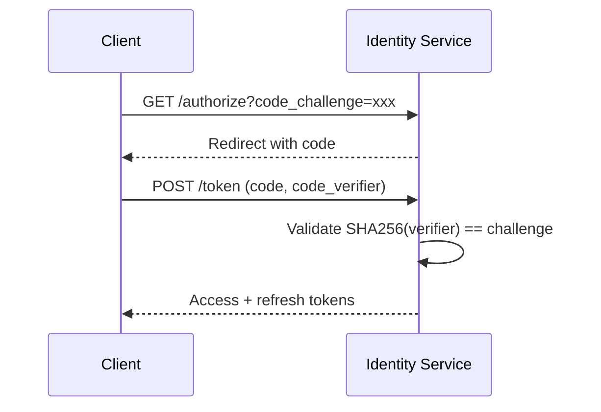

# AuthorizationCode

::: warning Auto-Generated
These docs are generated by `uv run codegen`. Do not edit manually.
:::

OAuth 2.0 authorization code grant (short-lived, 5 minutes).

## Fields

| Field | Type | Description |
|-------|------|-------------|
| `code` | string | Authorization code |
| `client_id` | string | OAuth client requesting authorization |
| `user_id` | uuid | Authorizing user ID |
| `redirect_uri` | string | Callback URI for token exchange |
| `scope` | string | Requested scopes |
| `code_challenge` | string? | PKCE code challenge (S256) |
| `code_challenge_method` | string? | PKCE method (always "S256") |
| `expires_at` | datetime | Code expiration |
| `created_at` | datetime | Code creation timestamp |

## PKCE Support

Authorization codes support [PKCE (RFC 7636)](https://tools.ietf.org/html/rfc7636) for enhanced security:

1. Client generates random `code_verifier`
2. Client sends `code_challenge = SHA256(code_verifier)` with authorization request
3. Client sends `code_verifier` with token exchange
4. Server validates `SHA256(code_verifier) == code_challenge`

Only the **S256** method is supported (plain is rejected).

## Lifetime

| Metric | Value |
|--------|-------|
| TTL | 5 minutes |
| Single use | Yes |

## Flow



## Example

```json
{
  "code": "abc123def456...",
  "client_id": "hellarch",
  "user_id": "550e8400-e29b-41d4-a716-446655440000",
  "redirect_uri": "http://localhost:5000/api/auth/hellarch/callback",
  "scope": "openid profile email",
  "code_challenge": "E9Melhoa2OwvFrEMTJguCHaoeK1t8URWbuGJSstw-cM",
  "code_challenge_method": "S256",
  "expires_at": "2024-01-15T10:35:00Z",
  "created_at": "2024-01-15T10:30:00Z"
}
```
