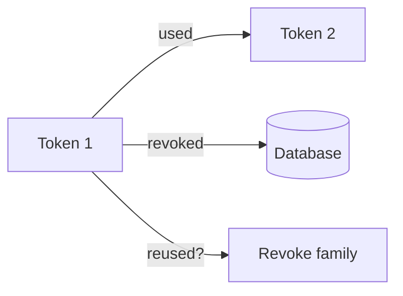

# RefreshToken

::: warning Auto-Generated
These docs are generated by `uv run codegen`. Do not edit manually.
:::

OAuth 2.0 refresh token (long-lived, 30 days). Supports token rotation with reuse detection.

## Fields

| Field | Type | Description |
|-------|------|-------------|
| `token_hash` | string | SHA-256 hash of the token |
| `user_id` | uuid | Owner user ID |
| `client_id` | string | OAuth client that issued the token |
| `scope` | string | Granted scopes |
| `expires_at` | datetime | Token expiration |
| `created_at` | datetime | Token creation timestamp |
| `family_id` | uuid | Token family for rotation tracking |
| `is_revoked` | boolean | Whether token has been used/revoked |
| `client_fingerprint` | string? | SHA-256 hash of client IP + User-Agent |

## Token Rotation

Refresh tokens support automatic rotation:

1. When a refresh token is used, it's marked as revoked
2. A new refresh token is issued with the same `family_id`
3. If a revoked token is reused, the entire family is revoked

This detects token theft: if an attacker uses a stolen token, the legitimate user's next refresh will fail, alerting them to the compromise.



## Security

- **Stored as hash**: Raw token is never persisted
- **Family tracking**: Enables reuse detection
- **Client binding**: Token rejected if fingerprint doesn't match

## Lifetime

| Metric | Value |
|--------|-------|
| TTL | 30 days |
| Rotation | New token on each use |

## Example

```json
{
  "token_hash": "f1e2d3c4...",
  "user_id": "550e8400-e29b-41d4-a716-446655440000",
  "client_id": "hellarch",
  "scope": "openid profile email offline_access",
  "expires_at": "2024-02-14T10:30:00Z",
  "created_at": "2024-01-15T10:30:00Z",
  "family_id": "660f9500-f39c-52e5-b827-557766551111",
  "is_revoked": false,
  "client_fingerprint": "sha256:abc123..."
}
```
